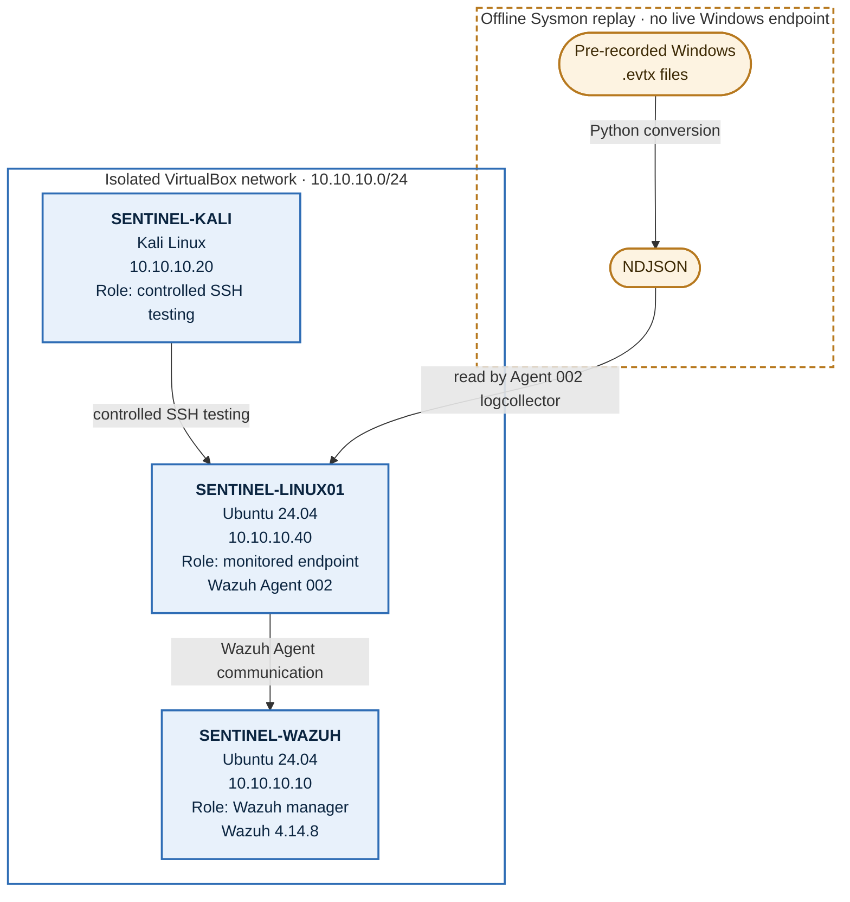

# SENTINEL — Evidence-Driven SOC Detection and Investigation Lab

> Does your detection still work when the attacker changes tactics?

Enterprise SOC platforms already exist, and SENTINEL isn't meant to replace Wazuh, Microsoft Sentinel or QRadar. I built it to apply what I'd learned and gain hands-on experience with the engineering behind security monitoring: generating or replaying security events, observing how detection logic handles them, investigating alerts, identifying gaps, and improving the logic through testing.

A detection firing once doesn't make it reliable. Understanding it means investigating why it fires, testing where it can fail, and examining what the evidence actually establishes.

---
## Lab architecture

SENTINEL-KALI performs controlled SSH testing against SENTINEL-LINUX01. SENTINEL-LINUX01 forwards telemetry to SENTINEL-WAZUH through Wazuh Agent 002; Kali does not forward telemetry directly to the manager. Windows Sysmon telemetry is replayed offline: pre-recorded `.evtx` captures are converted to NDJSON with Python and ingested through Agent 002's `logcollector`. No live Windows endpoint is part of this architecture.

---

## What I built and investigated

- **File integrity monitoring:** custom Level 8 Wazuh rules for modification, creation and deletion ([CASE-001](investigations/CASE-001.md)). Closed for its defined scope on 18 November 2026.
- **Windows Sysmon replay:** custom detection rules for replayed `.evtx` telemetry ([CASE-002](investigations/CASE-002.md)).
- **SSH brute force:** detection and manual investigation ([CASE-003](investigations/CASE-003.md)).
- **Mutation and evasion:** attack mutation, detection-evasion and selected benign-noise testing ([CASE-004](investigations/CASE-004.md)).
- **Python triage:** alert parsing and severity-based triage in the separate [Python SOC Automation Engine](https://github.com/andyydz/python-soc-automation). It is not a SOAR platform or automated response.

---

## Selected results

| Scope | Result |
|---|---|
| Controlled endpoint | Custom FIM creation, modification and deletion rules validated through controlled single-file lifecycle tests ([CASE-001](investigations/CASE-001.md), [18 Nov raw lifecycle JSON](evidence/v0.3/raw-alerts/fim-lifecycle-evidence.json), [2 Nov lifecycle screenshot](evidence/v0.3/screenshots/v0.3-fim-full-lifecycle-custom-rules.png)). Separate [v0.11 alert records](evidence/v0.11/v011_fim_alerts.json) are also committed as evidence; the v0.11 milestone status is pending reconciliation |
| Controlled endpoint | SSH test with 21 failed attempts and zero successful logins ([CASE-003](investigations/CASE-003.md), [SSH evidence index](evidence/v0.5/readme.md)) |
| Offline replay | Seven selected custom Sysmon detections fired on the tested samples ([CASE-002](investigations/CASE-002.md), [raw Sysmon alerts](evidence/sysmon-replay/sysmon_alerts_raw.json)) |
| Offline replay | Three benign `services.exe → svchost.exe` events matched general Level 0 base rule `100101` and produced no alerts |
| Offline replay | A command-line mutation bypassed keyword-based rule `100112` for the tested variation, exposing a detection gap ([CASE-004](investigations/CASE-004.md)) |

---

## Scope and limitations

- Linux-first lab; no live Windows endpoint, Active Directory environment, or live Sysmon driver testing. Windows telemetry comes from replayed `.evtx` captures.
- Testing is controlled and sample-bound. No enterprise-scale detection, false-positive, or false-negative rates have been established.
- Selected FIM noise exclusions are implemented but have not been independently validated through targeted tests. Broader noise-suppression retesting remains pending, and residual desktop noise remains. No complete containment, eradication, or recovery exercise has been evidenced.
- Some investigation results are supported by screenshots rather than committed raw records; see the [evidence guide](evidence/readme.md).

---

## Explore

[Changelog](CHANGELOG.md) · [Detection engineering](docs/05-detection-engineering.md) · [Testing and metrics](docs/07-testing-and-metrics.md) · [Investigations](investigations/readme.md) · [Evidence](evidence/readme.md) · [Detections](detections/readme.md) · [Security](SECURITY.md)

Authorized, isolated lab only. See [SECURITY.md](SECURITY.md).
