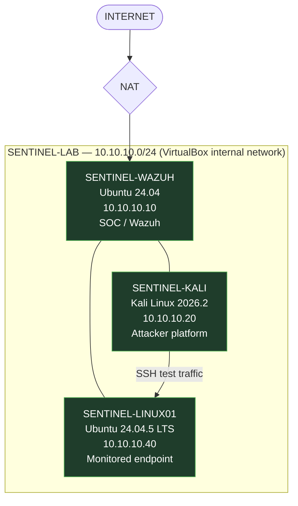
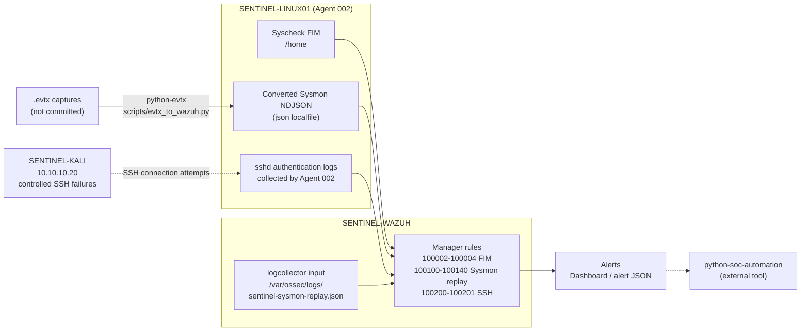
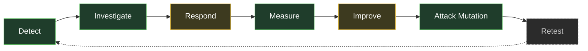

# SENTINEL Architecture

> **Does your detection still work when the attacker changes tactics?**

SENTINEL is a private, isolated virtual cybersecurity SOC laboratory. It is built to simulate controlled activity, collect security telemetry, engineer and validate detections, investigate alerts, measure controlled test results, test attacker-behavior mutations and tune detections. Automated response is not implemented.

Wazuh is the central monitoring and detection platform inside a broader validation lifecycle:

```
SIMULATE → DETECT → INVESTIGATE → RESPOND → MEASURE → IMPROVE → RETEST
```

This document is current through milestone **v0.9.1**. It separates what is **implemented and validated** from what is **observed but not fully validated**, **pending retest**, or **future work**.

**Status legend:** **Completed** (the documented milestone scope was finished) · **Implemented and merged** (capability is on `main`; further validation may remain) · **Validated** (tested for a documented scenario) · **Observed** (seen, but not fully validated or explained) · **Pending retest** · **Future work** (not built).

---

## 1. Purpose and Design Principle

Many basic home SOC labs stop at *Attack → Alert → Screenshot*. SENTINEL treats a detection as an engineering hypothesis: it must be tested against real activity, investigated, measured, improved, and retested. Missed detections and false positives are engineering evidence, not something to hide.

The lifecycle has been exercised for selected controlled cases, but it is only partly complete. Response is manual, and the broader post-tuning noise-suppression retest is pending:

```mermaid
flowchart LR
    SIM["Simulate<br/>controlled FIM, SSH and<br/>replay tests"] --> DET["Detect<br/>validated for selected<br/>scenarios"]
    DET --> INV["Investigate<br/>CASE-001 to CASE-004"]
    INV --> RESP["Respond<br/>manual; documented procedure<br/>and verification checks"]
    RESP --> MEA["Measure<br/>v0.6 controlled baseline"]
    MEA --> IMP["Improve<br/>v0.8 tuning merged"]
    IMP --> RET["Retest<br/>broader post-tuning<br/>retest pending"]

    classDef validated fill:#1f3d2b,stroke:#4caf50,color:#fff;
    classDef progress fill:#3d3a1f,stroke:#e0b83c,color:#fff;
    classDef planned fill:#2b2b2b,stroke:#888,color:#ccc,stroke-dasharray: 4 3;
    class SIM,DET,INV,MEA validated
    class RESP,IMP progress
    class RET planned
```



The full lifecycle has not been completed. Automated containment, eradication and recovery are not implemented, and a complete containment, eradication and recovery lifecycle has not been executed (section 7 describes what CASE-003 does document).

---

## 2. Current Architecture (Implemented)

Three VMs are operational. There is no live Windows endpoint or Active Directory environment. Windows telemetry is generated through controlled Sysmon event replay (section 5).



NAT outbound connectivity is shown on the Wazuh manager only. The three VMs communicate through the isolated internal network.

---

## 3. Virtual Machines

| | SENTINEL-WAZUH | SENTINEL-KALI | SENTINEL-LINUX01 |
|---|---|---|---|
| Role | Central SOC / Wazuh monitoring and detection | Controlled attacker / adversary-simulation platform | Monitored Linux endpoint (detection target) |
| OS | Ubuntu 24.04 | Kali Linux 2026.2 | Ubuntu 24.04.5 LTS |
| Lab IP | `10.10.10.10` | `10.10.10.20` | `10.10.10.40` |
| Network | SENTINEL-LAB + NAT (outbound) | SENTINEL-LAB | SENTINEL-LAB |
| Software | Wazuh 4.14.8 all-in-one (manager + Dashboard) | Standard Kali toolset | Wazuh Agent 4.14.8, **Agent ID `002`**, Active, enabled at boot |
| Status | Implemented | Implemented | Implemented |

**Verified at v0.1:** Wazuh Dashboard accessible with authentication verified; SENTINEL-LAB interfaces configured; Wazuh ↔ Linux01 and Kali ↔ Wazuh connectivity verified; Linux01 agent registered and visible as Active in the Dashboard.

**SENTINEL-KALI:** deployed and reachable. It is used to generate the controlled SSH authentication failures documented in [CASE-003](../investigations/CASE-003.md). The earlier FIM validation tests (section 6) were controlled file operations on SENTINEL-LINUX01.

**Agent ID reconciliation (open):** this document previously recorded SENTINEL-LINUX01 as Agent ID `001`. Current project documentation identifies it as Agent ID `002`, so `002` is used here. The earlier v0.1 evidence description (which referenced `001`) has not been reconciled with this; the v0.1 evidence should be checked against the original records. No explanation for the difference is asserted.

**Windows / Active Directory: not deployed.** A Windows VM was attempted during v0.1 and set aside after repeated deployment/boot issues, recorded as an infrastructure issue and not an attributed root cause. `10.10.10.30` is not assigned to any host. Windows Sysmon telemetry is replayed from pre-recorded captures (section 5); this is not live Windows monitoring. A live Windows/AD endpoint with real Sysmon telemetry is future work, and no live Windows endpoint work is underway.

---

## 4. Network Architecture and Security Boundaries

- **SENTINEL-LAB** (`10.10.10.0/24`): isolated VirtualBox internal network used for communication between the three VMs and for all authorized test activity.
- **NAT:** used on the Wazuh manager for legitimate outbound Internet/package access only, never for test or attack traffic.

| Host | Lab IP |
|---|---|
| SENTINEL-WAZUH | 10.10.10.10 |
| SENTINEL-KALI | 10.10.10.20 |
| SENTINEL-LINUX01 | 10.10.10.40 |

**Security rules**
- All simulations stay inside SENTINEL-LAB; external systems, the real Windows host, and the real LAN are never targeted.
- Testing occurs only against owned or explicitly authorized lab systems.
- No real credentials are used, and no secrets are stored in GitHub.
- VM disks are never committed, and sensitive raw telemetry is not uploaded.

**Host note:** the lab runs in Oracle VirtualBox 7.2.20 on a Windows 11 host. The host's Windows virtualization/VBS infrastructure may affect VM performance. This is a development-environment constraint, not part of the security architecture.

---

## 5. Telemetry and Detection Flow

SENTINEL has four separate detection pipelines plus an external triage tool. The two Sysmon pipelines are distinct and should not be conflated.



| Pipeline | Telemetry path | Rules | Documentation | Status |
|---|---|---|---|---|
| Linux FIM | Wazuh Syscheck on SENTINEL-LINUX01, scoped to `/home` | Custom `100002` (modification), `100003` (creation), `100004` (deletion) | [CASE-001](../investigations/CASE-001.md), [Rule 100002 investigation](../investigations/fim-rule-100002-investigation.md) | Implemented; validated for selected scenarios only |
| SSH authentication | Controlled SSH authentication failures generated by SENTINEL-KALI against SENTINEL-LINUX01; `sshd` authentication logs collected by Wazuh Agent 002 and evaluated on the manager | Custom `100200` (authentication failure), `100201` (repeated-failure escalation). Six failures within 60 seconds trigger the higher-severity detection. | [CASE-003](../investigations/CASE-003.md) | Implemented; investigated and verified for controlled tests |
| Sysmon EVTX replay | Pre-recorded Sysmon `.evtx` converted with `python-evtx` (via [`scripts/evtx_to_wazuh.py`](../scripts/evtx_to_wazuh.py)) and replayed through the Linux agent | Range `100100–100140` (base `100100–100104`) | [CASE-002](../investigations/CASE-002.md), [Sysmon replay evidence](../evidence/sysmon-replay/) | Implemented (replay-based; not live Windows monitoring) |
| Sysmon JSON replay | JSON ingested through Wazuh logcollector on the **Wazuh manager**, input `/var/ossec/logs/sentinel-sysmon-replay.json` | Observed rules include `100110`, `100130` and `100140` | [v0.9 evidence](../evidence/v0.9/readme.md) | Implemented and merged (v0.9); replay-based |

**SSH telemetry path.** SENTINEL-KALI (`10.10.10.20`) generates controlled SSH authentication failures. SENTINEL-LINUX01 (`10.10.10.40`, Agent `002`) receives the connection attempts, and Wazuh Agent `002` collects its `sshd` authentication logs. SENTINEL-WAZUH evaluates those events with Rules `100200` and `100201`. Kali does not send authentication logs to the manager, and the resulting alerts can then be processed by the external Python triage tool.

**EVTX versus JSON ingestion.** In the EVTX pipeline, binary `.evtx` captures are converted to NDJSON and replayed through the Linux agent. In the JSON pipeline, replay JSON is read by logcollector on the Wazuh manager from a local log file. Both are replay-based, and neither represents a live Windows host or the Sysmon kernel driver.

**Python-assisted SOC triage.** [python-soc-automation](https://github.com/andyydz/python-soc-automation) is a separate Python project that processes Wazuh alert JSON and supports alert triage (for example `python-soc-automation --triage --min-level 8`). It is an external analysis tool, not a native Wazuh component, and not a production Wazuh integration. It supports triage and manual analyst review; it does not perform containment, eradication or recovery.

**FIM details**
- **Built-in rules** (for example Rule `550` integrity checksum changed, `554` file added, `553` file deleted) generate alerts from FIM events.
- **Custom Rule `100002`** (Level 8, "SENTINEL: File integrity modification detected in monitored home directory.") targets file-modification events. A read-only inspection of the on-disk rule reported group `sentinel_fim`, parent `<if_sid>550</if_sid>`, and a `/home/` file condition. This shows what was in the file at inspection time, not which rule version the manager had loaded during the historical tests.
- `/home` is the configured monitoring scope. This document does not claim that every change under `/home`, or every file event type, is detected.

**Not yet implemented:** live Windows telemetry, additional telemetry sources beyond those above, and expanded endpoint diversity.

---

## 6. Controlled Test Results and Known Limitations

### FIM scenarios (v0.2–v0.3)

| Date | Scenario | Result | Status |
|---|---|---|---|
| 11 Oct 2026 | Controlled modification of `/home/sentinel-admin/sentinel-fim-validation.txt` | Custom Rule `100002`, Level 8, at `2026-10-11T20:25:14.746+0530`; built-in Rule `550` also observed. Evidence: [`v0.3-custom-rule-100002.png`](../evidence/v0.3/screenshots/v0.3-custom-rule-100002.png). The original source alert log was **not recovered** during the later review, so the result rests on screenshots. | Validated for the tested scenario |
| 16 Oct 2026 | Creation of `/home/sentinel-admin/sentinel-audit-test.txt` | Reviewed source record: built-in Rule `554`, Level 5, at `2026-10-16T11:40:06.007+0530`. Custom Rule `100002` **absent**. Screenshot: [`v0.3-oct16-creation-rule-554.png`](../evidence/v0.3/screenshots/v0.3-oct16-creation-rule-554.png). | Observation, not a custom-rule validation |
| 16 Oct 2026 | Deletion of the same file | Reviewed source record: built-in Rule `553`, Level 7, at `2026-10-16T12:31:32.819+0530`. Custom Rule `100002` **absent**. Screenshot: [`v0.3-oct16-detection-rule-553.png`](../evidence/v0.3/screenshots/v0.3-oct16-detection-rule-553.png). | Observation, not a custom-rule validation |
| 26 Oct 2026 | Two consecutive modifications of `/home/sentinel-admin/sentinel-v02-mod-test.txt` | Two Rule `100002`, Level 8 alerts: `2026-10-26T21:38:27.910+0530` (0 → 23 bytes) and `2026-10-26T21:38:48.473+0530` (23 → 61 bytes). Evidence: [October 26 controlled-modification source alerts](../evidence/v0.2/screenschots/v0.2-oct26-controlled-modification-source-alerts-new.png). | Validated for this modification scenario |
| 31 Oct 2026 | Custom Rules `100003` (creation) and `100004` (deletion), both Level 8, appeared in one terminal screenshot: [`v0.3-fim-lifecycle-custom-detections.png`](../evidence/v0.3/screenshots/v0.3-fim-lifecycle-custom-detections.png) | Raw alert records, process attribution and root cause are not established. | Observation only, not a validated controlled test |
| 2 Nov 2026 | One controlled lifecycle session on a single dedicated file (`/home/sentinel-admin/sentinel-v03-final-test.txt`): created, modified, deleted | Matched custom Rules `100003`, `100002` and `100004`, each Level 8. Screenshot: [`v0.3-fim-full-lifecycle-custom-rules.png`](../evidence/v0.3/screenshots/v0.3-fim-full-lifecycle-custom-rules.png). Raw alert JSON is not committed. | Validated for this single session only |

### Replay, SSH and measurement results (v0.4–v0.6)

- **Sysmon replay (v0.4, [CASE-002](../investigations/CASE-002.md)):** 3 pre-recorded `.evtx` captures were converted into 12 NDJSON records (24 lines replayed). All 7 selected replay detections fired, and 3 benign `services.exe → svchost.exe` events were suppressed under Level 0 Rule `100101`. These are replayed samples evaluated against rules, not seven confirmed attacks.
- **SSH (v0.5, [CASE-003](../investigations/CASE-003.md)):** controlled Kali-generated SSH authentication failures were investigated with Python-assisted severity triage and manual analyst review. The case also records verification of zero successful logins, a documented source-scoped containment procedure, confirmation that no persistent source block was left active, and verification that SSH remained responsive and healthy (see section 7).
- **Controlled measurement (v0.6, [report](../metrics/v0.6-purple-team-measurement.md)):** FIM lifecycle 3/3 selected events; Sysmon replay 7/7 selected detections; 3 benign Sysmon events suppressed; `/tmp` negative controls 0/3 FIM alerts; SSH threshold and sliding-window behaviour investigated. Clock skew between endpoint and manager affected some timing measurements, and negative time deltas are not valid detection latency.

### Mutation, evasion and reliability findings (v0.7, [CASE-004](../investigations/CASE-004.md))

| Observation | Status |
|---|---|
| Hidden files inside `/home` triggered FIM. | Observed in controlled testing |
| `/var/tmp` staging outside the monitored scope did not trigger FIM. | Observed in controlled testing |
| Benign cache/desktop activity produced Level 8 noise. | Observed; v0.8 added path exclusions, but residual desktop noise was still seen on 21 Nov 2026 (see below); broader retest pending |
| Sysmon command-line mutation bypassed keyword-specific Rule `100112` and matched base EID1 Rule `100101` at Level 0. | Observed in replay testing |
| Correlation with EID10/EID11 events was identified as a potential improvement. | Future work |

### FIM tuning and group-isolation verification (v0.8)

| Aspect | Status |
|---|---|
| Configuration changes | v0.8 introduced specific path exclusions for noisy activity and FIM group isolation. **Implemented and manager-validated.** |
| Controlled Agent `002` probe (21 Nov 2026) | On SENTINEL-LINUX01, `/home/sentinel-admin/.v08-check/probe.txt` was created, modified and deleted. Rules `100003`, `100002` and `100004` fired respectively, each at Level 8. All three alerts carried the `sentinel_fim` group without `sshd`, and hidden dot-directory monitoring remained active. **Verified for this probe.** |
| Residual noise | Desktop noise from `/home/sentinel-admin/.config/dconf/user` was still observed. Noise has not been eliminated. |
| Broader noise-suppression assessment | **Pending.** The probe is one controlled lifecycle, not a regression suite, repeatability test or measurement of overall noise reduction. |

These checks come from the current detection inventory. The controlled probe lifecycle and group-isolation checks are verified; the broader post-tuning noise-suppression assessment is incomplete.

### Known limitations
- The 26 October results are two alerts from consecutive modifications of one file. They are **not** two independent test cases or a regression suite. Likewise, the 2 November session is one session on one file, not a repeatability test or comprehensive regression suite.
- The 16 October records were reviewed from the Wazuh runtime log `/var/ossec/logs/alerts/2026/Oct/ossec-alerts-16.json`. That raw log is **not** claimed to be committed to GitHub.
- **Unresolved:** why Rule `100002` was absent from the reviewed 16 October creation and deletion records. This is not established as a detection failure, and no root cause is asserted. The `<if_sid>550</if_sid>` parent is not claimed as the cause, and the rule version loaded during the historical tests is unconfirmed. The 31 October and 2 November observations do not explain it.
- The v0.6 results are small controlled samples describing the v0.6 baseline. No general detection rate, production false-positive or false-negative rate, or coverage percentage is claimed, and not all possible metrics were measured. They are not post-v0.8 tuning results.
- Complete FIM coverage is not claimed.

---

## 7. Investigation and Incident Response

| Case | Scope | Status |
|---|---|---|
| [CASE-001](../investigations/CASE-001.md) | FIM investigation: controlled validation and review of related home-directory events | **Closed** for the reviewed scope per the 18 November 2026 closeout (`investigations/CASE-001.md`) |
| [CASE-002](../investigations/CASE-002.md) | Sysmon replay investigation | Completed |
| [CASE-003](../investigations/CASE-003.md) | Controlled SSH brute-force investigation, with Python-assisted severity triage, manual analyst review, response-related verification checks and a documented containment procedure | Completed and verified for the controlled scenario |
| [CASE-004](../investigations/CASE-004.md) | Mutation, evasion and reliability investigation | Completed and verified |

The planned case-report structure (summary, severity, affected assets, timeline, evidence, IOCs, MITRE ATT&CK mapping, root cause, response, performance, improvements, retest results, lessons learned) is applied progressively. MITRE ATT&CK references describe detection intent or observed indicators and do not independently prove malicious behavior.

**Incident response: detection, investigation, alert triage and manual analyst review are supported, and CASE-003 includes response-related documentation and verification.** A complete incident-response lifecycle is not implemented or claimed. Three things are kept apart:
- **Documented procedure:** a source-scoped containment procedure is documented in CASE-003.
- **Verification checks recorded:** zero successful logins; no persistent source block left active; SSH remained responsive and healthy.
- **Executed response actions:** a complete containment, eradication and recovery lifecycle was not executed, and this document makes no such claim. CASE-003 should be read for exactly which response steps were carried out.

Automated containment, eradication and recovery are not implemented. The intended model remains human-in-the-loop response inside the isolated lab. A completed investigation is not a completed response.

---

## 8. Measurement and Attack Mutation

**Measurement: Completed (v0.6) as a controlled baseline.** The v0.6 measurement recorded selected controlled results (section 6) in [`metrics/v0.6-purple-team-measurement.md`](../metrics/v0.6-purple-team-measurement.md). See [`metrics/readme.md`](../metrics/readme.md) for the framework. The framework's full metrics model (executions, successful and missed detections, false positives, detection rate, detection time, response time, before/after tuning) has **not** been fully measured, and the broader post-tuning noise-suppression assessment is pending (the limited v0.8 probe checks are in section 6).

**Attack mutation: Completed (v0.7) for the tested scenarios.** The Attack DNA concept represents an attack as a behavioral sequence across an attack chain; mutation changes *how* an objective is achieved (execution method, command structure, tooling, encoding, timing) to test whether a detection is behaviorally resilient. Not every scenario includes every stage. [CASE-004](../investigations/CASE-004.md) applied mutation, evasion and reliability testing to the FIM and Sysmon detections (findings in section 6). It is a set of controlled tests, not a comprehensive regression suite.



This purple-team feedback loop has been exercised through measurement, mutation and tuning. It is not closed: response is manual, and the broader post-v0.8 noise-suppression retest is pending.

---

## 9. Implementation Status and Roadmap

| Version | Focus | Status |
|---|---|---|
| v0.1 | Foundation | **Completed** |
| v0.2 | Detection Engineering & Linux Telemetry | **Completed** (18 Nov 2026; documentation and evidence reconciled retroactively after some v0.3 work). Controlled file-modification scenarios validated; broader coverage and false-positive/false-negative analysis remain open |
| v0.3 | SOC Investigation | **Completed** (CASE-001 closed for reviewed scope on 18 Nov 2026) |
| v0.4 | Sysmon EVTX replay and cross-platform detection | **Completed** (19 Nov 2026); replay-based |
| v0.5 | SSH brute-force detection and triage | **Completed** |
| v0.6 | Controlled purple-team measurement and testing | **Completed** (controlled baseline) |
| v0.7 | Mutation/evasion testing and reliability investigation | **Completed** |
| v0.8 | FIM group isolation, noise reduction and tuning | **Implemented and merged.** Path exclusions and group isolation manager-validated; controlled Agent `002` probe lifecycle and group-isolation checks verified on 21 Nov 2026; residual desktop noise observed; broader post-tuning noise-suppression retest **pending** |
| v0.9 | Sysmon JSON replay ingestion and Python-assisted triage integration | **Implemented and merged**; replay-based |
| v0.9.1 | Follow-up documentation, detection-inventory and metrics/status alignment | Documentation and alignment milestone; no new detection capability |
| v1.0 | Integrated SENTINEL | Future target (not built) |

**Evidence** is organized by phase under `evidence/` (v0.1, v0.2, v0.3, sysmon-replay, v0.5, v0.6, v0.7 and v0.9) and consists of real project artifacts only.

**Pending retest and open items:** broader post-v0.8 noise-suppression retest; determining why Rule `100002` was absent from the reviewed 16 October records; confirming the historical loaded rule configuration; reconciling the Agent ID `001` / `002` reference.

---

## 10. Future Work (not committed)

- Live Windows/AD endpoint integration with real Sysmon telemetry.
- Broader detection coverage and expanded endpoint diversity.
- Further repeatable regression testing, including systematic false-positive/false-negative testing.
- EID10/EID11 correlation to improve resilience against command-line mutation.
- Deeper DFIR and case-management tooling.
- Carefully controlled response automation with human approval.
- A custom SENTINEL console built on top of live Wazuh data.

None is in progress, and each will be pursued only if it solves a demonstrated project need.

---

**Does your detection still work when the attacker changes tactics?**
