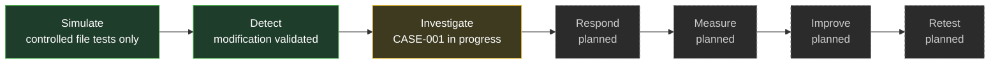
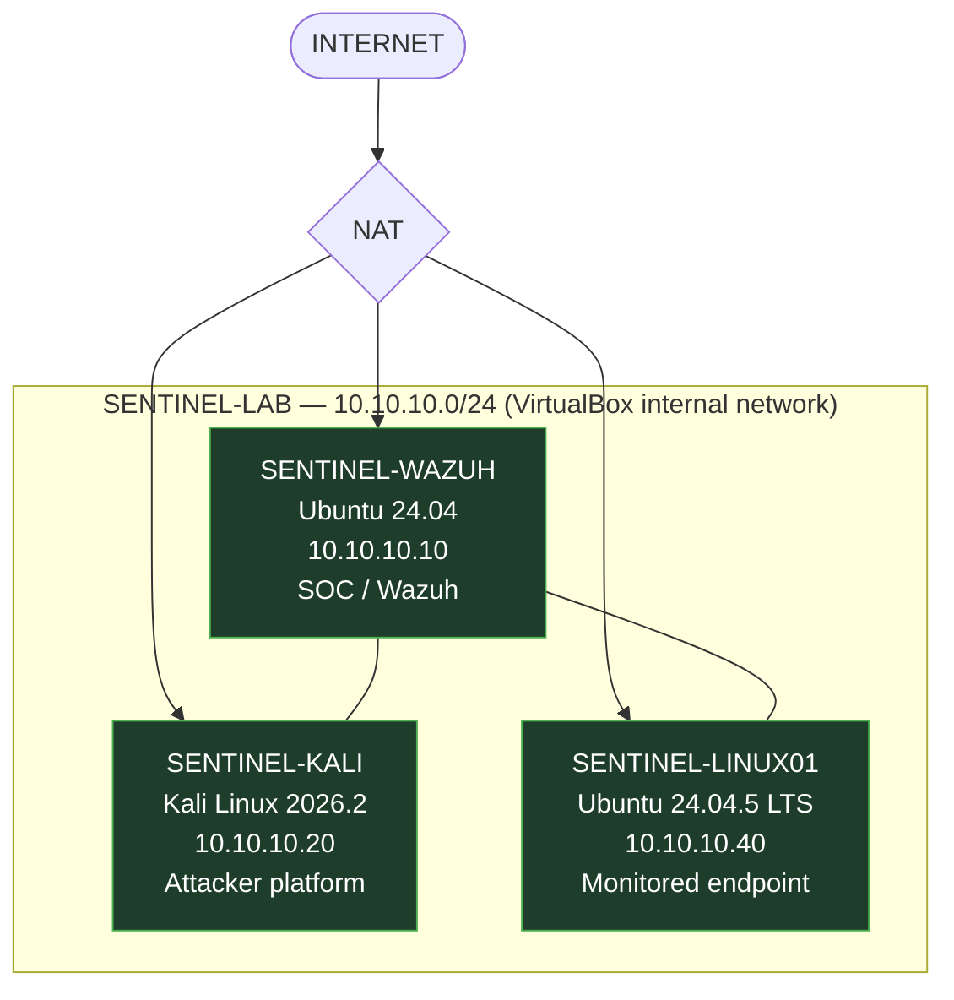
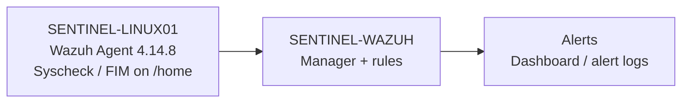
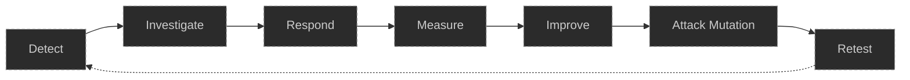

# SENTINEL Architecture

> **Does your detection still work when the attacker changes tactics?**

SENTINEL is a private, isolated virtual cybersecurity SOC laboratory. It is built to simulate controlled activity, collect security telemetry, engineer and validate detections, investigate alerts, and (in later phases) respond, measure, improve, mutate attacker behavior, and retest.

Wazuh is the central monitoring and detection platform inside a broader validation lifecycle:

```
SIMULATE → DETECT → INVESTIGATE → RESPOND → MEASURE → IMPROVE → RETEST
```

This document separates what is **implemented and validated** from what is **in progress** or **planned**.

**Status legend:** **Implemented** (built and operating) · **Validated** (tested for a documented scenario) · **In progress** · **Planned** (not built).

---

## 1. Purpose and Design Principle

Many basic home SOC labs stop at *Attack → Alert → Screenshot*. SENTINEL treats a detection as an engineering hypothesis: it must be tested against real activity, investigated, measured, improved, and retested. Missed detections and false positives are engineering evidence, not something to hide.

The lifecycle is only partly complete:



The full lifecycle has not been completed.

---

## 2. Current Architecture (Implemented)

Three VMs are operational. There is no Windows endpoint or Active Directory environment.



---

## 3. Virtual Machines

| | SENTINEL-WAZUH | SENTINEL-KALI | SENTINEL-LINUX01 |
|---|---|---|---|
| Role | Central SOC / Wazuh monitoring and detection | Controlled attacker / adversary-simulation platform | Monitored Linux endpoint (detection target) |
| OS | Ubuntu 24.04 | Kali Linux 2026.2 | Ubuntu 24.04.5 LTS |
| Resources | 4 vCPU · 8 GB RAM · ~50 GB dynamic disk | 2 vCPU · ~4 GB RAM · ~80 GB virtual disk | 2 vCPU · 4 GB RAM · 40 GB dynamic disk |
| Lab IP | `10.10.10.10` | `10.10.10.20` | `10.10.10.40` |
| Network | NAT + SENTINEL-LAB | NAT + SENTINEL-LAB | NAT + SENTINEL-LAB |
| Software | Wazuh 4.14.8 all-in-one (manager + Dashboard) | Standard Kali toolset | Wazuh Agent 4.14.8, **Agent ID `002`**, Active, enabled at boot |
| Status | Implemented | Implemented | Implemented |

**Verified at v0.1:** Wazuh Dashboard accessible with authentication verified; SENTINEL-LAB interfaces configured; Wazuh ↔ Linux01 and Kali ↔ Wazuh connectivity verified; Linux01 agent registered and visible as Active in the Dashboard.

**SENTINEL-KALI:** deployed and reachable. No Kali-driven attack simulation is documented as executed. The validated tests (section 6) were controlled file operations on SENTINEL-LINUX01.

**Agent ID reconciliation (open):** this document previously recorded SENTINEL-LINUX01 as Agent ID `001`. Current project documentation identifies it as Agent ID `002`, so `002` is used here. The earlier v0.1 evidence description (which referenced `001`) has not been reconciled with this; the v0.1 evidence should be checked. No explanation for the difference is asserted.

**Windows / Active Directory: Planned (future only).** A Windows VM was attempted during v0.1 and set aside after repeated deployment/boot issues, recorded as an infrastructure issue and not an attributed root cause. `10.10.10.30` is not assigned to any host. A future phase may add Windows Event Logs, Sysmon, PowerShell telemetry, and identity scenarios. No Windows work is underway.

---

## 4. Network Architecture and Security Boundaries

- **SENTINEL-LAB** (`10.10.10.0/24`): isolated VirtualBox internal network for lab communication and all authorized test activity.
- **NAT:** legitimate outbound Internet/package access only, never test or attack traffic.

| Host | Lab IP |
|---|---|
| SENTINEL-WAZUH | 10.10.10.10 |
| SENTINEL-KALI | 10.10.10.20 |
| SENTINEL-LINUX01 | 10.10.10.40 |

**Security rules**
- All simulations stay inside SENTINEL-LAB; external systems, the real Windows host, and the real LAN are never targeted.
- Testing occurs only against owned or explicitly authorized lab systems.
- No real credentials are used, and no secrets are stored in GitHub.
- VM disks are never committed, and sensitive raw telemetry is not uploaded.

**Host note:** the lab runs in Oracle VirtualBox 7.2.20 on a Windows 11 host. The host's Windows virtualization/VBS infrastructure may affect VM performance. This is a development-environment constraint, not part of the security architecture.

---

## 5. Telemetry and Detection Flow

**Implemented:** File Integrity Monitoring (Wazuh Syscheck) on SENTINEL-LINUX01, scoped to `/home`.



- **Built-in rules** (for example Rule `550` integrity checksum changed, `554` file added, `553` file deleted) generate alerts from FIM events.
- **Custom Rule `100002`** (Level 8, "SENTINEL: File integrity modification detected in monitored home directory.") targets file-modification events. A read-only inspection of the on-disk rule reported group `sentinel_fim`, parent `<if_sid>550</if_sid>`, and a `/home/` file condition. This shows what was in the file at inspection time, not which rule version the manager had loaded during the historical tests.
- `/home` is the configured monitoring scope. This document does not claim that every change under `/home`, or every file event type, is detected.

**Planned telemetry:** additional sources (authentication, process execution, command execution) and expanded endpoint diversity. Not implemented.

---

## 6. Validated Detection Results and Known Limitations

| Date | Scenario | Result | Status |
|---|---|---|---|
| 11 Oct 2026 | Controlled modification of `/home/sentinel-admin/sentinel-fim-validation.txt` | Custom Rule `100002`, Level 8, at `2026-10-11T20:25:14.746+0530`; built-in Rule `550` also observed. Evidence: [`v0.3-custom-rule-100002.png`](../evidence/v0.3/v0.3-custom-rule-100002.png). The original source alert log was **not recovered** during the later review, so the result rests on screenshots. | Validated for the tested scenario |
| 16 Oct 2026 | Creation of `/home/sentinel-admin/sentinel-audit-test.txt` | Reviewed source record: built-in Rule `554`, Level 5, at `2026-10-16T11:40:06.007+0530`. Custom Rule `100002` **absent**. Screenshot: [`v0.3-oct16-creation-rule-554.png`](../evidence/v0.3/v0.3-oct16-creation-rule-554.png). | Observation, not a custom-rule validation |
| 16 Oct 2026 | Deletion of the same file | Reviewed source record: built-in Rule `553`, Level 7, at `2026-10-16T12:31:32.819+0530`. Custom Rule `100002` **absent**. Screenshot: [`v0.3-oct16-detection-rule-553.png`](../evidence/v0.3/v0.3-oct16-detection-rule-553.png). | Observation, not a custom-rule validation |
| 26 Oct 2026 | Two consecutive modifications of `/home/sentinel-admin/sentinel-v02-mod-test.txt` | Two Rule `100002`, Level 8 alerts: `2026-10-26T21:38:27.910+0530` (0 → 23 bytes) and `2026-10-26T21:38:48.473+0530` (23 → 61 bytes). Evidence: [October 26 controlled-modification source alerts](../evidence/v0.2/v0.2-oct26-controlled-modification-source-alerts-new.png). | Validated for this modification scenario |

**Known limitations**
- The 26 October results are two alerts from consecutive modifications of one file. They are **not** two independent test cases or a regression suite.
- The 16 October records were reviewed from the Wazuh runtime log `/var/ossec/logs/alerts/2026/Oct/ossec-alerts-16.json`. That raw log is **not** claimed to be committed to GitHub.
- **Unresolved:** why Rule `100002` was absent from the reviewed 16 October creation and deletion records. This is not established as a detection failure, and no root cause is asserted. The `<if_sid>550</if_sid>` parent is not claimed as the cause, and the rule version loaded during the historical tests is unconfirmed.
- No detection rate, false-positive or false-negative rate, MTTA, MTTR, or coverage percentage has been measured. Complete FIM coverage is not claimed.

---

## 7. Investigation and Incident Response

**Investigation: In progress.** `investigations/CASE-001.md` documents a controlled FIM validation and review of related home-directory events. CASE-001 evidence reconciliation is **closed for the reviewed scope**. The **overall investigation remains open**. The planned case-report structure (summary, severity, affected assets, timeline, evidence, IOCs, MITRE ATT&CK mapping, root cause, response, performance, improvements, retest results, lessons learned) is applied progressively.

**Incident response: Planned.** The intended model is human-in-the-loop response inside the isolated lab. No automated remediation exists, and no containment, eradication, or recovery exercise has been completed.

---

## 8. Measurement and Attack Mutation (Planned)

**Measurement: Planned (primarily v0.5).** The intended metrics model covers executions, successful and missed detections, false positives, detection rate, detection time, response time, and before/after tuning. No measured values exist, and see [`metrics/readme.md`](../metrics/readme.md) for the framework.

**Attack DNA and Attack Mutation: Planned (v0.6), not implemented.** Attack DNA would represent an attack as a behavioral sequence across an attack chain; mutation would change *how* an objective is achieved (execution method, command structure, tooling, encoding, timing) to test whether a detection is behaviorally resilient. Not every scenario would include every stage.



This purple-team feedback loop is the intended design only. It is not running.

---

## 9. Implementation Status and Roadmap

| Version | Focus | Status |
|---|---|---|
| v0.1 | Foundation | **Completed** |
| v0.2 | Detection Engineering & Linux Telemetry | Controlled file-modification scenario **validated**; broader coverage, additional telemetry, and false-positive/false-negative analysis remain open |
| v0.3 | SOC Investigation | **In progress** (CASE-001 open) |
| v0.4 | Incident Response | Planned |
| v0.5 | Purple-Team Measurement | Planned |
| v0.6 | Attack DNA & Mutation | Planned |
| v1.0 | Integrated SENTINEL | Future target (not built) |

**Evidence** is organized by phase under `evidence/` (v0.1, v0.2, v0.3 so far) and consists of real project artifacts only.

**Remaining near-term work:** determine why Rule `100002` was absent from the reviewed 16 October records; confirm the loaded rule configuration; repeatable creation, modification, and deletion tests; systematic false-positive/false-negative testing; tuning with regression validation; and reconciling the Agent ID `001` / `002` reference.

---

## 10. Future Expansion (Planned, not committed)

Windows and Active Directory endpoints, Sysmon telemetry, expanded endpoint diversity, deeper DFIR and case-management tooling, additional automation, and a custom SENTINEL console built on top of live Wazuh data. None is in progress, and each will be pursued only if it solves a demonstrated project need.

---

**Does your detection still work when the attacker changes tactics?**
