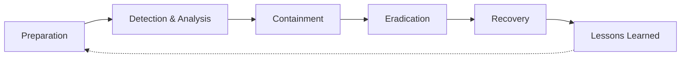

# SENTINEL Incident Response

> Does your detection still work when the attacker changes tactics?

This document defines how SENTINEL investigates and responds to a detected event. It is a **methodology document** — it describes the process SENTINEL follows, and separately, honestly tracks what has actually been exercised so far. Response work is meant to feed back into detection engineering: every incident should produce a lesson, and that lesson should be retested.

---

## 1. Current State

**Environment:**

| Component | Details |
|---|---|
| SENTINEL-WAZUH | Ubuntu 24.04, Wazuh 4.14.8, `10.10.10.10` |
| SENTINEL-LINUX01 | Ubuntu 24.04, Wazuh Agent 4.14.8, `10.10.10.40`, Agent ID `002` |
| Lab network | `SENTINEL-LAB`, `10.10.10.0/24` (internal, isolated) |

**Confirmed:**
- Real-time File Integrity Monitoring is configured on `/home` on SENTINEL-LINUX01.
- Built-in Wazuh Rule 550 (Level 7, "Integrity checksum changed") has been observed from controlled FIM testing.
- Custom Wazuh Rule 100002 (Level 8) generated the expected alert during a controlled modification of `/home/sentinel-admin/sentinel-fim-validation.txt`, event timestamp `2026-10-11T20:25:14.746+0530` — see `docs/05-detection-engineering.md`. This validates the tested modification scenario only; it does not establish complete FIM coverage or prove malicious activity. This was a controlled lab test, not a real incident.
- **Investigation `CASE-001`** (`investigations/CASE-001.md`) has started. Real FIM events, including Rule 550 and Rule 100002 event details, have been filtered and reviewed as a first investigation exercise. **Current assessment:** CASE-001's controlled modification-validation objective is closed — this confirms the tested modification-detection scenario only. **CASE-001 remains open overall.** Broader event review, false-positive analysis, detection tuning, and additional validation remain outstanding, and its timeline reconstruction, root-cause analysis, and attribution are not yet complete.

**Reviewed records from 16 October 2026** (controlled actions on `/home/sentinel-admin/sentinel-audit-test.txt`; the screenshots have been reviewed, the source alert JSON has not):
- **Creation:** the reviewed screenshot shows built-in Rule 554 ("File added to the system"). Custom Rule 100002 is absent from that reviewed record.
- **Deletion:** the reviewed record shows built-in Rule 553 ("File deleted") at `2026-10-16T12:31:32.819+0530`. Custom Rule 100002 is absent from that reviewed record. Whether Rule 100002 should cover deletion is an **open question**; no cause is asserted.
- These are reviewed records of individual controlled actions, not successful validations of Rule 100002 for creation or deletion.
- **Unresolved discrepancies:** the creation screenshot displays `2026-10-16T11:40:06.007+0530`, while the evidence README lists `2026-10-16T11:40:06.087+0530`; this awaits review of the source alert JSON. The creation screenshot's filename contains `creation-rule-553` although its content shows Rule 554, and the evidence README reportedly refers to an older filename, `creation-rule-664`.
- An earlier claim that Rules 554 and 100002 fired together during creation is unsupported by the reviewed record and remains unexplained. It is not treated as a result.
- A read-only inspection of `local_rules.xml` showed Rule 100002 with parent `<if_sid>550</if_sid>`, Level 8, a `file` field condition of `/home/`, and group `sentinel_fim`. This establishes the on-disk definition at inspection time, not the version loaded by the running manager during the earlier tests. The exact matching behavior of the `/home/` condition is unverified.
- The reviewed creation and deletion events were Rules 554 and 553, and neither record shows Rule 100002; this is consistent with the Rule 550 dependency in those records but is not a root-cause analysis. Rule 100002 has not been changed or tuned.

**Reported operational observation (not a security incident):** a Wazuh Manager startup reportedly timed out, and the Manager subsequently started after a lock directory was removed. The root cause is unconfirmed. One graceful Manager/endpoint VM restart cycle was reported successful, with Agent `002` reconnecting; this single observation is not evidence of general resilience. Logs have not been independently reviewed or confirmed saved in the repository.

**What's not yet complete:**
- CASE-001's timeline, root cause, attribution, and final conclusions.
- Containment, eradication, or recovery — none have been performed in this lab yet.
- Source alert JSON review for the 16 October records, the creation timestamp and filename discrepancies, verification of the manager-loaded Rule 100002 version, and resolution of the Rule 550 dependency question and the deletion coverage question.
- Broader false-positive/negative testing and tuning for Rule 100002.
- Response metrics — none have been measured.

Everything from Section 2 onward is the methodology SENTINEL follows. Where something has actually been done, it's labeled **verified**; everything else is **documented** (defined, but not yet exercised) or **planned**.

---

## 2. Incident Response Lifecycle



| Phase | Objective | Status in SENTINEL |
|---|---|---|
| **Preparation** | Infrastructure, telemetry, and documented procedures are in place before an incident occurs | Partially complete — the Wazuh environment and FIM telemetry are available and Rule 100002 is validated for one scenario (modification); broader telemetry and repeatable validation remain outstanding (`docs/05-detection-engineering.md`) |
| **Detection & Analysis** | An alert or anomaly is triaged and investigated to determine scope and whether it's a real incident | In progress — CASE-001 is the first exercise of this phase; its controlled modification-validation objective is closed, but the overall investigation remains open |
| **Containment** | Limit the spread or impact of confirmed malicious activity | Documented only — none has been exercised in the lab |
| **Eradication** | Remove the cause (persistence, malicious files, bad config) | Documented only — none has been exercised in the lab |
| **Recovery** | Restore normal operation and confirm monitoring/detection work again | Documented only — none has been exercised in the lab |
| **Lessons Learned** | Capture what worked, what didn't, and feed it back into detection engineering | Not yet exercised as a completed post-incident phase — no case has reached it |

This is the standard six-phase model SENTINEL will measure itself against as later milestones (v0.4+) are built out. The controlled tests documented above are validation exercises, not confirmed security incidents, and are treated as such throughout this document. Investigation (Detection & Analysis) and response (Containment onward) are distinct: the work done to date is investigation and detection validation only, and no response action has been performed.

---

## 3. Detection & Analysis — Telemetry and Evidence

Wazuh alerts and endpoint telemetry are the starting point for analysis, not a conclusion. A Wazuh alert — whether built-in Rule 550 or custom Rule 100002 — confirms that a rule matched a condition. It does not by itself confirm malicious intent, process attribution, who was responsible, or what else happened around it. Likewise, a built-in rule alert (for example Rules 554 and 553 in the reviewed 16 October records) does not establish whether custom Rule 100002 should cover the same event.

**Evidence sources currently available:** Wazuh FIM/Syscheck events from SENTINEL-LINUX01 (`/home`), including Rule 550 and the confirmed Rule 100002 output for the tested modification scenario, which supports the original CASE-001 investigation. The 16 October creation and deletion screenshots are reviewed records: built-in Rule 554 for creation and built-in Rule 553 for deletion, with custom Rule 100002 absent from each. Source alert JSON review for those records remains outstanding. Other telemetry (authentication, process execution, command context) is not yet configured — see `docs/05-detection-engineering.md` for current telemetry status. CASE-001 currently relies on FIM event data only.

**Analysis questions a triage/investigation step should answer:**

| Question | Notes |
|---|---|
| What happened? | Describe the observed event, not an assumed cause |
| Which asset, user, process, timestamp? | Fill in only what the telemetry actually supports |
| Is this expected, suspicious, or malicious? | A judgment call, not an automatic classification from the alert alone |
| What evidence is available vs. missing? | Document gaps as explicitly as findings |
| Does this warrant further investigation or escalation? | See Section 4 |

**Evidence handling:** every piece of evidence should be timestamped, traceable to its source, and preserved rather than overwritten. Evidence supporting the Rule 100002 validation and CASE-001, including the reviewed 16 October screenshots, is stored under `evidence/v0.3/`, with earlier pipeline/infrastructure evidence under `evidence/v0.2/`. Source alert JSON for the 16 October records and the operational artifacts from the Manager startup observation have not been confirmed as saved in the repository, and no evidence path is claimed for them. Nothing sensitive (credentials, secrets, VM disks, large raw datasets) is committed alongside it.

---

## 4. Decision-Making and Escalation

Not every alert or anomaly needs the same depth of response. SENTINEL's escalation path:

```
Alert/Anomaly → Triage → [Escalate to full investigation?] → Investigation
   → [Confirmed malicious?] → Containment decision
```

- **Escalate to investigation** when triage can't rule out malicious activity from available context, or when the affected asset/data matters enough to be worth the time even if the activity is probably benign.
- **Escalate to containment** only once investigation has established enough confidence that inaction carries more risk than action — containment is not a default reaction to every alert, including a confirmed Rule 100002 alert.
- **Human review is required** before any destructive or disruptive action (isolating an endpoint, killing a process, reverting a snapshot) — this lab has no automated response, and any future automation must still include a human decision point here (Section 6).
- When evidence is genuinely ambiguous, the honest outcome is "unresolved, more telemetry needed" — not a forced conclusion in either direction.

---

## 5. Post-Incident Review and Detection Improvement

Every case that reaches this phase should answer: what happened, how it was detected, what evidence confirmed it, what was missed, and what should change. The core loop:

```
Incident → Lesson → Detection Improvement → Retest
```

This is the mechanism that connects incident response back to `docs/05-detection-engineering.md`: a gap found during investigation (missing telemetry, a rule that didn't fire, insufficient alert context) becomes a concrete engineering task, not just a note. The reviewed 16 October deletion record, where built-in Rule 553 appeared and custom Rule 100002 did not, is an example of a question that may or may not turn out to be a gap; it is not established as one. Likewise, the creation record shows built-in Rule 554 with Rule 100002 absent, and the earlier claim that both fired together is unsupported and unexplained, not a verified positive result. The Rule 550 dependency question remains unresolved and no definitive root cause is asserted. No case has completed the full post-incident review phase — CASE-001 is still in Detection & Analysis, with its controlled modification-validation objective closed but the case open overall.

**Case report format** (used once a case is complete):

```markdown
# Case-XXX
## Incident Summary
## Severity
## Affected Assets
## Timeline
## Evidence
## Indicators of Compromise
## Investigation
## Root Cause
## Containment / Eradication / Recovery
## Lessons Learned
```

`investigations/CASE-001.md` is an investigation record documenting the controlled-validation work completed so far. It is not a completed incident report in the sense above — its timeline, root cause, and conclusions remain open.

---

## 6. Future Plans

The following are planned and not yet implemented or exercised:

- Completing CASE-001: broader event review, false-positive analysis, detection tuning, timeline reconstruction, and a finished case report, without claiming a root cause or attribution that has not been established
- Reviewing or obtaining the source alert JSON for the 16 October creation and deletion records, if available
- Resolving the creation timestamp and screenshot filename discrepancies in a separately approved documentation pass
- Verifying the Rule 100002 version loaded by the manager during testing, if historical evidence permits
- Reviewing built-in Rules 550, 553, and 554 and verifying the field-condition matching behavior (see `docs/05-detection-engineering.md`)
- Reviewing and recording the reported Wazuh Manager startup observation and restart cycle through the project's failure/lessons documentation, with root cause treated as unconfirmed until evidence supports one
- A controlled containment exercise (e.g., isolating SENTINEL-LINUX01 or stopping a test process), followed later by eradication and recovery validation, including verifying detection/telemetry still work post-recovery
- Broader telemetry (authentication, process execution) to support richer investigations
- Response metrics (time to detect, time to triage, time to contain/respond) — no values exist yet
- Any response automation, which will always require a human decision point per Section 4
- Purple-team and attack-mutation connections (v0.5–v0.6): using incident response findings to test whether detections hold up against varied attacker behavior

None of the above are claimed as current capability — they're the direction this document and the lab are headed.

---

## 7. Related Documents

| Document | Role |
|---|---|
| `docs/04-threat-model.md` | Identifies the threats this process responds to |
| `docs/05-detection-engineering.md` | Detection methodology and current rule status (Rule 550, Rule 100002) |
| `docs/07-testing-and-metrics.md` | How results are tested and measured |
| `investigations/CASE-001.md` | The current SOC investigation case record |
| `evidence/v0.2/`, `evidence/v0.3/` | Evidence supporting CASE-001 and other work, organized by version |
