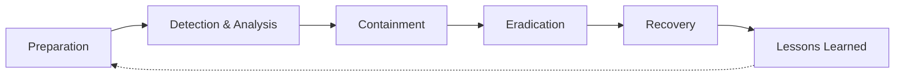

# SENTINEL Incident Response

> Does your detection still work when the attacker changes tactics?

This document defines how SENTINEL investigates and responds to a detected event. It is a **methodology document** — it describes the process SENTINEL follows, and separately, honestly tracks what has actually been exercised so far. Response work is meant to feed back into detection engineering: every incident should produce a lesson, and that lesson should be retested.

---

## 1. Current State

**Environment:**

| Component | Details |
|---|---|
| SENTINEL-WAZUH | Ubuntu 24.04, Wazuh 4.14.8, `10.10.10.10` |
| SENTINEL-LINUX01 | Ubuntu 24.04, Wazuh Agent 4.14.8, `10.10.10.40`, Agent ID `002` |
| Lab network | `SENTINEL-LAB`, `10.10.10.0/24` (internal, isolated) |

**What's verified:**
- Real-time File Integrity Monitoring is configured on `/home`.
- Built-in Wazuh Rule 550 (Level 7, "Integrity checksum changed") has been observed from controlled FIM testing.
- Custom Wazuh Rule 100002 (Level 8) has been **confirmed to generate the expected alert** during a controlled modification of `/home/sentinel-admin/sentinel-fim-validation.txt`, event timestamp `2026-10-11T20:25:14.746+0530` — see `docs/05-detection-engineering.md`. This validates the tested modification scenario only; it does not establish complete FIM coverage or prove malicious activity. This was a controlled lab test, not a real incident.
- **Investigation `CASE-001`** (`investigations/CASE-001.md`) has started. Real FIM events, including Rule 550 and Rule 100002 event details, have been filtered and reviewed as a first investigation exercise. **Current assessment:** the controlled-validation objective for CASE-001 is closed — this confirms the tested modification-detection scenario only. Broader event review, false-positive analysis, detection tuning, and additional validation remain ongoing. CASE-001's timeline reconstruction, root-cause analysis, and attribution are not yet complete.

**What's not yet complete:**
- CASE-001's timeline, root cause, attribution, and final conclusions.
- Containment, eradication, or recovery — none have been performed in this lab yet.
- Full FIM coverage (file creation/deletion), broader false-positive/negative testing, and tuning for Rule 100002.
- Response metrics — none have been measured.

Everything from Section 2 onward is the methodology SENTINEL follows. Where something has actually been done, it's labeled **verified**; everything else is **documented** (defined, but not yet exercised) or **planned**.

---

## 2. Incident Response Lifecycle



| Phase | Objective | Status in SENTINEL |
|---|---|---|
| **Preparation** | Infrastructure, telemetry, and documented procedures are in place before an incident occurs | Partially done — Wazuh/agent/FIM are deployed and Rule 100002 is validated for one scenario; broader telemetry is still being built (`docs/05-detection-engineering.md`) |
| **Detection & Analysis** | An alert or anomaly is triaged and investigated to determine scope and whether it's a real incident | In progress — CASE-001 is the first exercise of this phase; its controlled-validation objective is closed, broader review is ongoing |
| **Containment** | Limit the spread or impact of confirmed malicious activity | Documented only — no containment action has been performed |
| **Eradication** | Remove the cause (persistence, malicious files, bad config) | Documented only — not yet exercised |
| **Recovery** | Restore normal operation and confirm monitoring/detection work again | Documented only — not yet exercised |
| **Lessons Learned** | Capture what worked, what didn't, and feed it back into detection engineering | Not yet exercised — no case has reached this phase |

This is the standard six-phase model SENTINEL will measure itself against as later milestones (v0.4+) are built out. The controlled test documented above is a validation exercise, not a confirmed real incident, and is treated as such throughout this document.

---

## 3. Detection & Analysis — Telemetry and Evidence

Wazuh alerts and endpoint telemetry are the starting point for analysis, not a conclusion. A Wazuh alert — whether built-in Rule 550 or custom Rule 100002 — confirms that a rule matched a condition. It does not by itself confirm malicious intent, who was responsible, or what else happened around it.

**Evidence sources currently available:** Wazuh FIM/Syscheck events from SENTINEL-LINUX01 (`/home`), including Rule 550 and the confirmed Rule 100002 output for the tested modification scenario. Other telemetry (authentication, process execution, command context) is not yet configured — see `docs/05-detection-engineering.md` for current telemetry status. CASE-001 currently relies on FIM event data only.

**Analysis questions a triage/investigation step should answer:**

| Question | Notes |
|---|---|
| What happened? | Describe the observed event, not an assumed cause |
| Which asset, user, process, timestamp? | Fill in only what the telemetry actually supports |
| Is this expected, suspicious, or malicious? | A judgment call, not an automatic classification from the alert alone |
| What evidence is available vs. missing? | Document gaps as explicitly as findings |
| Does this warrant further investigation or escalation? | See Section 4 |

**Evidence handling:** every piece of evidence should be timestamped, traceable to its source, and preserved rather than overwritten. Evidence supporting the Rule 100002 validation and CASE-001 is stored under `evidence/v0.3/`, with earlier pipeline/infrastructure evidence under `evidence/v0.2/`. Nothing sensitive (credentials, secrets, VM disks, large raw datasets) is committed alongside it.

---

## 4. Decision-Making and Escalation

Not every alert or anomaly needs the same depth of response. SENTINEL's escalation path:

```
Alert/Anomaly → Triage → [Escalate to full investigation?] → Investigation
   → [Confirmed malicious?] → Containment decision
```

- **Escalate to investigation** when triage can't rule out malicious activity from available context, or when the affected asset/data matters enough to be worth the time even if the activity is probably benign.
- **Escalate to containment** only once investigation has established enough confidence that inaction carries more risk than action — containment is not a default reaction to every alert, including a confirmed Rule 100002 alert.
- **Human review is required** before any destructive or disruptive action (isolating an endpoint, killing a process, reverting a snapshot) — this lab has no automated response, and any future automation must still include a human decision point here (Section 6).
- When evidence is genuinely ambiguous, the honest outcome is "unresolved, more telemetry needed" — not a forced conclusion in either direction.

---

## 5. Post-Incident Review and Detection Improvement

Every case that reaches this phase should answer: what happened, how it was detected, what evidence confirmed it, what was missed, and what should change. The core loop:

```
Incident → Lesson → Detection Improvement → Retest
```

This is the mechanism that connects incident response back to `docs/05-detection-engineering.md`: a gap found during investigation (missing telemetry, a rule that didn't fire, insufficient alert context) becomes a concrete engineering task, not just a note. No case has reached this phase yet — CASE-001 is still in Detection & Analysis, with its controlled-validation objective closed but broader review ongoing.

**Case report format** (used once a case is complete):

```markdown
# Case-XXX
## Incident Summary
## Severity
## Affected Assets
## Timeline
## Evidence
## Indicators of Compromise
## Investigation
## Root Cause
## Containment / Eradication / Recovery
## Lessons Learned
```

`investigations/CASE-001.md` documents the controlled-validation work completed so far. It does not yet have a finished report in the full sense above — its timeline, root cause, and conclusions remain open.

---

## 6. Future Plans

The following are planned and not yet implemented or exercised:

- Completing CASE-001: broader event review, false-positive analysis, detection tuning, timeline reconstruction, root-cause determination, attribution, and a finished case report
- Extending Rule 100002 validation to file creation/deletion scenarios (see `docs/05-detection-engineering.md`)
- A first containment exercise (e.g., isolating SENTINEL-LINUX01 or stopping a test process) under controlled conditions
- Eradication and recovery exercises, including verifying detection/telemetry still work post-recovery
- Broader telemetry (authentication, process execution) to support richer investigations
- Response metrics (time to detect, time to triage, time to contain/respond) — no values exist yet
- Any response automation, which will always require a human decision point per Section 4
- Purple-team and attack-mutation connections (v0.5–v0.6): using incident response findings to test whether detections hold up against varied attacker behavior

None of the above are claimed as current capability — they're the direction this document and the lab are headed.

---

## 7. Related Documents

| Document | Role |
|---|---|
| `docs/04-threat-model.md` | Identifies the threats this process responds to |
| `docs/05-detection-engineering.md` | Detection methodology and current rule status (Rule 550, Rule 100002) |
| `docs/07-testing-and-metrics.md` | How results are tested and measured |
| `investigations/CASE-001.md` | The current SOC investigation case record |
| `evidence/v0.2/`, `evidence/v0.3/` | Evidence supporting CASE-001 and other work, organized by version |
