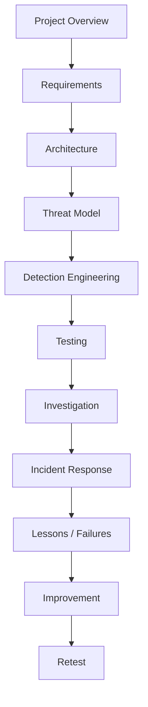

# SENTINEL Documentation

This directory contains the engineering documentation for SENTINEL, covering project objectives, requirements, architecture, threat modeling, detection engineering, incident response, testing, and lessons learned.

This is **not** the main project README — the repository root has its own `README.md` for a general audience. This file is the index for everything under `/docs`.

---

## 1. Documentation Purpose

SENTINEL's documentation is designed to preserve two things at once:

- What the project is **supposed to do**
- What the project **actually does**

It exists to support engineering, security testing, troubleshooting, incident investigation, detection development, validation, future maintenance, technical interviews, and portfolio evidence.

Three rules govern all of it:

- Documentation reflects actual project state.
- Planned capabilities are never presented as implemented.
- Failed experiments are never hidden.

---

## 2. Documentation Structure

| # | Document | Purpose |
|---|---|---|
| 01 | `01-project-overview.md` | What SENTINEL is, its purpose, core question, lifecycle, design philosophy, roadmap, and major concepts |
| 02 | `02-requirements.md` | Hardware, software, networking, storage, virtualization, security, and repository requirements |
| 03 | `03-architecture.md` | Actual infrastructure, VMs, network topology, components, trust boundaries, telemetry flow, future expansion |
| 04 | `04-threat-model.md` | Assets, threats, attack surfaces, trust boundaries, attacker capabilities, security objectives, threat scenarios |
| 05 | `05-detection-engineering.md` | How SENTINEL designs, tests, tunes, validates, and improves detections |
| 06 | `06-incident-response.md` | How SENTINEL handles a detected security event, from detection through response and improvement |
| 07 | `07-testing-and-metrics.md` | Testing & Metrics: how SENTINEL proves its security controls actually work — the main validation methodology |
| 08 | `08-lessons-and-failures.md` | Real project failures, troubleshooting, engineering decisions, and lessons learned |

### 01-project-overview.md
Defines what SENTINEL is, its purpose, core question, lifecycle, design philosophy, roadmap, and major concepts. Core question:

> "Does the detection still work when the attacker changes tactics?"

### 02-requirements.md
Defines the hardware, software, networking, storage, virtualization, security, and repository requirements needed to operate SENTINEL.

### 03-architecture.md
Documents the actual SENTINEL infrastructure, virtual machines, network topology, components, trust boundaries, telemetry flow, and future expansion.

### 04-threat-model.md
Defines assets, threats, attack surfaces, trust boundaries, attacker capabilities, security objectives, and threat scenarios relevant to SENTINEL.

### 05-detection-engineering.md
Defines how SENTINEL designs, tests, tunes, validates, and improves security detections:

```
Threat → Attack Scenario → Telemetry → Detection Logic → Alert →
Investigation → Validation → Measurement → Tuning → Retest
```

### 06-incident-response.md
Defines how SENTINEL handles a detected security event:

```
Detection → Triage → Investigation → Containment → Eradication →
Recovery → Post-Incident Review → Detection Improvement → Retest
```

### 07-testing-and-metrics.md
Testing & Metrics. Defines how SENTINEL proves that security controls actually work. This is the main validation methodology, covering test cases, test matrices, telemetry validation, detection validation, investigation validation, response testing, regression testing, false-positive testing, false-negative testing, metrics, purple-team validation, attack mutation, and detection resilience. Core principle:

> "Configured does not mean validated."

### 08-lessons-and-failures.md
Documents real project failures, troubleshooting, engineering decisions, lessons learned, corrective actions, and retesting. Core principle:

> "Failure is data."

---

## 3. How the Documents Connect

```
Project Overview
      ↓
Requirements
      ↓
Architecture
      ↓
Threat Model
      ↓
Detection Engineering
      ↓
Testing & Metrics
      ↓
Incident Response
      ↓
Lessons & Failures
      ↓
Improvement → Retest
```

In practice: the **Threat Model** identifies what could happen. **Detection Engineering** defines how it should be detected. **Testing & Metrics** determines whether the detection actually works. **Incident Response** defines what happens after a real detection fires. **Lessons & Failures** records what went wrong and what was learned along the way. The resulting improvement then gets retested — closing the loop back into Detection Engineering and Testing.

---

## 4. SENTINEL Engineering Loop

Development philosophy:

```
BUILD → UNDERSTAND → TEST → BREAK → FIX → MEASURE → DOCUMENT → EXPLAIN
```

Security-operation loop:

```
SIMULATE → DETECT → INVESTIGATE → RESPOND → MEASURE → IMPROVE → RETEST
```

Mutation extension:

```
MUTATE → RETEST DETECTION RESILIENCE
```

Mutation-style testing has already been exercised within the documented v0.7 / CASE-004 scope, including a Sysmon command-line variation (`comsvcs.dll, #24`) that bypassed keyword-specific Rule `100112` and matched base Rule `100101` at Level 0. That is a documented detection gap for the tested variation only.

Further mutation scenarios and broader detection-resilience testing remain future work. SENTINEL does not currently have a comprehensive or repeatable mutation-testing framework.

---

## 5. Current Project State

### Infrastructure

| Host | OS | IP | Role |
|---|---|---|---|
| SENTINEL-WAZUH | Ubuntu 24.04, Wazuh 4.14.8 | 10.10.10.10 | SOC / monitoring platform |
| SENTINEL-KALI | Kali Linux | 10.10.10.20 | Controlled attacker system |
| SENTINEL-LINUX01 | Ubuntu 24.04.5 LTS, Wazuh Agent 4.14.8 (Agent ID 002) | 10.10.10.40 | Monitored Linux endpoint |

**Network:** `SENTINEL-LAB` — `10.10.10.0/24` (isolated).

SENTINEL is a Linux-first lab. There is no live Windows or Active Directory endpoint; Windows Sysmon telemetry is replayed. This follows the v0.1 architecture decision made after the Windows VM boot failure (FAIL-001, see `08-lessons-and-failures.md`).

### Verified project work

- **v0.1 (historical foundation):** core virtual infrastructure, Wazuh, Kali, Linux01, the lab network, and the Linux01 Wazuh Agent.
- **CASE-001:** FIM investigation, closed on 18 November 2026 for its reviewed scope.
- **CASE-002:** selected Windows Sysmon detections tested using replayed EVTX telemetry, not a live Windows endpoint.
- **CASE-003:** controlled SSH brute-force-style testing, custom rules `100200` and `100201`, Python-assisted triage, and a documented manual containment procedure.
- **CASE-004:** controlled FIM, Sysmon mutation/evasion, and SSH threshold testing, including the `comsvcs.dll, #24` detection gap.
- **v0.6:** controlled purple-team measurement using small samples, not statistically meaningful detection rates.
- **v0.8:** FIM group isolation and selected noise exclusions implemented. The broader noise-suppression retest remains pending, and residual `dconf` noise remains.
- **v0.9:** manager-side Sysmon JSON replay and Python-assisted triage integration.
- **v0.9.1:** follow-up field and timestamp handling.
- **v0.10:** live Linux FIM probe and file-based Python SOC triage validation. Its evidence archive is outside the SENTINEL repository at `~/soc-evidence/v0.10-fim-probe/`.
- **v0.11:** evidence artifacts are committed, but the milestone description and status are pending reconciliation (see Section 6).

### Not claimed

SENTINEL does not currently claim:

- Live Windows or Active Directory monitoring.
- Automated containment, eradication, recovery, or SOAR.
- A comprehensive automated regression suite.
- Comprehensive FIM coverage or resolved FIM noise.

Items are treated as implemented only once they are validated and documented in their respective files.

---

## 6. Version Roadmap

| Version | Focus | Documentation Emphasis |
|---|---|---|
| v0.1 | Foundation | Requirements, Architecture |
| v0.2 | Detection Engineering & Linux Telemetry | Detection Engineering, Testing & Metrics |
| v0.3 | SOC Investigation | Incident Response, Testing & Metrics |
| v0.4 | Windows Sysmon Replay & Cross-Platform Detection (`CASE-002`) | Detection Engineering, Incident Response |
| v0.5 | Incident Response — SSH brute-force IR & triage (`CASE-003`) | Incident Response, Testing & Metrics |
| v0.6 | Purple-Team Measurement | Testing & Metrics, Lessons & Failures |
| v0.7 | Attack DNA & Mutation Testing (`CASE-004`) | Detection Engineering, Testing & Metrics |
| v0.8–v0.9 | FIM isolation/tuning & Sysmon JSON replay (`v0.9.1` follow-up field and timestamp handling) | Detection Engineering, Incident Response |
| v0.10 | Live Linux FIM probe and file-based Python triage validation (archive outside the repository) | Testing & Metrics |
| v0.11 | Evidence present (`evidence/v0.11/`); milestone documentation and status pending reconciliation | Not yet reconciled |

**v0.10 and v0.11 are distinct.** The v0.10 archive is stored outside this repository at `~/soc-evidence/v0.10-fim-probe/`; no `evidence/v0.10/` directory is committed.

**v0.11 status:** the repository contains committed v0.11 evidence artifacts: FIM alert records for Rules `100002`, `100003` and `100004`, a triage report, and pre/post-cutoff rule-count summaries. However, `CHANGELOG.md`, `03-architecture.md` and `05-detection-engineering.md` do not yet document a v0.11 milestone. This table therefore records only that the evidence exists. It does not state a v0.11 title, purpose, completion status or validation result, and the presence of these files alone does not establish a completed regression suite.

Documentation evolves alongside implementation — a document is updated when the underlying capability actually changes, not ahead of it.

---

## 7. Document Ownership / Update Rules

| Document | Update when... |
|---|---|
| 01 Project Overview | Project direction, scope, architecture philosophy, or roadmap changes |
| 02 Requirements | Hardware/software/network/resource requirements change |
| 03 Architecture | Infrastructure, networking, components, or data flow changes |
| 04 Threat Model | New assets, attack surfaces, threats, or security assumptions are introduced |
| 05 Detection Engineering | Detection methodology, telemetry strategy, detection logic, or validation approach changes |
| 06 Incident Response | Investigation, containment, eradication, recovery, or response workflows change |
| 07 Testing & Metrics | Tests are created, executed, failed, validated, or retired |
| 08 Lessons & Failures | A meaningful failure, engineering decision, or lesson occurs |

Not every document needs to change with every version — only the documents actually affected by a given change are updated.

---

## 8. Document Status Model

Documentation may use these labels: `CURRENT`, `IMPLEMENTED`, `IN PROGRESS`, `PLANNED`, `FUTURE`, `UNKNOWN`, `NOT YET TESTED`. Planned functionality is never presented as completed.

---

## 9. Evidence

Implementation claims are eventually backed by evidence stored under:

```
evidence/
├── v0.1/
├── v0.2/
├── v0.3/
├── sysmon-replay/    (v0.4 Sysmon replay evidence)
├── v0.5/
├── v0.6/
├── v0.7/
├── v0.9/
└── v0.11/
```

Notes on this layout:

- **No `evidence/v0.8/` directory** is committed.
- **No `evidence/v0.10/` directory** is committed. The v0.10 evidence archive is stored outside this repository at `~/soc-evidence/v0.10-fim-probe/` and is not committed repository evidence.
- **`evidence/v0.11/`** contains committed artifacts whose milestone status is still pending reconciliation (see Section 6). It should not be read as a fully documented milestone.

Evidence may include screenshots, Wazuh alerts, logs, test results, detection configurations, investigation notes, incident timelines, metrics, and before/after comparisons. Secrets, credentials, private keys, VM disks, and sensitive raw telemetry are never committed.

---

## 10. Failure Documentation

Failures are part of SENTINEL's engineering history. The `failure-log/` directory currently contains only its guidance file:

```
failure-log/
└── readme.md
```

`failure-log/readme.md` is the operational guidance for future individual failure records. No individual failure-record files have been added, and the absence of such files is not evidence that no failures, gaps or findings have occurred.

The formal FAIL-001 entry and the other verified findings (detection gaps, benign noise, scope limitations and unresolved questions) are currently documented in `08-lessons-and-failures.md`.

Failures are captured honestly and follow:

```
Failure → Analysis → Fix → Retest → Lesson
```

No fictional failures are recorded anywhere in this project.

---

## 11. Testing Principle

> SENTINEL does not consider a security control successful merely because it exists.

```
Implementation → Test → Evidence → Measurement → Retest
```

A successful screenshot is not equivalent to validated security coverage.

---

## 12. Future Documentation

Additional documentation may be introduced later if the project's complexity justifies it — for example: DFIR methodology, threat-hunting missions, custom SENTINEL console architecture, API documentation, automation design, deception/honeypot documentation, Windows/AD architecture, or detection coverage reports.

**None of these documents currently exist.** New documentation is added only when it's actually needed, not for its own sake.

---

## 13. Contribution / Maintenance Principles

1. Document real implementation.
2. Separate current from planned.
3. Record important failures.
4. Record evidence.
5. Avoid unnecessary duplication.
6. Update affected documents when architecture changes.
7. Use consistent terminology.
8. Do not fabricate metrics.
9. Do not hide failed tests.
10. Keep documentation understandable to someone who did not build the system.

---

## 14. Reading Order

These are suggested paths, not mandatory ordering.

**New Developer:**
`01 → 02 → 03 → 04 → 05 → 07 → 06 → 08`

**Security / SOC Reviewer:**
`01 → 03 → 04 → 05 → 07 → 06`

**Interviewer:**
`01 → 03 → 05 → 07 → 08`

---

## 15. Documentation Map



---

## 16. Relationship to Root README

| | Root `README.md` | `docs/README.md` (this file) | Individual docs |
|---|---|---|---|
| Audience | General / portfolio visitor | Anyone navigating `/docs` | Engineers, reviewers, interviewers going deep |
| Contents | Project introduction, purpose, architecture summary, key capabilities, quick-start orientation | Documentation index, engineering documentation map, current documentation state, reading paths, document relationships | Detailed engineering information for that specific area |

This file does not duplicate the root README's content — it exists purely to help someone find and navigate the detailed documents.

---

## 17. Project Philosophy

SENTINEL is not built around collecting tools. It is built around answering one question:

> "Can we prove that our defenses work?"

The documentation exists to make that proof understandable, reproducible, evidence-based, testable, honest, and continuously improvable.

---

## 18. Final Status

**Documentation currently includes the eight numbered engineering documents:**

- 01 Project Overview
- 02 Requirements
- 03 Architecture
- 04 Threat Model
- 05 Detection Engineering
- 06 Incident Response
- 07 Testing & Metrics
- 08 Lessons & Failures

**Documented milestone state:**

- `v0.1`–`v0.7` complete (`CASE-001`–`CASE-004`).
- `v0.8` and `v0.9` (`v0.9.1` follow-up field and timestamp handling) merged on `main`. The post-tuning noise-suppression retest remains pending, and residual `dconf` noise remains.
- `v0.10` (live Linux FIM probe and file-based Python triage validation) is documented; its evidence archive is outside the repository at `~/soc-evidence/v0.10-fim-probe/`.
- `v0.11` evidence files are committed under `evidence/v0.11/`, but the milestone description and status still need to be reconciled across `CHANGELOG.md`, `03-architecture.md` and `05-detection-engineering.md`.

**Unresolved follow-up work remains.** Live Windows agent telemetry is pending/out-of-scope. Comprehensive FIM coverage, a repeatable mutation-testing framework, and a comprehensive automated regression suite are not claimed. This is not a statement that the project is complete.

This file is an **index and navigation guide** for the SENTINEL engineering documentation. It does not invent implementation results, does not claim planned functionality is complete, and does not duplicate the detailed contents of the individual documents.
