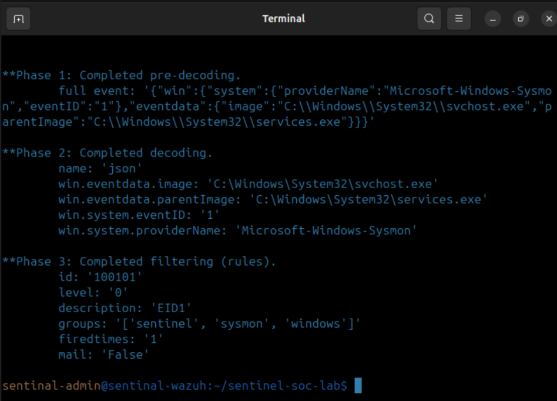
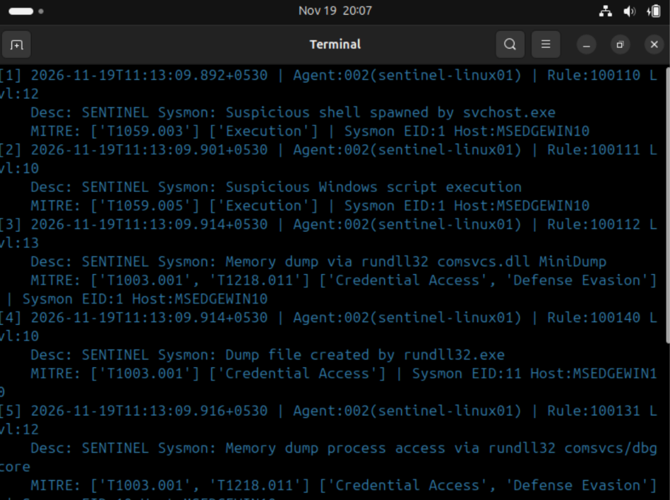
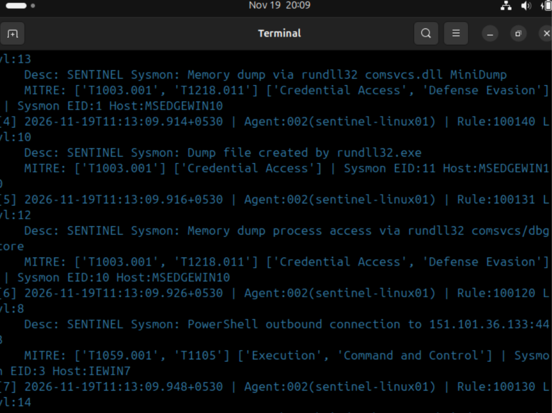
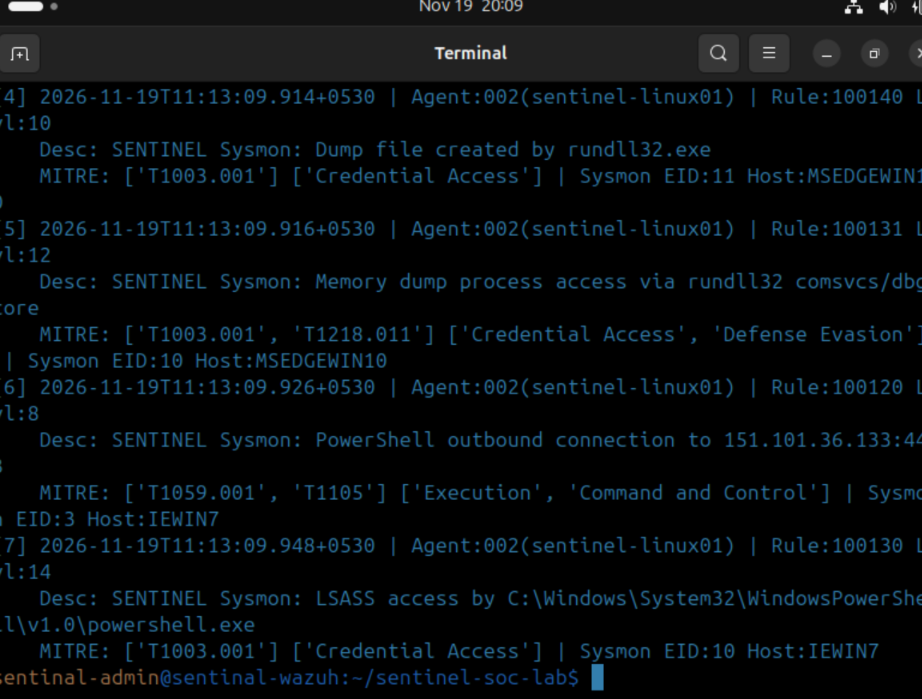
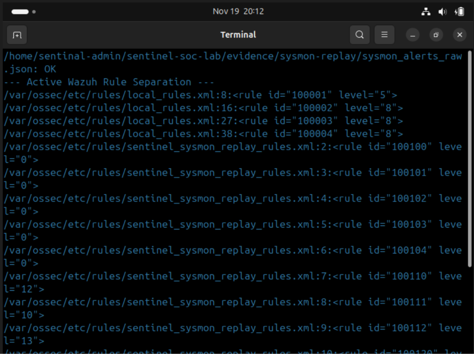
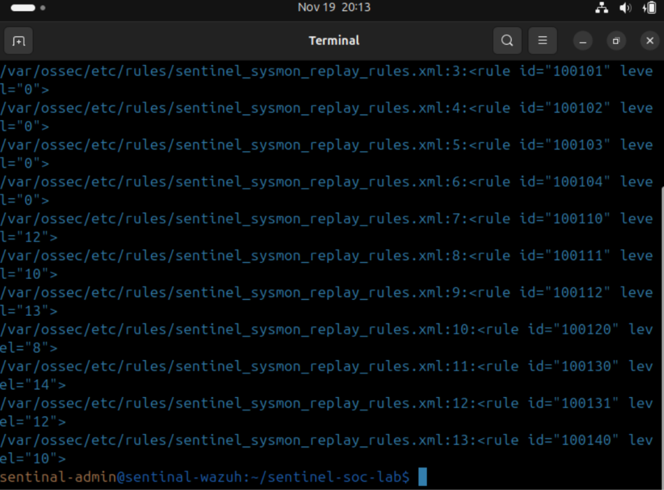
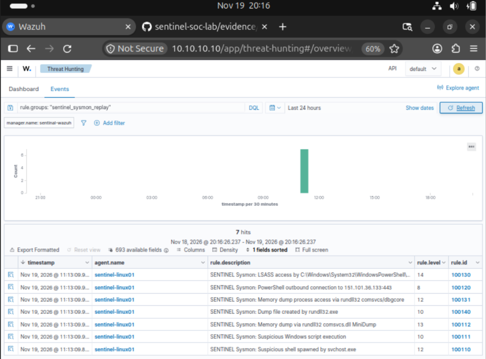

# v0.4 Evidence Index: Windows Sysmon Replay

## Scope and Methodology

This directory holds the evidence for the **v0.4 Windows Sysmon telemetry replay**.

The replay was conducted on **19 November 2026**. Pre-recorded Windows Sysmon EVTX captures were converted to NDJSON and replayed through **SENTINEL-LINUX01** (10.10.10.40, Wazuh Agent 002) to **SENTINEL-WAZUH** (10.10.10.10, Wazuh 4.14.8).

This was **replayed telemetry, not live monitoring of a Windows endpoint**. The Windows Sysmon kernel driver was not running in the SENTINEL lab.

## Raw Alert Summary

Seven Wazuh alert records across seven distinct behavioral rule IDs.

| Rule IDs |
|---|
| 100110, 100111, 100112, 100120, 100130, 100131, 100140 |

- **Forwarding agent:** all seven records identify `sentinel-linux01` (Agent ID `002`) as the Wazuh agent that forwarded the replayed data.
- **Original source hosts:** the underlying Sysmon telemetry identifies the source hosts as `MSEDGEWIN10` and `IEWIN7`.
- **Interpretation:** these are seven selected rule matches on replayed telemetry. They are not seven confirmed attacks.

## Evidence Files

| File | Description |
|---|---|
| [sysmon_alerts_raw.json](sysmon_alerts_raw.json) | The seven raw Wazuh alert records generated by the replay |
| [sysmon_alerts_raw.sha256](sysmon_alerts_raw.sha256) | The recorded SHA-256 checksum for the JSON evidence file |
| [CASE-002](../../investigations/CASE-002.md) | The detailed investigation and validation report |
| `screenshots/` | Screenshots documenting ruleset validation, fired alerts, integrity checks, and the Wazuh dashboard (shown below) |

## Screenshots

1. **Ruleset syntax + logtest**

   

2. **Fired alerts + MITRE (1/3)**

   

3. **Fired alerts + MITRE (2/3)**

   

4. **Fired alerts + MITRE (3/3)**

   

5. **SHA-256 OK + rule split (1/2)**

   

6. **SHA-256 OK + rule split (2/2)**

   

7. **Wazuh Dashboard (7 hits)**

   

## Evidence Interpretation and Limitations

- A rule match shows only that the rule matched the selected replayed event.
- It does not establish malicious activity, and it does not prove that a live endpoint would generate the same result.
- This evidence is limited to the selected captures and the tested rules.
- The replay does not establish comprehensive Sysmon coverage.

For detailed findings and validation, see [CASE-002](../../investigations/CASE-002.md).
