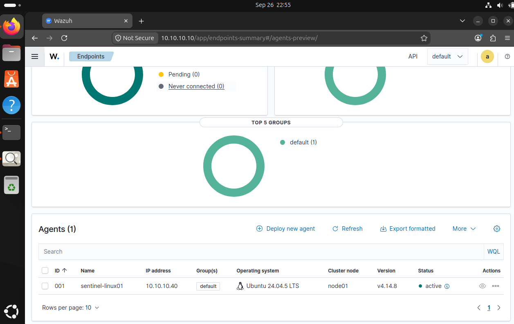
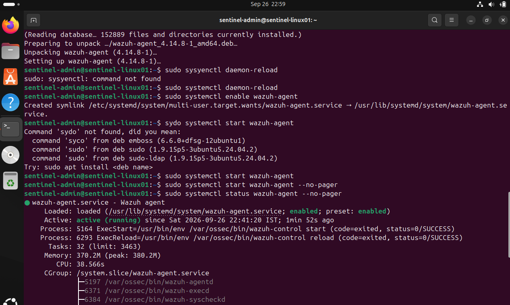
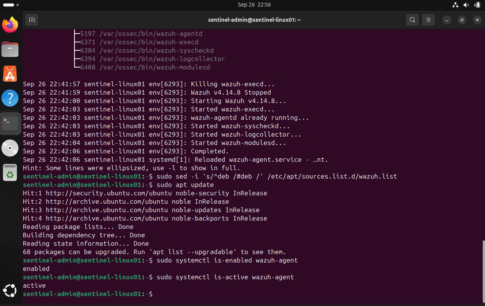

# SENTINEL Evidence — v0.1 (Foundation)

This folder contains the evidence collected during SENTINEL's v0.1 milestone: standing up the core SOC infrastructure and connecting the first monitored endpoint to Wazuh.

**What v0.1 set out to prove:** the lab infrastructure is deployed and reachable, the Wazuh Agent is running, and the endpoint is registered as Active in the Wazuh Dashboard — not just configured on paper.

---

## What was verified

| Component | What it shows |
|---|---|
| Wazuh Dashboard | SENTINEL-WAZUH is deployed and the SOC platform is reachable and operational |
| Wazuh Agent status | SENTINEL-LINUX01's agent is registered with the Wazuh Manager and shown as Active at the time of capture. |
| Infrastructure verification | The lab network and endpoint connectivity work end to end |

**Environment at the time of capture:**
- SENTINEL-WAZUH — Ubuntu 24.04, Wazuh 4.14.8, `10.10.10.10`
- SENTINEL-LINUX01 — Ubuntu 24.04.5 LTS, Wazuh Agent 4.14.8, Agent ID `001` (as recorded at v0.1 capture), `10.10.10.40`
- Network: `SENTINEL-LAB` — `10.10.10.0/24`

> **Note on Agent ID:** `001` is the value recorded at the time of the v0.1 capture and is preserved here as historical evidence. Later SENTINEL documentation records the current SENTINEL-LINUX01 agent as Agent ID `002`.

---

## Evidence

### 1. Wazuh Agent — Active and Connected

The Wazuh Dashboard showing SENTINEL-LINUX01 (Agent ID `001` at the time of capture) registered and reporting a status of **Active**. This shows the agent was enrolled with the Wazuh Manager and reporting Active at the time of capture.

### 2. Wazuh Agent Service — Running on the Endpoint

The Wazuh Agent service running on SENTINEL-LINUX01 itself, showing the service is running on the endpoint, as a complement to the dashboard's Active status.

### 3. Final Infrastructure Verification

A final check supporting the lab connectivity check between SENTINEL-WAZUH and SENTINEL-LINUX01 over the `SENTINEL-LAB` network, closing out v0.1.

---

## What this evidence does *not* claim

To keep this honest: these screenshots confirm infrastructure and connectivity only. They do **not** independently validate all telemetry types, custom detections, or the complete SOC pipeline, and they do not demonstrate a detection firing, an investigation, an incident response action, or any measured security outcome.

v0.1 documents only the initial infrastructure foundation. Later telemetry, detection, investigation, response, and measurement work is documented in subsequent milestone evidence and investigation records. This v0.1 index does not claim that those later capabilities were demonstrated during v0.1.

---

**Status:** v0.1 — Foundation, completed
