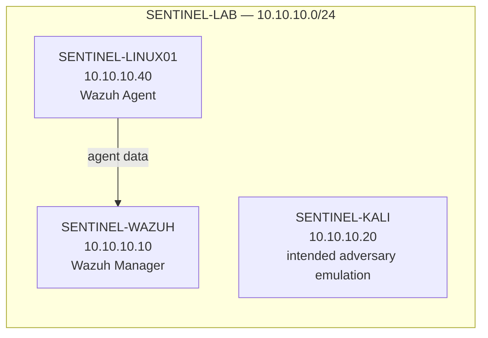

# SENTINEL v0.2 — Infrastructure & Telemetry Foundation

> **Historical record.** This document describes the v0.2 infrastructure milestone as originally captured. Observations made later (October 2026) are labeled as such and are not part of the original v0.2 capture. For the current state of detection and investigation work, see [Later documentation](#later-documentation).

## Executive summary

v0.2 established the infrastructure and initial telemetry foundation for SENTINEL: a small, controlled, single-endpoint lab in which a Wazuh Manager receives data from one monitored Linux endpoint. The milestone covers Wazuh agent communication, the documented active-agent state at the time of verification, and an initial real-time File Integrity Monitoring (FIM) setup on `/home`.

It does not establish a complete SOC, mature detection engineering, or an incident-response capability.

## Lab architecture

| System | Role | Verified details | IP |
|---|---|---|---|
| SENTINEL-WAZUH | Wazuh Manager and dashboard | Ubuntu 24.04, Wazuh 4.14.8 | `10.10.10.10` |
| SENTINEL-LINUX01 | Monitored Linux endpoint | Ubuntu 24.04.5 LTS, Wazuh Agent 4.14.8 | `10.10.10.40` |
| SENTINEL-KALI | Intended for controlled adversary emulation | Kali Linux 2026.2 | `10.10.10.20` |

The systems share the internal network **SENTINEL-LAB** (`10.10.10.0/24`). NAT is used for outbound access. No Windows, Sysmon, or Active Directory endpoint exists in this lab.

Kali appears in the diagram only as a lab member. No Kali-driven attack is documented in this milestone.

## Wazuh–Linux01 integration

The verified agent is `sentinel-linux01`, Agent ID `002`, confirmed `ACTIVE`.

Evidence:
- [Agent status screenshot](v0.2-agent-active.png)
- [Wazuh Manager running](v0.2-wazuh-manager-running-01.png)
- [Linux01 agent running](v0.2-linux01-agent-running.png)
- [Linux01-to-Wazuh connectivity](v0.2-linux01-to-wazuh-connectivity.png)
- [Dashboard lab status](wazuh-dashboard-lab-status.png)

The connectivity screenshot supports a connectivity check between the two hosts. This document does not claim which command, port, or protocol it shows. Enrollment ports, keys, and network controls are not described here.

Further integration detail is in [Wazuh–Linux01 Integration](wazuh-linux01-integration.md).

## Initial FIM setup

The original v0.2 capture configured real-time FIM (Syscheck) on `/home`. A controlled file modification produced built-in Wazuh **Rule 550** (Level 7, "Integrity checksum changed"). This shows file-change events reaching the manager. The FIM screenshots are indexed in the [v0.2 evidence README](readme.md).

At the time of the original capture, custom Rule `100002` had not been shown firing. Later results are summarized under [Milestone outcome and limitations](#milestone-outcome-and-limitations).

## Enrollment troubleshooting note

Older project notes mention an earlier enrollment/registration issue and an Agent ID `001`. The original supporting logs and any failure screenshot were not retained. The manager log directory checked in a later review showed the current `ossec.log` and no rotated `ossec.log*` files at the depth checked. Recent entries there reflect current agent heartbeat and SCA-related activity, and they do not explain the earlier issue.

As a result, the cause and sequence of the earlier issue, and the relationship between Agent IDs `001` and `002`, are **unresolved and cannot be independently verified**. This document does not attribute the agent's current active state to any specific configuration change, cleanup step, or restart.

## Telemetry interpretation

The [HC_STARTUP evidence 1](v0.2-wazuh-hc-startup-01.png) and [HC_STARTUP evidence 2](v0.2-wazuh-hc-startup-02.png) screenshots are linked as records of an `HC_STARTUP` observation from `sentinel-linux01`. HC_STARTUP is an agent startup/control message. It indicates agent–manager communication. It is not, by itself, proof that arbitrary endpoint events were processed or that the full telemetry pipeline was validated.

In the original capture, the pipeline claim rests on the Rule 550 FIM event above, and only for that scenario.

A Security Configuration Assessment (SCA) result for the CIS Ubuntu Linux 24.04 LTS Benchmark was observed in a later review (29 October 2026). It is not part of the original v0.2 capture and is not recorded here. SCA is built-in Wazuh functionality, not a custom SENTINEL detection.

## Evidence index

| Evidence | Supports |
|---|---|
| [v0.2-agent-active.png](v0.2-agent-active.png) | Agent `002` active |
| [v0.2-wazuh-manager-running-01.png](v0.2-wazuh-manager-running-01.png) | Manager running |
| [v0.2-linux01-agent-running.png](v0.2-linux01-agent-running.png) | Agent service running on Linux01 |
| [v0.2-linux01-to-wazuh-connectivity.png](v0.2-linux01-to-wazuh-connectivity.png) | Host-to-manager connectivity check |
| [v0.2-wazuh-hc-startup-01.png](v0.2-wazuh-hc-startup-01.png), [v0.2-wazuh-hc-startup-02.png](v0.2-wazuh-hc-startup-02.png) | `HC_STARTUP` observation |
| [wazuh-dashboard-lab-status.png](wazuh-dashboard-lab-status.png) | Dashboard overview |

No screenshot of the earlier enrollment issue exists in this directory.

## Milestone outcome and limitations

**Established by the original v0.2 capture:**
- Three-VM lab topology and Wazuh infrastructure.
- Agent connectivity and documented active-agent state (`002`).
- Initial `/home` FIM setup.
- Original controlled modification detected by built-in Rule 550.

**Later observations (not original v0.2 evidence):**
- **11 October 2026:** A controlled modification produced a custom Rule `100002` (Level 8) alert. Existing screenshots support this. The original source alert log was not recovered during the 26 October review.
- **16 October 2026:** The reviewed creation record showed built-in Rule 554 (Level 5), and the reviewed deletion record showed built-in Rule 553 (Level 7). Rule `100002` was absent from both. Why remains unresolved.
- **26 October 2026:** Two consecutive modifications of one file produced two Level 8 Rule `100002` alerts. This is one file modified twice, not two independent test cases or a regression suite.

**Not established:**
- The historical enrollment cause and the Agent `001`/`002` relationship.
- Comprehensive FIM coverage.
- Custom Rule `100002` operating during the original v0.2 capture.
- Containment, eradication, or recovery exercises.
- Detection rates, false-positive/negative rates, MTTA/MTTR, or coverage percentages.
- Completed attack mutation or regression testing.

## Security notes

- Credentials, authentication keys, API tokens, and the contents of `/var/ossec/etc/client.keys` are not reproduced in this repository's documentation.
- Lab IP addresses are documented because they belong to the isolated SENTINEL-LAB network.

## Later documentation

- [v0.2 evidence README](readme.md)
- [CASE-001](../../investigations/CASE-001.md)
- [Rule 100002 investigation](../../investigations/fim-rule-100002-investigation.md)
-
