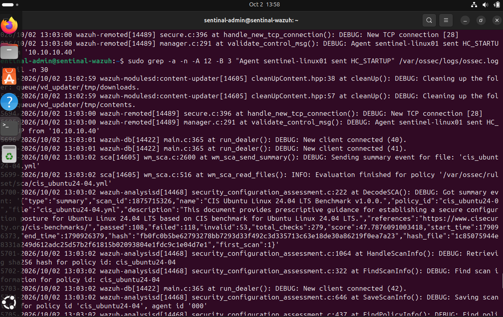
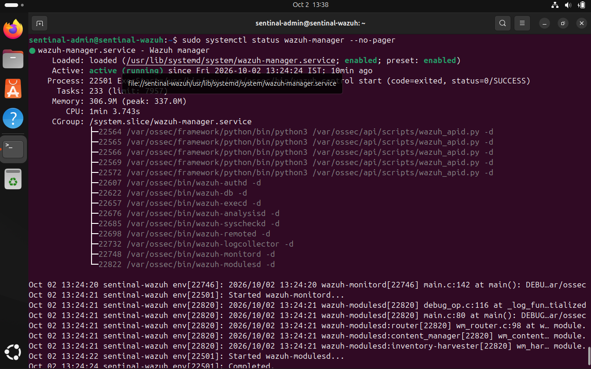
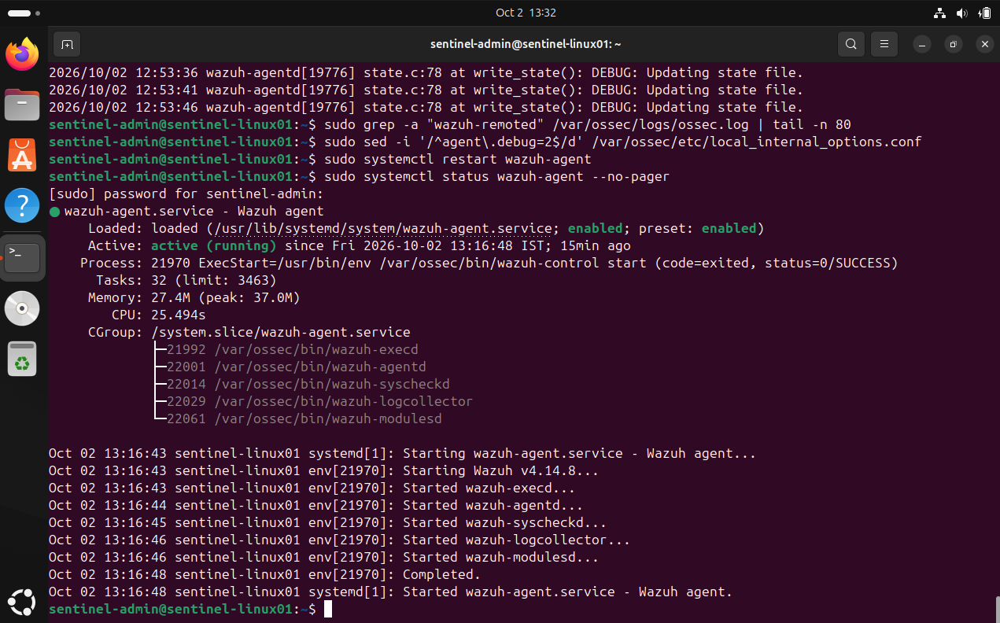
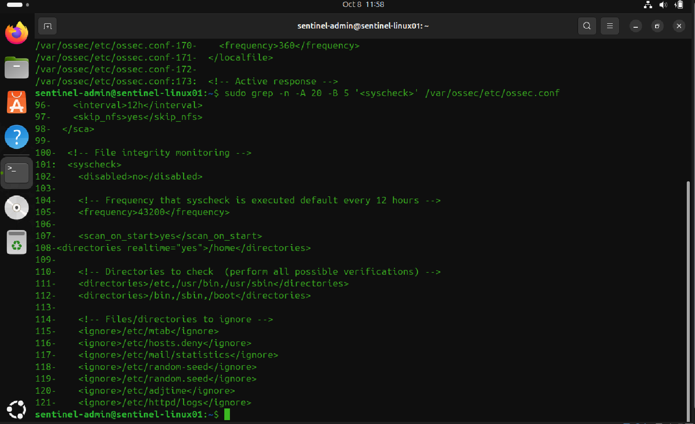
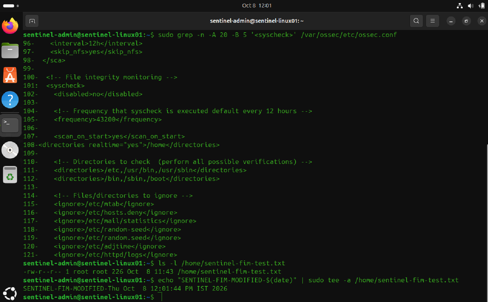

# SENTINEL Evidence — v0.2

Evidence for v0.2: getting Wazuh and SENTINEL-LINUX01 actually talking to each other, and building out a first File Integrity Monitoring (FIM) setup on top of that pipeline.

**Environment:** SENTINEL-WAZUH (`10.10.10.10`, Wazuh `4.14.8`) ↔ SENTINEL-LINUX01 (`10.10.10.40`, Wazuh Agent `4.14.8`, Agent ID `002`)

---

## Infrastructure & connectivity

Manager starts up clean, health check passes.

Manager process is up on SENTINEL-WAZUH.

Agent service is installed and running on SENTINEL-LINUX01.

Linux01 can actually reach the manager over the network.

Agent `002` shows up in the dashboard as Active — so the whole chain (agent → network → manager → dashboard) works end to end.

Overall dashboard view at the time, matching everything above.

---

## FIM on `/home`

Set up real-time FIM on `/home` via Syscheck.

Created and then modified a test file in `/home` to actually trigger something.

The modification got picked up — Wazuh's built-in **Rule 550** (Level 7, "Integrity checksum changed") fired. So the telemetry pipeline from file change → Wazuh Manager works.

---

## Custom rule — still open

Wrote a custom rule, ID `100002`, in `local_rules.xml` to catch this same event specifically. It passed Wazuh's syntax check (`analysisd`), but I haven't gotten it to actually fire a Level 8 alert yet. Rule 550 firing proves the telemetry works — it doesn't prove my custom rule works. That's unfinished.

---

## Full write-up

More detail on the infrastructure/telemetry setup and the Linux01 integration work lives in:
- `infrastructure-and-telemetry-foundation.md`
- `wazuh-linux01-integration.md`

---

## Full file list

| File | What it shows |
|---|---|
| `v0.2-wazuh-hc-startup-01.png` / `-02.png` | Manager health check / startup |
| `v0.2-wazuh-manager-running-01.png` | Manager running |
| `v0.2-linux01-agent-running.png` / `wazuh-agent-running.png` | Agent running on Linux01 |
| `v0.2-linux01-to-wazuh-connectivity.png` | Linux01 ↔ Wazuh connectivity |
| `v0.2-agent-active.png` | Agent active in dashboard |
| `wazuh-dashboard-lab-status.png` | Dashboard overview |
| `v0.2-fim-home-realtime-cong.png` | `/home` FIM config |
| `v0.2-fim-test-file-created.png` / `-modified.png` | Test file create/modify |
| `v0.2-fim-controlled-modification.png` | Rule 550 result |

`v0.3-case001-fim-filtered-events.png` and `v0.3-case001-rule-550-event-details.png` are in this folder too but belong to v0.3 — not covered here.
