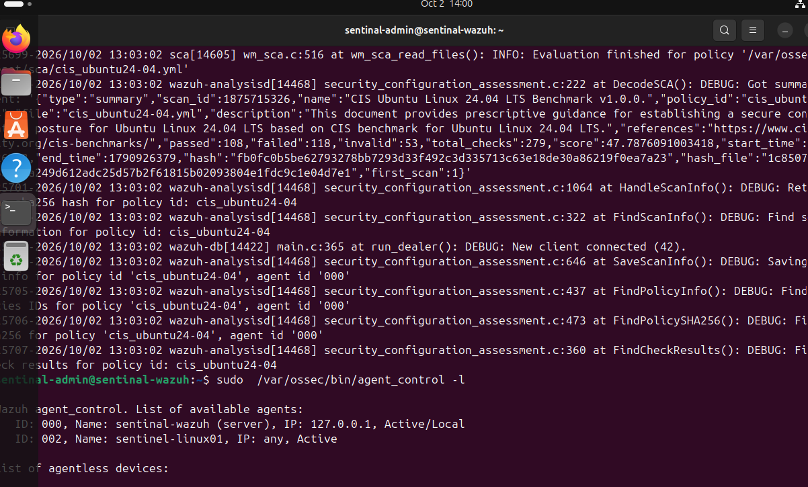
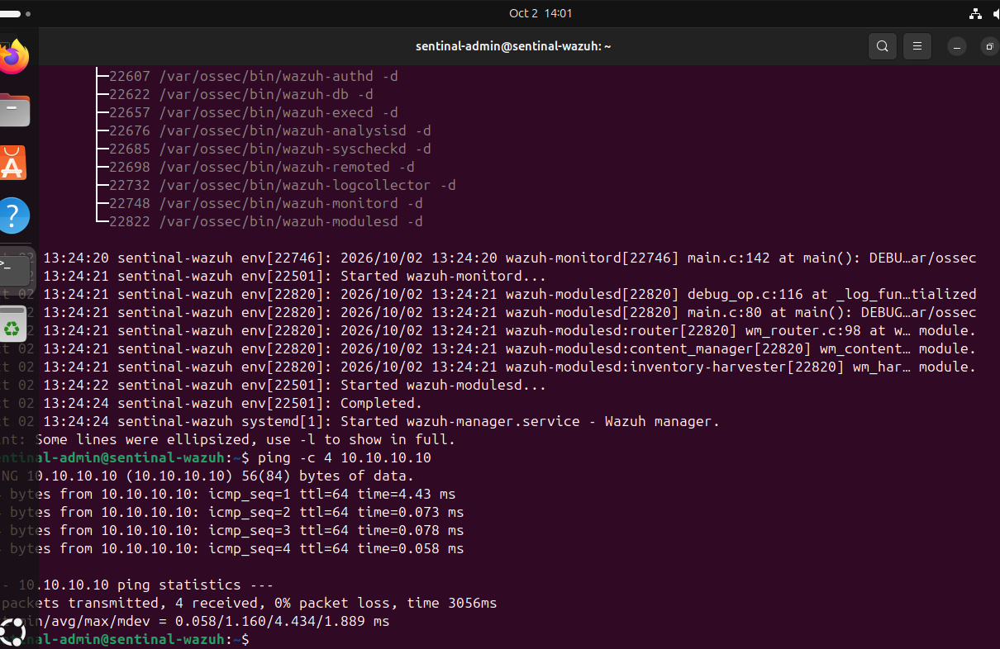
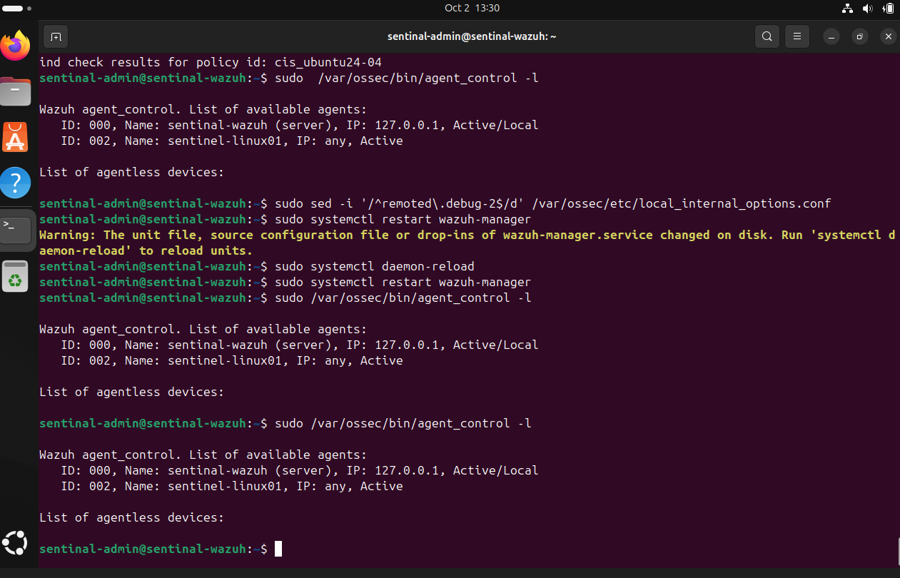
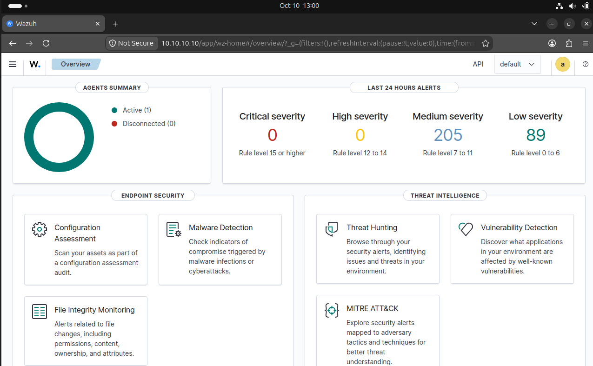
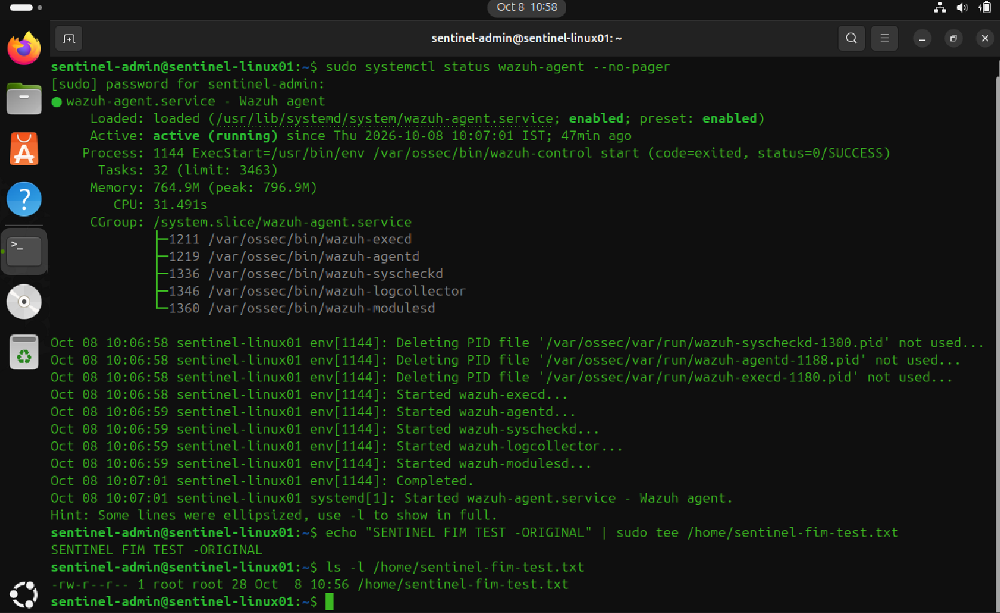
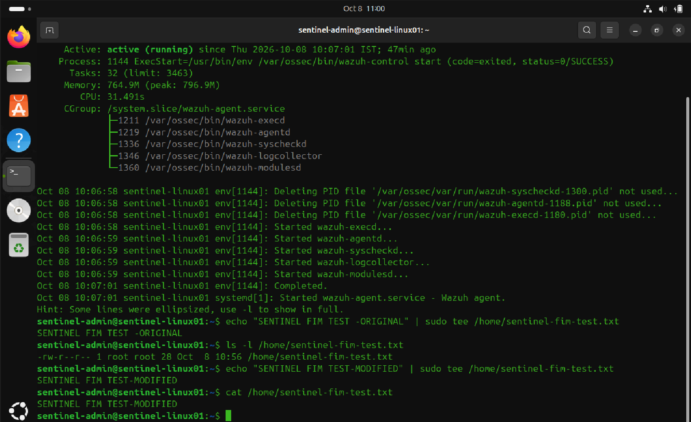
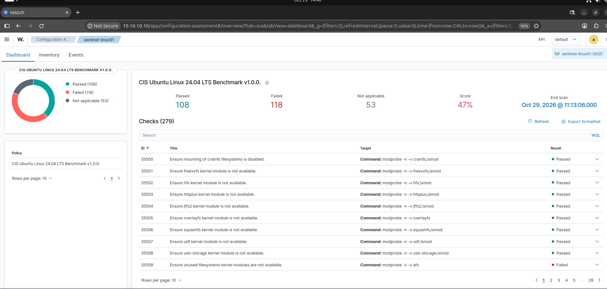

# SENTINEL Evidence — v0.2

Evidence for v0.2: getting Wazuh and SENTINEL-LINUX01 actually talking to each other, and building out a first File Integrity Monitoring (FIM) setup on top of that pipeline.

**Environment:** SENTINEL-WAZUH (`10.10.10.10`, Wazuh `4.14.8`) ↔ SENTINEL-LINUX01 (`10.10.10.40`, Wazuh Agent `4.14.8`, Agent ID `002`)

---

## Infrastructure & connectivity

Manager starts up clean, health check passes.

Manager process is up on SENTINEL-WAZUH.

Agent service is installed and running on SENTINEL-LINUX01.

Linux01 can actually reach the manager over the network.

Agent `002` is shown as Active in the dashboard. Together with the documented connectivity check and the original Rule 550 FIM alert, this supports agent–manager communication and file-change detection for the specific controlled modification tested. It does not establish that the complete telemetry pipeline was validated for all event types.

Overall dashboard view at the time, matching everything above.

---

## FIM on `/home`

Set up real-time FIM on `/home` via Syscheck.

Created and then modified a test file in `/home` to actually trigger something.

The modification got picked up — Wazuh's built-in **Rule 550** (Level 7, "Integrity checksum changed") fired. So the telemetry pipeline from file change → Wazuh Manager works.

---

## Custom rule — open at the time of v0.2

Wrote a custom rule, ID `100002`, in `local_rules.xml` to catch this same event specifically. It passed Wazuh's syntax check (`analysisd`), but at the time of this evidence capture I hadn't gotten it to actually fire a Level 8 alert. Rule 550 firing proves the telemetry works — it doesn't prove my custom rule works. That was unfinished at this milestone.

### Later updates (after the original v0.2 capture)

The results below were recorded after the v0.2 evidence above and are not part of the original v0.2 capture. They are summarized here for context; see [`../v0.3/readme.md`](../v0.3/readme.md) for the v0.3 evidence.

- **11 October 2026 — modification:** Existing screenshots support a Level 8 Rule `100002` alert for a controlled modification of `/home/sentinel-admin/sentinel-fim-validation.txt` at `2026-10-11T20:25:14.746+0530`. The original source alert log was not recovered during the 26 October review, so this result rests on the screenshots.
- **16 October 2026 — creation and deletion:** The reviewed creation record showed built-in Rule `554` at `2026-10-16T11:40:06.007+0530`, and the reviewed deletion record showed built-in Rule `553` (Level 7) at `2026-10-16T12:31:32.819+0530`. Custom Rule `100002` was absent from both reviewed records. Why it was absent remains unresolved.
- **26 October 2026 — modification:** Two consecutive modifications of `/home/sentinel-admin/sentinel-v02-mod-test.txt` produced Level 8 Rule `100002` alerts at `2026-10-26T21:38:27.910+0530` (size 0 → 23 bytes) and `2026-10-26T21:38:48.473+0530` (size 23 → 61 bytes). These are two alerts from consecutive modifications of one file, not independent test cases or a regression suite. Screenshot: [`v0.2-oct26-controlled-modification-source-alerts-new.png`](screenschots/v0.2-oct26-controlled-modification-source-alerts-new.png). It supports those two recorded alerts and nothing beyond them.

**Bounds on these results:** Modification detection by Rule `100002` is validated only for the tested scenarios. The two reviewed 16 October records do not establish how the custom rule behaves for creation or deletion events in general, and no root cause for its absence from those records is asserted. No comprehensive FIM coverage, measured detection rates, completed tuning, or regression testing is claimed. The raw 16 October records and the original 11 October source log are not claimed to be committed to the repository.

---

## Later observation — Security Configuration Assessment (29 October 2026)

This is one Wazuh Security Configuration Assessment (SCA) dashboard observation from 29 October 2026. It is later evidence stored in this directory for repository organization only. It is not part of the original v0.2 capture. SCA is built-in Wazuh functionality, not a custom SENTINEL detection.

The results and their limitations are documented in the [SCA baseline report](sca-baseline.md). This observation does not claim remediation, an improved security posture, successful compliance, or any detection performance.

---

## Full write-up

More detail on the infrastructure/telemetry setup and the Linux01 integration work lives in:

- [Infrastructure and Telemetry Foundation](infrastructure-and-telemetry-foundation.md)
- [Wazuh–Linux01 Integration](wazuh-linux01-integration.md)

---

## Full file list

| File | What it shows |
|---|---|
| [v0.2-wazuh-hc-startup-01.png](screenschots/v0.2-wazuh-hc-startup-01.png) / [v0.2-wazuh-hc-startup-02.png](screenschots/v0.2-wazuh-hc-startup-02.png) | Manager health check / startup |
| [v0.2-wazuh-manager-running-01.png](screenschots/v0.2-wazuh-manager-running-01.png) | Manager running |
| [v0.2-linux01-agent-running.png](screenschots/v0.2-linux01-agent-running.png) / [wazuh-agent-running.png](screenschots/wazuh-agent-running.png) | Agent running on Linux01 |
| [v0.2-linux01-to-wazuh-connectivity.png](v0.2-linux01-to-wazuh-connectivity.png) | Linux01 ↔ Wazuh connectivity |
| [v0.2-agent-active.png](screenschots/v0.2-agent-active.png) | Agent active in dashboard |
| [wazuh-dashboard-lab-status.png](screenschots/wazuh-dashboard-lab-status.png) | Dashboard overview |
| [v0.2-fim-home-realtime-cong.png](screenschots/v0.2-fim-home-realtime-cong.png) | `/home` FIM config |
| [v0.2-fim-test-file-created.png](screenschots/v0.2-fim-test-file-created.png) / [v0.2-fim-test-file-modified.png](screenschots/v0.2-fim-test-file-modified.png) | Test file create/modify |
| [v0.2-fim-controlled-modification.png](screenschots/v0.2-fim-controlled-modification.png) | Rule 550 result (original v0.2 capture) |
| [v0.2-oct26-controlled-modification-source-alerts-new.png](screenschots/v0.2-oct26-controlled-modification-source-alerts-new.png) | 26 October 2026 source alerts: two Level 8 Rule `100002` alerts from consecutive modifications of one file (`sentinel-v02-mod-test.txt`). Added after the original v0.2 capture; the filename keeps the `v0.2` prefix but the evidence dates from the later review. |
| [sca-baseline.md](sca-baseline.md) | Later report (29 October 2026) documenting one SCA dashboard observation. Not original v0.2 evidence. |
| [v0.2-sca-telementry-processing.png](screenschots/v0.2-sca-telementry-processing.png) | SCA dashboard view supporting that report. Captured 29 October 2026, after the original v0.2 capture; the filename keeps the `v0.2` prefix but is not original v0.2 evidence. |

[v0.3-case001-fim-filtered-events.png](screenschots/v0.3-case001-fim-filtered-events.png) and [v0.3-case001-rule-550-event-details.png](screenschots/v0.3-case001-rule-550-event-details.png) are in this folder too but belong to v0.3 — not covered here.
