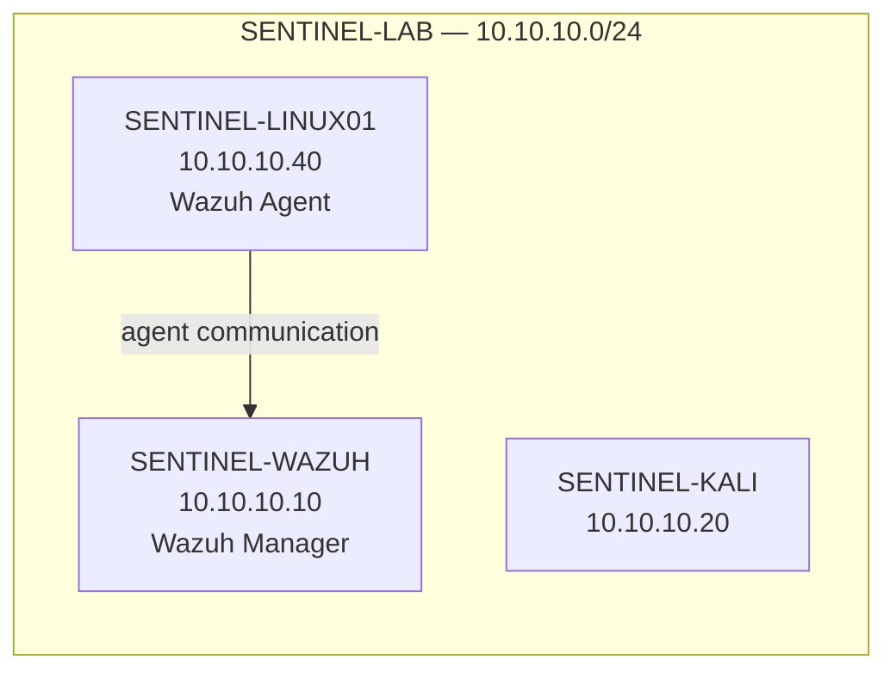

# SENTINEL — Wazuh ↔ Linux01 Integration (v0.2)

> **Historical scope.** This document records the v0.2 integration of `SENTINEL-LINUX01` with the Wazuh Manager and the evidence that supports it. Later observations are linked, not reproduced, and are not part of the original v0.2 capture.

## Integration objective

Enroll the Linux endpoint `SENTINEL-LINUX01` as a Wazuh agent against `SENTINEL-WAZUH`, confirm agent–manager communication, and set up an initial real-time File Integrity Monitoring (FIM) configuration on `/home`. This is the groundwork for later detection work. It is not a completed SOC or detection capability.

## Environment

| System | Role | Details | IP |
|---|---|---|---|
| SENTINEL-WAZUH | Wazuh Manager and dashboard | Ubuntu 24.04, Wazuh 4.14.8 | `10.10.10.10` |
| SENTINEL-LINUX01 | Monitored endpoint | Ubuntu 24.04.5 LTS, Wazuh Agent 4.14.8 | `10.10.10.40` |
| SENTINEL-KALI | Intended adversary-emulation platform | Kali Linux 2026.2 | `10.10.10.20` |

The VMs share the internal network **SENTINEL-LAB** (`10.10.10.0/24`). NAT is used for outbound access. There is no Windows, Sysmon, or Active Directory endpoint in the lab. No Kali-driven attack simulation is documented in this milestone.

Detection, investigation, response, and metrics functions are planned or later work. They are not separate infrastructure in this diagram.

## Communication and current agent identity

The Linux01 agent communicates with the Manager. The currently registered agent is:

| Field | Value |
|---|---|
| Agent name | `sentinel-linux01` |
| Agent ID | `002` |
| State | `ACTIVE` |

Supporting screenshots (a filename alone does not establish what an image shows beyond its description here):
- [Agent status](screenschots/v0.2-agent-active.png)
- [Manager running](screenschots/v0.2-wazuh-manager-running-01.png)
- [Linux01 agent service running](screenschots/v0.2-linux01-agent-running.png)
- [Linux01-to-Wazuh connectivity check](screenschots/v0.2-linux01-to-wazuh-connectivity.png)

The connectivity screenshot supports a check between the two hosts. This document does not state which command, port, or protocol it shows.

## Evidence-backed telemetry observations

**Agent communication.** The `HC_STARTUP` screenshots ([1](screenschots/v0.2-wazuh-hc-startup-01.png), [2](screenschots/v0.2-wazuh-hc-startup-02.png)) record an `HC_STARTUP` observation from `sentinel-linux01`. `HC_STARTUP` is an agent startup/control message. It supports agent–manager communication. It does not by itself show that endpoint events were processed or that the full telemetry pipeline was validated.

**Original FIM event.** In the original v0.2 capture, real-time FIM on `/home` was configured, and a controlled file modification produced built-in Wazuh **Rule 550** (Level 7, "Integrity checksum changed"). This supports file-change detection for that tested scenario only. See the [v0.2 evidence README](readme.md).

**Custom Rule `100002`.** This document does not establish that custom Rule `100002` fired during the original v0.2 capture. Later controlled tests (11, 16, and 26 October 2026) are documented in [CASE-001](../../investigations/CASE-001.md) and the [Rule 100002 investigation](../../investigations/fim-rule-100002-investigation.md). They are not evidence of custom-rule performance in this historical record.

**Later SCA observation.** A Security Configuration Assessment dashboard view was captured on 29 October 2026, after the original milestone. It is documented separately in the [SCA baseline report](sca-baseline.md) and does not validate the original integration.

## Historical enrollment limitation

Older project notes describe an earlier enrollment/registration issue and mention Agent ID `001`. The original supporting logs and any failure screenshot were not retained. The cause and sequence of that issue, and the relationship between Agent IDs `001` and `002`, cannot be independently reconstructed and remain unresolved.

This document does not attribute the current `ACTIVE` state to any specific configuration change, and it makes no claim about debug settings, cleanup steps, or restarts. See [Infrastructure & Telemetry Foundation](infrastructure-and-telemetry-foundation.md) for the same limitation.

## Security considerations

- No credentials, authentication keys, tokens, or `client.keys` contents are included in this document.
- Lab IP addresses are documented because they belong to the isolated SENTINEL-LAB network.
- Screenshots and log excerpts should not show passwords, API keys, tokens, private keys, or `client.keys` contents.

## Evidence index

| Evidence | Supports |
|---|---|
| [v0.2-agent-active.png](screenschots/v0.2-agent-active.png) | Agent `002` listed as active |
| [v0.2-wazuh-manager-running-01.png](screenschots/v0.2-wazuh-manager-running-01.png) | Manager running |
| [v0.2-linux01-agent-running.png](v0.2-linux01-agent-running.png), [wazuh-agent-running.png](screenschots/wazuh-agent-running.png) | Agent running on Linux01 |
| [v0.2-linux01-to-wazuh-connectivity.png](screenschots/v0.2-linux01-to-wazuh-connectivity.png) | Host-to-manager connectivity check |
| [v0.2-wazuh-hc-startup-01.png](screenschots/v0.2-wazuh-hc-startup-01.png), [v0.2-wazuh-hc-startup-02.png](screenschots/v0.2-wazuh-hc-startup-02.png) | `HC_STARTUP` observation |
| [wazuh-dashboard-lab-status.png](screenschots/wazuh-dashboard-lab-status.png) | Dashboard overview |

No screenshot of the earlier enrollment issue exists.

## Integration outcome and limitations

**Established:**
- Three-VM lab and Wazuh Manager/agent infrastructure.
- Current agent `sentinel-linux01`, ID `002`, listed `ACTIVE`.
- Initial real-time FIM setup on `/home`.
- Original controlled modification detected by built-in Rule 550.

**Not established by this document:**
- The historical enrollment cause and the Agent `001`/`002` relationship.
- Complete telemetry-pipeline validation beyond the scenarios above.
- Comprehensive FIM coverage.
- Custom Rule `100002` operation during the original capture.
- Containment, eradication, or recovery exercises.
- Detection rates, false-positive/negative rates, MTTA/MTTR, or coverage percentages.
- Attack mutation or regression testing.

## Related documentation

- [Infrastructure & Telemetry Foundation](infrastructure-and-telemetry-foundation.md)
- [v0.2 evidence README](readme.md)
- [SCA baseline report](sca-baseline.md)
- [Architecture](../../docs/03-architecture.md)
- [CASE-001](../../investigations/CASE-001.md)
- [Rule 100002 investigation](../../investigations/fim-rule-100002-investigation.md)
-
