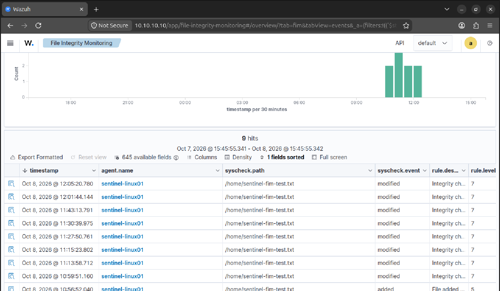
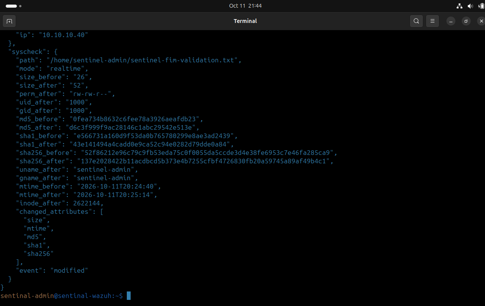
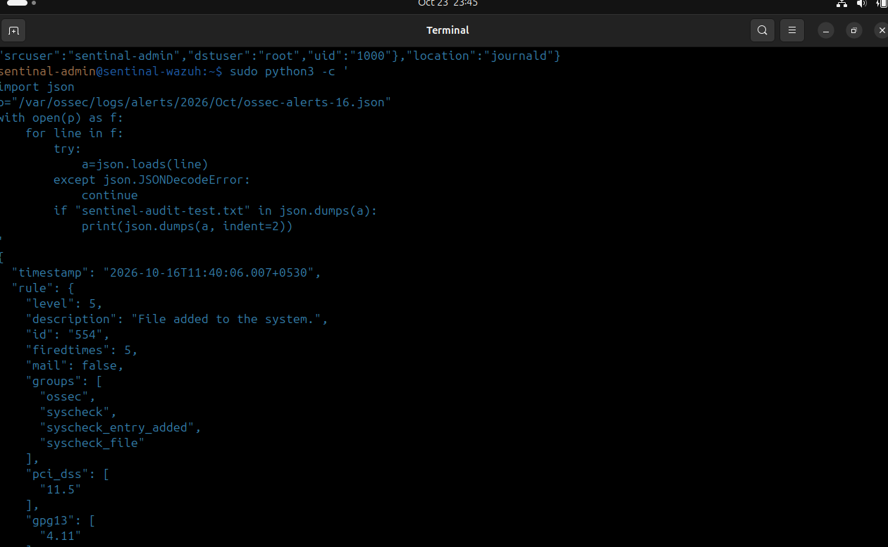
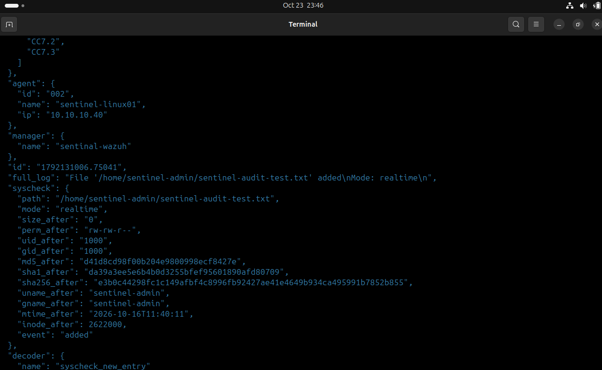
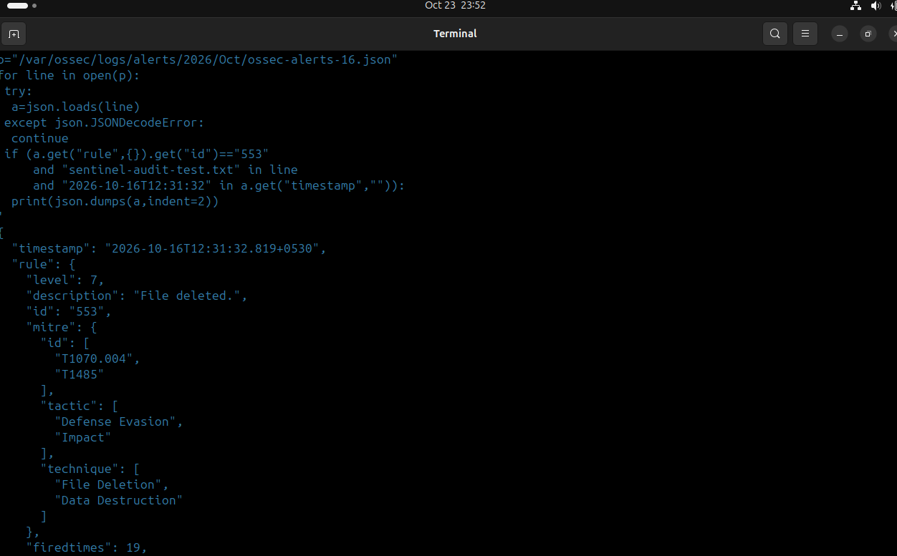

# SENTINEL v0.3: SOC Investigation Evidence

## Controlled FIM tests for CASE-001: modification, creation, and deletion

This directory contains screenshots supporting the SENTINEL v0.3 SOC investigation checkpoint. They cover endpoint file metadata, Wazuh File Integrity Monitoring (FIM) events, controlled modification tests of custom Rule `100002`, and two October 16 tests (file creation and file deletion) that produced built-in Wazuh alerts. One further modification test (26 October) is referenced from `evidence/v0.2/`.

The evidence supports the specific results described below. It does not establish complete FIM coverage or a comprehensive endpoint forensic assessment.

## Status

- SENTINEL v0.3 is in progress.
- Evidence reconciliation for the reviewed CASE-001 scope is closed. The broader CASE-001 investigation remains open.
- No containment, eradication, or recovery exercise has been completed.

## How to Read This Evidence

- **Screenshots** show only what is visibly captured in each image.
- **Findings from the reviewed source alert records** (event timestamps and the absence of Rule `100002` from the October 16 records) rest on review of those records, not on the screenshots alone.
- The absence of Rule `100002` from the two October 16 records is an **observation**. It is not a confirmed detection failure, and its cause has not been determined.

---

## Evidence Overview

| # | Evidence | File | What it supports |
|---|----------|------|------------------|
| 1 | CASE-001 endpoint file metadata | [`v0.3-case001-endpoint-file-metadata.png`](screenshots/v0.3-case001-endpoint-file-metadata.png) | Metadata for the controlled test file |
| 2 | CASE-001 filtered FIM events | [`v0.3-case001-fim-filtered-events.png`](screenshots/v0.3-case001-fim-filtered-events.png) | FIM events reviewed during the investigation |
| 3 | CASE-001 Rule 550 event details | [`v0.3-case001-rule-550-event-details.png`](screenshots/v0.3-case001-rule-550-event-details.png) | Built-in integrity-checksum-change alert |
| 4 | Custom Rule 100002 alert (Oct 11) | [`v0.3-custom-rule-100002.png`](screenshots/v0.3-custom-rule-100002.png) | Custom Level 8 alert from the Oct 11 modification test |
| 5 | Custom Rule 100002 dashboard JSON (Oct 11) | [`v0.3-custom-rule-100002-dashboard-json.png`](screenshots/v0.3-custom-rule-100002-dashboard-json.png) | Event fields used to verify the Oct 11 alert |
| 6 | Oct 16 creation, Rule 554 | [`v0.3-oct16-creation-rule-554.png`](screenshots/v0.3-oct16-creation-rule-554.png) | Built-in "File added to the system" alert |
| 7 | Oct 16 creation, file path | [`v0.3-oct16-creation-file-path.png`](screenshots/v0.3-oct16-creation-file-path.png) | Test-file path on the creation event |
| 8 | Oct 16 deletion, Rule 553 | [`v0.3-oct16-detection-rule-553.png`](screenshots/v0.3-oct16-detection-rule-553.png) | Built-in "File deleted" alert |
| 9 | Oct 16 deletion, file path | [`v0.3-oct16-detection-file-path.png`](screenshots/v0.3-oct16-detection-file-path.png) | Test-file path on the deletion event |
| 10 | Oct 26 modification, source alerts | [`v0.2-oct26-controlled-modification-source-alerts-new.png`](../v0.2/v0.2-oct26-controlled-modification-source-alerts-new.png) | Terminal output of two Level 8 Rule 100002 alerts from two consecutive modifications of one file (stored in `evidence/v0.2/`) |
| 11 | Rule 100002 definition | [`v0.3-rule-100002-definition.png`](screenshots/v0.3-rule-100002-definition.png) | Reported configuration of the custom rule |
| 12 | Investigation report on GitHub | [`v0.3-fim-rule-100002-investigation-github.png`](screenshots/v0.3-fim-rule-100002-investigation-github.png) | How the report appears on GitHub; not independent proof of detection |

> **Filename note:** The deletion screenshots (rows 8 and 9) keep their existing `detection` filenames. Descriptive text in this document uses "deletion".

---

## 1. CASE-001: Endpoint File Metadata

- **Purpose:** Records metadata for the controlled test file in the investigation scenario.
- **Evidence value:** Documents the test artifact and provides context for the file-integrity investigation.

---

## 2. CASE-001: Filtered FIM Events

- **Purpose:** Shows the filtered Wazuh FIM events reviewed during CASE-001.
- **Evidence value:** Demonstrates the event-review stage and helps identify the relevant integrity-change activity.

---

## 3. CASE-001: Built-in Rule 550 Event Details

- **Purpose:** Captures a built-in Wazuh Rule `550` (integrity checksum changed) alert.
- **Evidence value:** Provides context for the underlying FIM event and shows the built-in detection path observed during testing.

> **Note:** Rule 550 and custom Rule 100002 are distinct rules. Evidence of one does not independently validate the other.

---

## 4. Custom Rule 100002: October 11 Modification Test

| Field | Value |
|-------|-------|
| Rule ID | `100002` |
| Alert level | `8` |
| Description | SENTINEL: File integrity modification detected in monitored home directory. |
| Test objective | Confirm that the controlled file modification triggers the custom detection. |
| Event timestamp | `2026-10-11T20:25:14.746+0530` |

### Dashboard event JSON

- **Purpose:** Captures the event details used to inspect and verify the alert.
- **Evidence value:** Supports verification of the rule ID, alert level, file path, event details, and integrity information visible in the captured event.
- **Source record:** The original source alert record was not recovered. This test is supported by the screenshots above.
- **Scope:** Supports the specific tested modification scenario only.

> Interpret the screenshots together with the investigation report, not as proof of broader detection coverage.

---

## 5. October 16 File-Creation Test: Built-in Rule 554

**From the reviewed source alert record**

| Field | Value |
|-------|-------|
| Rule | Built-in Wazuh Rule `554`, "File added to the system." |
| Alert level | `5` |
| Test file | `/home/sentinel-admin/sentinel-audit-test.txt` |
| Event timestamp | `2026-10-16T11:40:06.007+0530` |
| Rule `100002` | Absent from this record |

**What the screenshots support:** The two screenshots are the visual references for the Rule 554 creation alert and the test-file path. The absence of Rule `100002` rests on review of the source record, not on the screenshots alone.

---

## 6. October 16 File-Deletion Test: Built-in Rule 553

**From the reviewed source alert record**

| Field | Value |
|-------|-------|
| Rule | Built-in Wazuh Rule `553`, "File deleted." |
| Alert level | `7` |
| Test file | `/home/sentinel-admin/sentinel-audit-test.txt` (same path as the creation test) |
| Event timestamp | `2026-10-16T12:31:32.819+0530` |
| Rule `100002` | Absent from this record |

**What the screenshots support:** The two screenshots are the visual references for the Rule 553 deletion alert and the test-file path. The absence of Rule `100002` rests on review of the source record, not on the screenshots alone.

> **Observation, not a conclusion:** Rule `100002` was absent from both reviewed October 16 records, and the reason is unresolved. No root cause, detection failure, or malicious activity is established by this evidence. These results apply to the reviewed records only and do not show how Rule `100002` behaves for other creation or deletion events.

---

## 7. Custom Rule 100002: October 26 Modification Test

- **Test file:** `/home/sentinel-admin/sentinel-v02-mod-test.txt`
- **Observed result:** Terminal output shows two Level 8 Rule `100002` alerts, recorded from two consecutive modifications of the same file:
  - `2026-10-26T21:38:27.910+0530`: size changed from 0 to 23 bytes.
  - `2026-10-26T21:38:48.473+0530`: size changed from 23 to 61 bytes.
- **Scope:** These are two alert events from one file, not two independent test cases or a regression suite. They support the modification scenario for this controlled test file only.
- **Location:** The screenshot is stored in `evidence/v0.2/` and is referenced from here, not copied.

---

## 8. Custom Rule 100002: Rule Definition

- **Purpose:** Shows the reported configuration of the custom rule.
- **Reported dependency:** The rule has been described as using `<if_sid>550</if_sid>`, which would tie it to events already matched by built-in Rule 550.
- **Reported path condition:** A match on `/home/` has been described. Its exact matching behavior is unverified.
- **Limits of this screenshot:** It does not establish which rule definition was loaded during the historical October 16 tests, and the active configuration has not been re-verified here.
- **Relation to Oct 16 results:** The reported dependency is not established as the cause of Rule `100002` being absent from the reviewed creation and deletion records. That reason is unresolved.

---

## 9. Investigation Report

- The detailed findings are in the [FIM Rule 100002 investigation report](../../investigations/fim-rule-100002-investigation.md).
- This screenshot documents how the report appears on GitHub. It is not independent proof of the underlying detection; the supporting evidence is in sections 1 to 8.

---

## Investigation Outcome

- The controlled October 11 modification test generated a custom Rule `100002` Level 8 alert.
- On October 26, terminal output showed two further Rule `100002` Level 8 alerts from two consecutive modifications of `sentinel-v02-mod-test.txt`. Together with October 11, these support the tested modification scenario only.
- The reviewed October 16 creation and deletion records showed built-in Rules `554` (Level 5) and `553` (Level 7), respectively, with Rule `100002` absent from both records. The reason is unresolved.
- The CASE-001 reviewed event set also contained background configuration and cache changes. No malicious indicators were identified in that dataset, but the evidence does not establish process-level attribution for every event or show that the endpoint was free of threats.
- Evidence reconciliation for the reviewed CASE-001 scope is closed. The broader CASE-001 investigation remains open.
- Findings are documented in [CASE-001](../../investigations/CASE-001.md) and the [FIM Rule 100002 investigation report](../../investigations/fim-rule-100002-investigation.md).

---

## Limitations and Remaining Work

- Creation and deletion were each reviewed for a single test file path. Other directories, multiple files, and repeated events remain untested. The October 11 and 26 modification tests likewise cover only their respective test files.
- The original October 11 source alert record was not recovered.
- Review the active Rule 100002 definition, confirm which rule version was loaded during the October 16 tests, and determine why Rule `100002` was absent from the reviewed October 16 records.
- Decide whether file creation and deletion in `/home/` warrant custom detections.
- Review and tune noisy FIM events where appropriate.
- Develop systematic false-positive and false-negative test cases.
- No containment, eradication, or recovery exercise has been completed.
- Expand telemetry and investigation coverage as the project progresses.

---

## Scope Statement

These screenshots document specific, controlled detection-validation and investigation checkpoints. They are not evidence that every detection scenario has been tested, that FIM coverage is complete, or that the SENTINEL SOC workflow is finished. SENTINEL v0.3 and CASE-001 are not complete.

---

## Related Documentation

| Document | Path |
|----------|------|
| Investigation findings and disposition (CASE-001) | [`CASE-001`](../../investigations/CASE-001.md) |
| FIM Rule 100002 investigation report | [`fim-rule-100002-investigation`](../../investigations/fim-rule-100002-investigation.md) |
| Detection methodology and remaining validation work | [`Detection Engineering`](../../docs/05-detection-engineering.md) |

---

SENTINEL v0.3: SOC Investigation Evidence
