# SENTINEL v0.3: SOC Investigation Evidence

## FIM detection evidence for CASE-001: modification, creation, and deletion

This directory is the evidence index for the SENTINEL v0.3 SOC investigation checkpoint. It covers endpoint file metadata, Wazuh File Integrity Monitoring (FIM) events, custom Rules `100002`, `100003` and `100004`, built-in alerts from the October 16 tests, the October 31 observations, two controlled lifecycle sessions (November 2 and November 18), FIM configuration evidence from the endpoint and the manager, and a November 3 read-only check of the on-disk Rule `100002` definition.

The evidence supports the specific results described below. It does not establish complete FIM coverage, a detection rate, or a comprehensive endpoint forensic assessment. The full timeline, technical findings, severity classification, limitations and follow-up actions are in [CASE-001](../../investigations/CASE-001.md); this README does not duplicate them.

## Status

- The SENTINEL v0.3 phase milestone and its documentation and evidence deliverables are complete, per the 18 November 2026 closeout.
- **CASE-001 was closed on 18 November 2026 for its defined investigation scope**, as recorded in `CASE-001.md` ("Resolution & Sprint Closeout (18 November 2026)"). That closeout is authoritative and supersedes any earlier "open" or "in progress" wording.
- This closure does not mean that all broader FIM validation or detection-engineering work is complete. That work is separate from the case closure (see Remaining Work).
- Two separate controlled creation, modification and deletion lifecycle sessions are recorded: November 2 (terminal screenshot) and November 18 (raw alert JSON). Each is a single session on one dedicated file. Together they are not a regression suite.
- October 31 has two separate evidence sets (a screenshot and two raw alert JSON files). Their relationship has not been established.
- Endpoint (E14) and manager (E15) Syscheck configuration screenshots (`v0.3-e14-endpoint-syscheck-configuration.png` and `v0.3-e15-manager-syscheck-configuration.png`) are present in `screenshots/` and show local configuration only.
- A read-only check on November 3, 2026 confirmed the on-disk Rule `100002` definition and that `wazuh-analysisd` was running. It does not verify the in-memory rule or the configuration loaded on October 16.
- No containment, eradication, or recovery exercise has been completed.

## How to Read This Evidence

- **Direct evidence:** a screenshot or record directly showing an alert, configuration or event.
- **Supporting evidence:** context that does not independently establish a detection result.
- **Screenshots are not raw alert exports.** They show only what is visibly captured.
- **Raw alert JSON** is committed under [`raw-alerts/`](raw-alerts/) for October 31 (controlled-test file) and November 18 only. For all other dates, raw alert JSON or source records are not committed in this directory: October 11 (not recovered), October 31 screenshot set, and November 2. The October 16 source records were reviewed but are not claimed to be committed.
- The absence of Rule `100002` from the October 16 records is an **observation**, not a confirmed detection failure. Its cause is unresolved.
- Later validations do not establish which rules or configuration were loaded during earlier tests.

### Severity terms

These classifications measure different things and must not be compared or substituted:

| Term | Value | What it measures |
|---|---|---|
| CASE-001 administrative investigation classification | **Low** | An administrative classification of the CASE-001 investigation for its reviewed scope. It is not the severity or impact assessment of any individual alert. |
| Custom Wazuh alert level (Rules `100002`, `100003`, `100004`) | **Level 8** | The level assigned to each alert by its rule definition. It is not an assessment of case severity or impact. |
| October 16 built-in alert levels | **5** (Rule `554`), **7** (Rule `553`) | Default levels of the built-in Wazuh rules for file creation and deletion. |

## Evidence Sets by Date (chronological)

Each row is a separate set. Rows must not be merged into one test or session.

| Date (2026) | Rule(s) observed | File | Evidence type | Raw JSON committed | Nature |
|---|---|---|---|---|---|
| Oct 11 | `100002` (L8) | Not stated in this index | Screenshots (E04, E05) | No (not recovered) | Modification test |
| Oct 16 | Built-in `554` (L5), `553` (L7); `100002` absent | `/home/sentinel-admin/sentinel-audit-test.txt` | Screenshots + reviewed source records (E06–E09) | Not claimed | Built-in alerts; not custom-rule validations |
| Oct 26 | `100002` (L8) ×2 | `/home/sentinel-admin/sentinel-v02-mod-test.txt` | Terminal screenshot (E10) | Not indexed here | Two alerts from consecutive modifications of one file |
| Oct 31 (A) | `100003`, `100004` (L8) | Under `/home/sentinel-admin/snap/firmware-updater/262/.config/bus/` | Terminal screenshot (E13) | No | Observation; trigger not established |
| Oct 31 (B) | `100003`, `100004` (L8) | `/home/sentinel-admin/sentinel-v03-controlled-test.txt` | Raw alert JSON (E17, E18) | Yes | Creation and deletion only |
| Nov 2 | `100003`, `100002`, `100004` (L8) | `/home/sentinel-admin/sentinel-v03-final-test.txt` | Terminal screenshot (E16) | No | One controlled lifecycle session |
| Nov 18 | `100003`, `100002`, `100004` (L8) | `/home/sentinel-admin/fim-sprint-test.txt` | Raw alert JSON (E19) + checksum manifest (E20) | Yes | One controlled lifecycle session |

---

## Evidence Index

| ID | Evidence file | Type | Description | Supported finding |
|---|---|---|---|---|
| E01 | [`v0.3-case001-endpoint-file-metadata.png`](screenshots/v0.3-case001-endpoint-file-metadata.png) | Supporting (investigation) | Metadata for the controlled test file | Test artifact context |
| E02 | [`v0.3-case001-fim-filtered-events.png`](screenshots/v0.3-case001-fim-filtered-events.png) | Supporting (investigation) | Filtered FIM events reviewed in CASE-001 | Event-review stage |
| E03 | [`v0.3-case001-rule-550-event-details.png`](screenshots/v0.3-case001-rule-550-event-details.png) | Direct (detection) | Built-in Rule `550` integrity-checksum-change alert | Built-in detection path |
| E04 | [`v0.3-custom-rule-100002.png`](screenshots/v0.3-custom-rule-100002.png) | Direct (detection) | Custom Level 8 alert, Oct 11 modification test | `100002` modification |
| E05 | [`v0.3-custom-rule-100002-dashboard-json.png`](screenshots/v0.3-custom-rule-100002-dashboard-json.png) | Direct (alert event fields, screenshot) | Event fields for the Oct 11 alert (screenshot, not a raw record) | `100002` modification |
| E06 | [`v0.3-oct16-creation-rule-554.png`](screenshots/v0.3-oct16-creation-rule-554.png) | Direct (detection) | Built-in "File added to the system" alert | Oct 16 creation, Rule `554` |
| E07 | [`v0.3-oct16-creation-file-path.png`](screenshots/v0.3-oct16-creation-file-path.png) | Supporting (event field) | Test-file path on the creation event | Oct 16 creation |
| E08 | [`v0.3-oct16-detection-rule-553.png`](screenshots/v0.3-oct16-detection-rule-553.png) | Direct (detection) | Built-in "File deleted" alert | Oct 16 deletion, Rule `553` |
| E09 | [`v0.3-oct16-detection-file-path.png`](screenshots/v0.3-oct16-detection-file-path.png) | Supporting (event field) | Test-file path on the deletion event | Oct 16 deletion |
| E10 | [`v0.2-oct26-controlled-modification-source-alerts-new.png`](../v0.2/screenschots/v0.2-oct26-controlled-modification-source-alerts-new.png) | Direct (detection) | Terminal output of two Level 8 `100002` alerts (stored in `evidence/v0.2/`; existing directory spelling preserved) | `100002` modification, Oct 26 |
| E11 | [`v0.3-rule-100002-definition.png`](screenshots/v0.3-rule-100002-definition.png) | Supporting (rule configuration) | Custom Rule `100002` definition (screenshot); on-disk definition checked Nov 3, see Section 9 | Rule logic context |
| E12 | [`v0.3-fim-rule-100002-investigation-github.png`](screenshots/v0.3-fim-rule-100002-investigation-github.png) | Supporting (investigation) | How the report appears on GitHub; not proof of detection | Documentation |
| E13 | [`v0.3-fim-lifecycle-custom-detections.png`](screenshots/v0.3-fim-lifecycle-custom-detections.png) | Direct (detection, screenshot) | Terminal screenshot of Rules `100003` and `100004` alerts, Oct 31 (application configuration path) | `100003` creation; `100004` deletion |
| E14 | [`v0.3-e14-endpoint-syscheck-configuration.png`](screenshots/v0.3-e14-endpoint-syscheck-configuration.png) | Direct (endpoint configuration) | Local `/var/ossec/etc/ossec.conf` on SENTINEL-LINUX01 (endpoint), Syscheck settings | Endpoint Syscheck configuration, including `/home` real-time monitoring |
| E15 | [`v0.3-e15-manager-syscheck-configuration.png`](screenshots/v0.3-e15-manager-syscheck-configuration.png) | Direct (manager configuration) | Local `/var/ossec/etc/ossec.conf` on SENTINEL-WAZUH (manager), Syscheck settings | Manager-side configuration only; not endpoint evidence |
| E16 | [`v0.3-fim-full-lifecycle-custom-rules.png`](screenshots/v0.3-fim-full-lifecycle-custom-rules.png) | Direct (detection, screenshot) | Terminal screenshot of Rules `100003`, `100002` and `100004` alerts for the dedicated test file, one Nov 2 session | `100003` creation; `100002` modification; `100004` deletion, Nov 2 |
| E17 | [`raw-alerts/sentinel-v03-creation-alert.json`](raw-alerts/sentinel-v03-creation-alert.json) | Direct (raw alert JSON) | Rule `100003`, Level 8, `2026-10-31T22:56:46.988+0530`, `/home/sentinel-admin/sentinel-v03-controlled-test.txt` | `100003` creation, Oct 31 (B) |
| E18 | [`raw-alerts/sentinel-v03-deletion-alert.json`](raw-alerts/sentinel-v03-deletion-alert.json) | Direct (raw alert JSON) | Rule `100004`, Level 8, `2026-10-31T23:27:05.164+0530`, same file | `100004` deletion, Oct 31 (B) |
| E19 | [`raw-alerts/fim-lifecycle-evidence.json`](raw-alerts/fim-lifecycle-evidence.json) | Direct (raw alert JSON) | Three Wazuh alert records for `/home/sentinel-admin/fim-sprint-test.txt` (Rules `100003`, `100002`, `100004`), Nov 18 | Nov 18 lifecycle |
| E20 | [`raw-alerts/SHA256SUMS`](raw-alerts/SHA256SUMS) | Supporting (checksum manifest) | Checksum manifest with three entries, covering all three raw alert JSON files: `sentinel-v03-creation-alert.json` (E17), `sentinel-v03-deletion-alert.json` (E18) and `fim-lifecycle-evidence.json` (E19), not only the November 18 file. Recorded here; not independently verified. See Section 7 | Integrity reference for E17–E19 |

> **Filename note:** The deletion screenshots (E08, E09) keep their existing `detection` filenames. Descriptive text uses "deletion". No operational-recovery screenshots are indexed in this directory.


---

## 1. Test-File Metadata and Event Review (E01–E03)

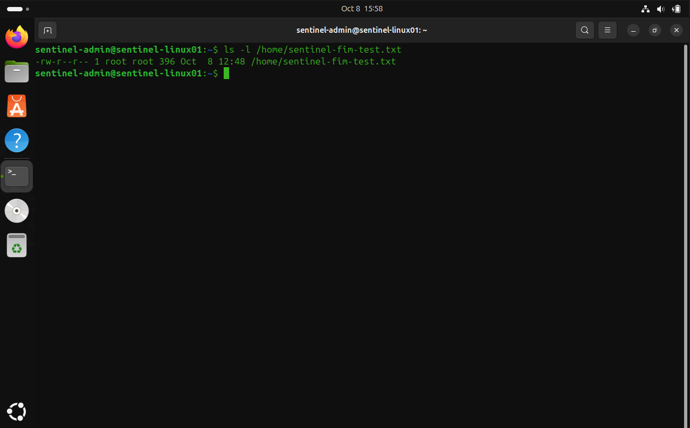

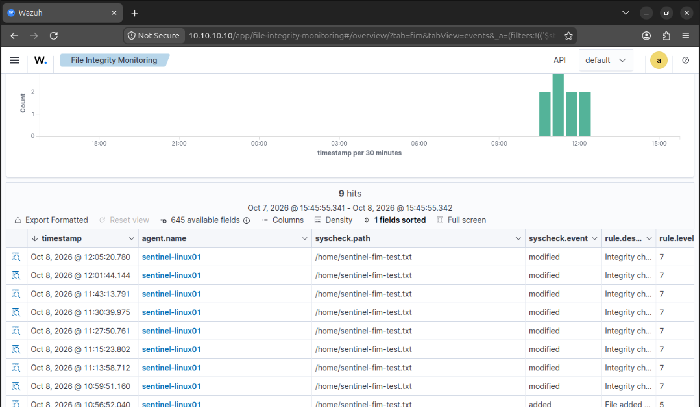

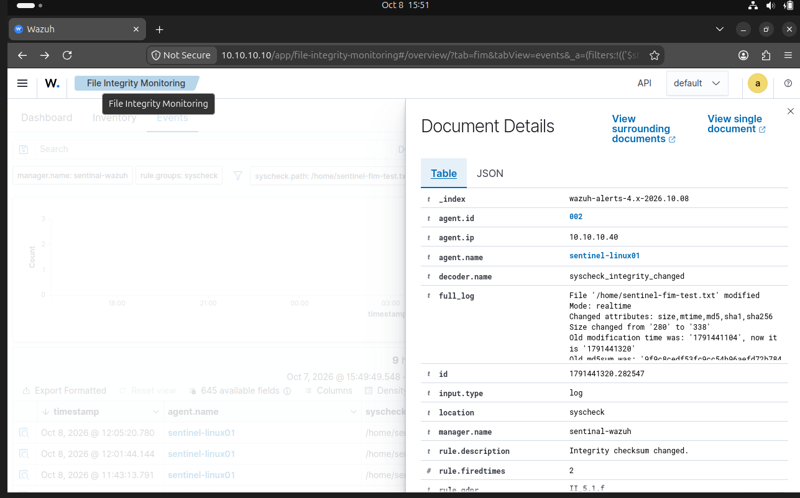

- E01 records metadata for the controlled test file, E02 shows the filtered FIM events reviewed, and E03 captures a built-in Rule `550` alert.
- Rule `550` and custom Rule `100002` are distinct rules. Evidence of one does not independently validate the other.

---

## 2. Custom Rule 100002: October 11 Modification Test (E04, E05)

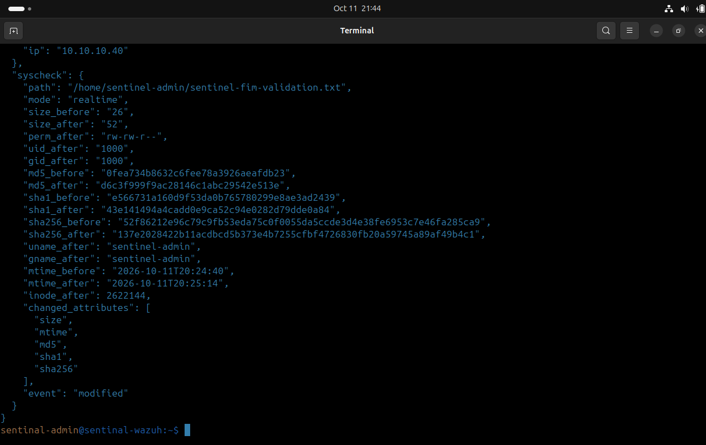

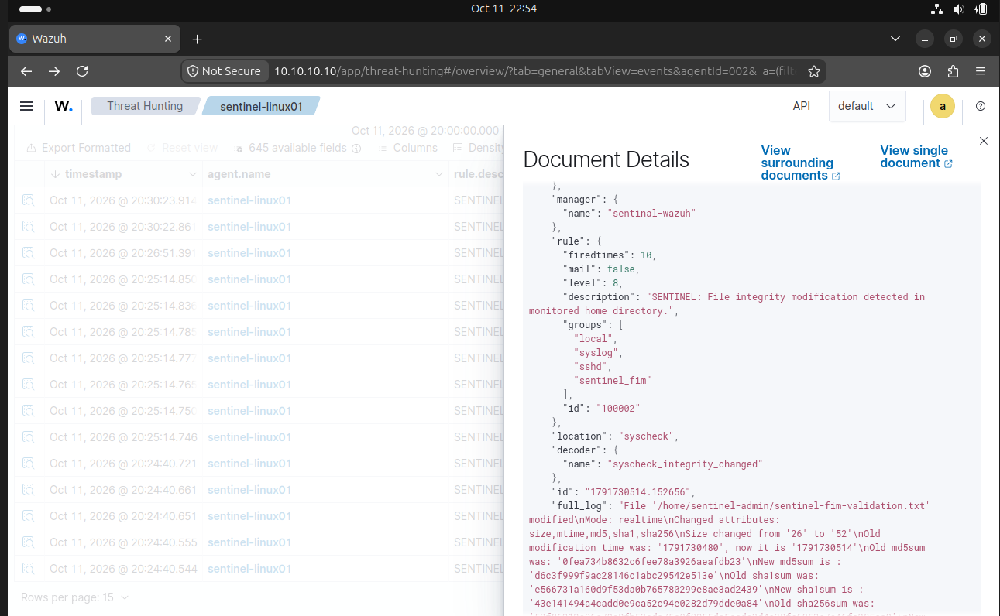

| Field | Value |
|---|---|
| Rule ID | `100002` |
| Alert level | `8` |
| Description | SENTINEL: File integrity modification detected in monitored home directory. |
| Event timestamp | `2026-10-11T20:25:14.746+0530` |

- **Source record:** the original source alert record was not recovered; this test is supported by the screenshots.
- **Scope:** the tested modification scenario only.

---

## 3. October 16 Creation and Deletion: Built-in Rules (E06–E09)

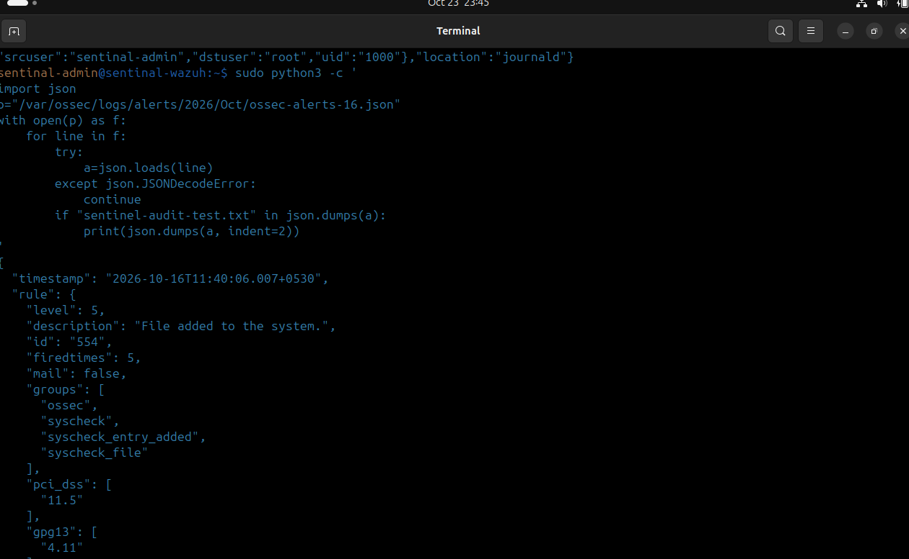

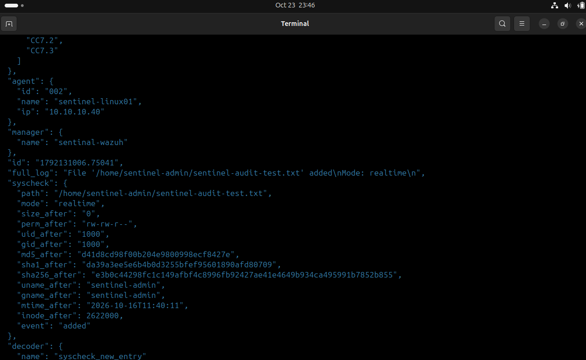

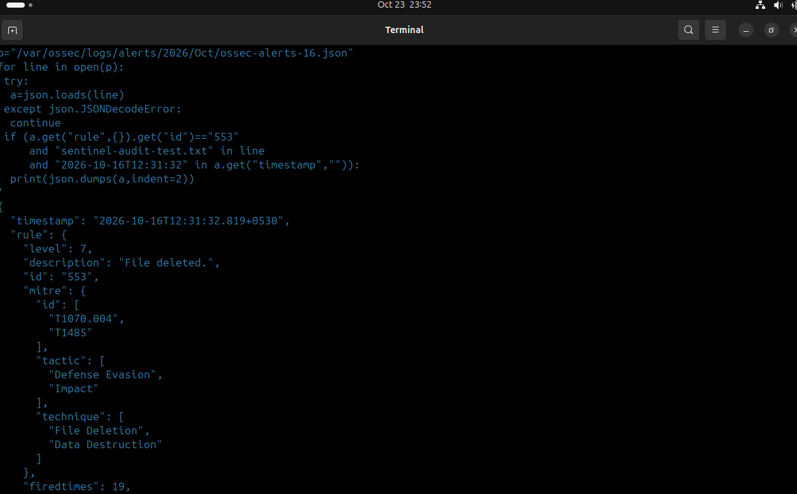


**From the reviewed source alert records**

| Test | Rule | Level | Timestamp | Test file | `100002` |
|---|---|---|---|---|---|
| Creation | Built-in `554`, "File added to the system." | `5` | `2026-10-16T11:40:06.007+0530` | `/home/sentinel-admin/sentinel-audit-test.txt` | Absent |
| Deletion | Built-in `553`, "File deleted." | `7` | `2026-10-16T12:31:32.819+0530` | Same path | Absent |

The screenshots are visual references for the alerts and paths. The absence of Rule `100002` rests on review of the source records, not on the screenshots alone.

> **Observation, not a conclusion:** the reason for `100002` being absent is unresolved, including whether and how it was deployed or loaded at that time. No root cause, detection failure or malicious activity is established. These results apply to the reviewed records only, are historical, and are not custom-rule validations. Later sessions (Sections 5–7) and the November 3 on-disk check (Section 9) do not explain them.

---

## 4. Custom Rule 100002: October 26 Modification Test (E10)

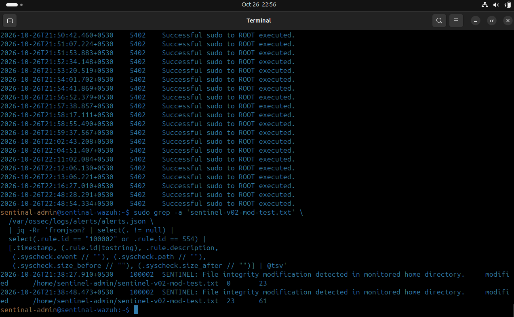

- **Test file:** `/home/sentinel-admin/sentinel-v02-mod-test.txt`
- **Observed:** two Level 8 Rule `100002` alerts from two consecutive modifications of one file:
  - `2026-10-26T21:38:27.910+0530`: 0 to 23 bytes.
  - `2026-10-26T21:38:48.473+0530`: 23 to 61 bytes.
- **Scope:** two alert events from one file, not two independent test cases or a regression suite.
- **Location:** stored in `evidence/v0.2/` and referenced here, not copied.

---

## 5. Custom Rules 100003 and 100004: October 31 (two separate evidence sets)

The two sets below involve different files and different timestamps. Their relationship (same session, related activity, or unrelated) has not been established. They must not be read as one test.

### 5A. Screenshot: application configuration path (E13)

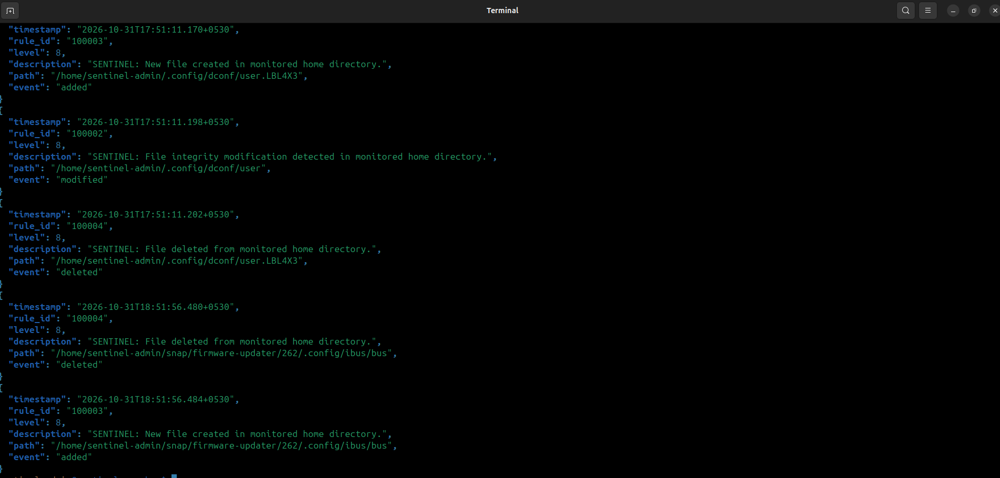

| Rule | Event | Alert level | Approx. time | Path |
|---|---|---|---|---|
| `100003` | Creation | `8` | ~18:51:56 IST | Under `/home/sentinel-admin/snap/firmware-updater/262/.config/bus/` |
| `100004` | Deletion | `8` | ~18:51:56 IST | Same directory |

- Both alerts identify the affected file path, which is in an application configuration directory.
- The screenshot does not show whether the events were deliberately triggered or ordinary application activity. Trigger origin, process attribution and root cause are unknown.
- Each rule is evidenced by a single event in a terminal screenshot. No raw alert record for this set is committed.
- These are not repeatable controlled tests.

### 5B. Raw alert JSON: `sentinel-v03-controlled-test.txt` (E17, E18)

| Event | Rule | Level | Timestamp | File | Record |
|---|---|---|---|---|---|
| Creation | `100003` | `8` | `2026-10-31T22:56:46.988+0530` | `/home/sentinel-admin/sentinel-v03-controlled-test.txt` | [E17](raw-alerts/sentinel-v03-creation-alert.json) |
| Deletion | `100004` | `8` | `2026-10-31T23:27:05.164+0530` | Same file | [E18](raw-alerts/sentinel-v03-deletion-alert.json) |

- **Establishes:** two committed raw alert records show custom Rules `100003` and `100004` firing at Level 8 for the same file.
- **Does not establish:** a lifecycle test. No modification record exists for this file in this set, so this is creation and deletion only.
- **Relationship to 5A:** not established. Different file, different timestamps.

### Scope of both October 31 sets

- Neither converts the October 16 built-in-rule observations into custom-rule validations, and `100002` is not claimed to handle creation or deletion.
- Why `100003`/`100004` were observed on October 31 when `554`/`553` appeared on October 16 is unresolved; no explanation is established.

---

## 6. November 2 Controlled Lifecycle: Screenshot (E16)

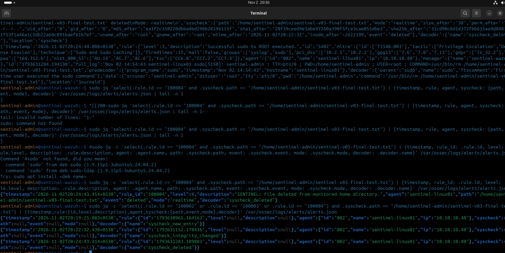

| Event | Event type | Rule | Alert level | File |
|---|---|---|---|---|
| Creation | added | `100003` | `8` | `/home/sentinel-admin/sentinel-v03-final-test.txt` |
| Modification | modified | `100002` | `8` | Same path |
| Deletion | deleted | `100004` | `8` | Same path |

- **Observed:** the terminal screenshot shows each lifecycle event matched by its corresponding custom rule at Level 8 for the same file path.
- **Scope:** one controlled session on one dedicated file, three event types.
- **Records:** terminal screenshot only. Exact alert timestamps are not recorded here, and raw alert JSON for this session is not committed.
- **Separation:** distinct from the October 31 sets and from the November 18 session (Section 7). It does not explain the October 16 results.

---

## 7. November 18 Controlled Lifecycle: Raw JSON (E19, E20)

Evidence file: [`raw-alerts/fim-lifecycle-evidence.json`](raw-alerts/fim-lifecycle-evidence.json) (three Wazuh alert records, one file). Manifest: [`raw-alerts/SHA256SUMS`](raw-alerts/SHA256SUMS), which has three entries covering all three raw alert JSON files (E17, E18, E19).

| Event | Rule | Level | Timestamp | File |
|---|---|---|---|---|
| Creation | `100003` | `8` | `2026-11-18T12:57:06.508+0530` | `/home/sentinel-admin/fim-sprint-test.txt` |
| Modification | `100002` | `8` | `2026-11-18T12:59:29.407+0530` | Same path |
| Deletion | `100004` | `8` | `2026-11-18T13:04:23.506+0530` | Same path |

**Record details (from the JSON):**

- All three records identify Agent `002`, `sentinel-linux01`, IP `10.10.10.40`, and real-time Syscheck events.
- Inode `2622203` appears in the records. The modification record contains before-and-after hashes; the deletion record contains the final file hash.

**Checksum:** the SHA-256 recorded for this evidence is `d3765e7240462b21d82b7ae8e7f772beeb8c57420f80d3e306024fb9ed32b2b6`, with the manifest at `raw-alerts/SHA256SUMS`. This index records the value; it does not claim independent verification.

**Establishes:**

- In one controlled session, custom Rules `100003`, `100002` and `100004` each fired at Level 8 for creation, modification and deletion of the same file, as raw alert records from the endpoint agent.
- The matching inode and hash transitions support the interpretation that the three records concern the same file across the creation, modification and deletion sequence.

**Does not establish:**

- A detection rate, repeatability, complete coverage, or a regression suite. Together with November 2, this is two single-file sessions.
- Behavior for other paths, file types, sizes, or concurrent events.
- Process attribution, or which rule definition and Syscheck configuration were loaded in memory.
- Anything about the October 16 results, or any relationship to the November 2 session.
- Malicious activity. No malicious indicators were identified in the reviewed events.

---

## 8. FIM Configuration Evidence (E14, E15)

The two configuration screenshots come from different hosts and serve different purposes. Neither substitutes for the other. **Endpoint `/home` monitoring is attributed only to E14.** Manager-side settings (E15) are not evidence of endpoint coverage. Both show local configuration files as captured; neither establishes which configuration was loaded during the historical October 16 tests.

### Endpoint configuration: SENTINEL-LINUX01 (E14)

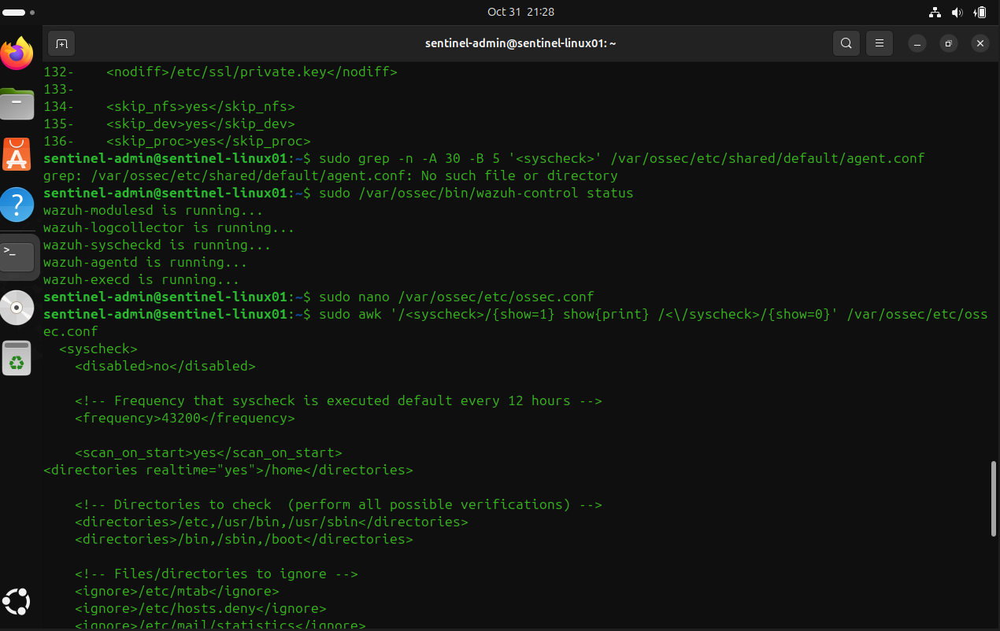

The screenshot shows the endpoint's local `/var/ossec/etc/ossec.conf` with these visible Syscheck settings:

```xml
<syscheck>
  <disabled>no</disabled>
  <frequency>43200</frequency>
  <scan_on_start>yes</scan_on_start>
  <directories realtime="yes">/home</directories>
</syscheck>
```

Verified from the visible settings:

- Syscheck is enabled.
- `/home` is included in the endpoint's local FIM configuration, with real-time monitoring.
- Startup scanning is enabled.
- Scheduled scan frequency is 43,200 seconds (12 hours).

Limits: this is the endpoint's *local* configuration as visible in the screenshot. It does not establish which configuration was loaded during the October 16 tests, whether centrally pushed settings apply, or why `100002` was absent on October 16.

### Manager configuration: SENTINEL-WAZUH (E15)

> Filename unverified: `CASE-001.md` references a differently named file (`v0.3-e14-manager-syscheck-configuration.png`). See the path verification note under the Evidence Index. The image below may not render if the indexed path does not exist.

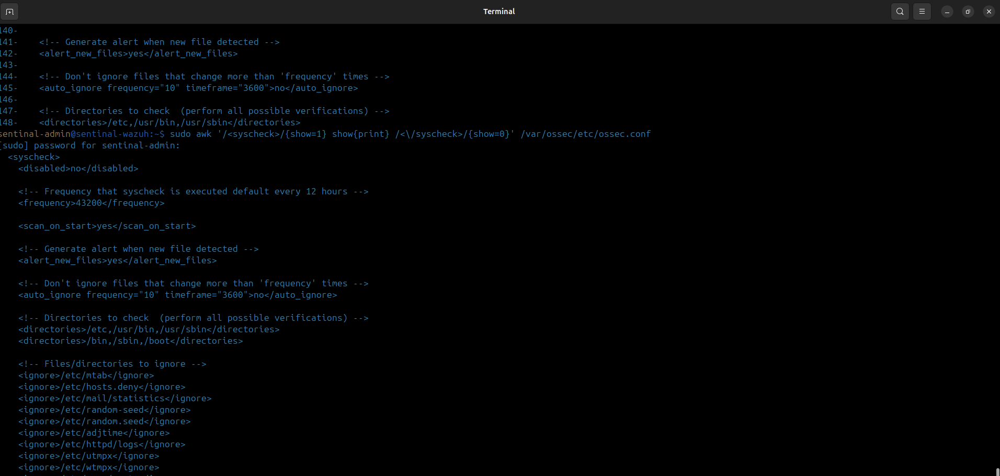

The screenshot shows the manager's local `/var/ossec/etc/ossec.conf` with these visible settings:

- `<disabled>no</disabled>`
- `<scan_on_start>yes</scan_on_start>`
- `<alert_new_files>yes</alert_new_files>`
- `<directories>/etc,/usr/bin,/bin,/usr/sbin</directories>`

Limits:

- This is **manager-side** evidence only. It lists no `/home` directory and must **not** be read as evidence for or against `/home` monitoring on the endpoint.
- It does not establish which configuration was loaded during the October 16 tests or why `100002` was absent on October 16.

---

## 9. Custom Rule 100002: Rule Definition (E11)

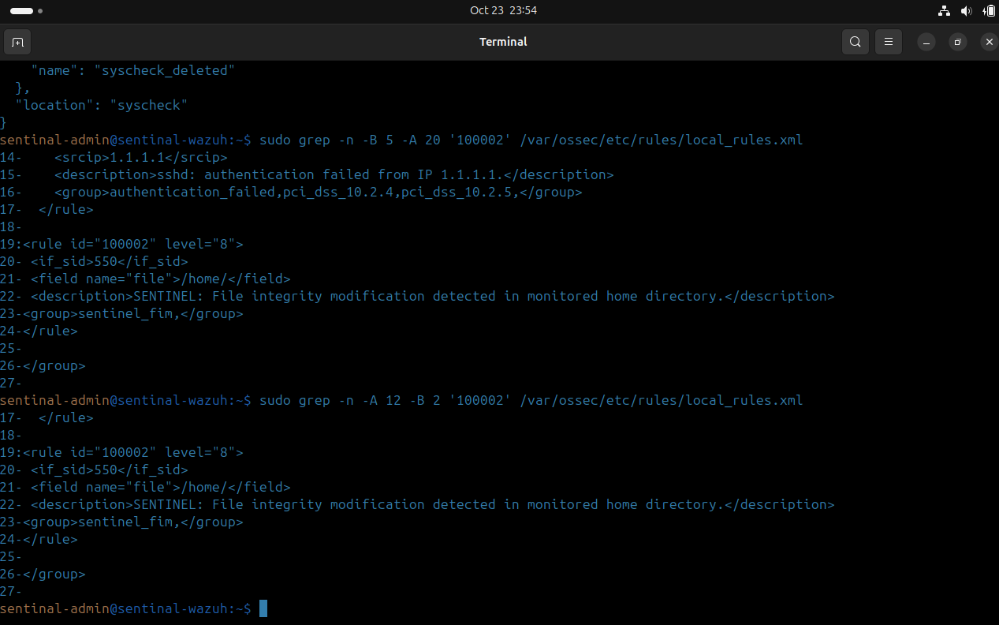

The screenshot (E11) provides supporting evidence of the custom rule definition.

**November 3 configuration verification (on-disk definition and service state).** A read-only check of `/var/ossec/etc/rules/local_rules.xml` on SENTINEL-WAZUH confirmed the following **on-disk** definition:

```xml
<rule id="100002" level="8">
  <if_sid>550</if_sid>
  <field name="file">^/home/</field>
  <description>SENTINEL: File integrity modification detected in monitored home directory.</description>
  <group>sentinel_fim,</group>
</rule>
```

Confirmed:

- **Rule ID and level:** `100002`, Level `8`.
- **Parent rule:** `<if_sid>550</if_sid>`.
- **File condition:** `^/home/`.
- **Analysis engine state:** `wazuh-analysisd` was running during the November 3 check.
- **Configuration chronology:** the on-disk rule file modification time preceded the analysis engine's start time. This is consistent with the engine starting after the file was modified.
- **Method:** read-only; no configuration change or restart was performed. Recorded as a maintainer-run check; no screenshot of it is indexed in this directory.

**Not verified:**

- The exact rule definition **loaded in memory** by the analysis engine. The chronology above is consistent with, but does not prove, the engine having loaded this definition.
- Which rule definition and Syscheck configuration were loaded during the October 16 tests.
- Why Rule `100002` was absent from the reviewed October 16 records. The `<if_sid>550</if_sid>` dependency is not established as the cause.
- The definitions of Rules `100003` and `100004`, which are not covered by any screenshot in this directory.

---

## 10. Investigation Report (E12)

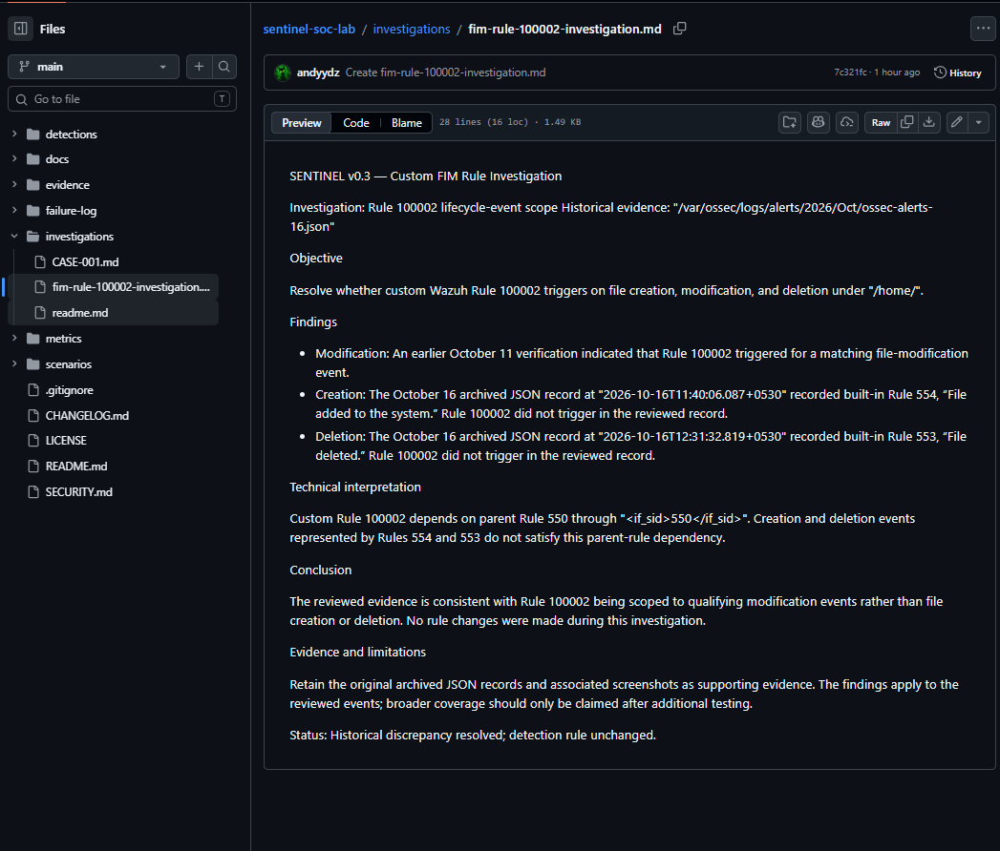

- Detailed findings: [FIM Rule 100002 investigation report](../../investigations/fim-rule-100002-investigation.md).
- This screenshot shows how the report appears on GitHub. It is not independent proof of detection.

---

## Evidence Limitations

- **Raw JSON coverage:** committed only for October 31 (controlled-test file, creation and deletion) and November 18. October 11 (not recovered), the October 31 screenshot set (E13) and November 2 (E16) rest on screenshots without committed raw records. October 16 findings rest on reviewed historical source records, with screenshots as visual references.
- **Screenshots vs. records:** screenshot-based results show only what is visibly captured; exact timestamps are not available for E13 (approximate) or E16 (not recorded).
- **Sessions:** the November 2 and November 18 sessions are single-file, single-session results. Neither shows repeatability, a detection rate, or complete coverage, and neither explains the October 16 results.
- **Configuration screenshots:** E14 and E15 have different purposes and show local files as captured. They do not establish which configuration was loaded during the October 16 tests, and E15 does not show endpoint `/home` monitoring.
- **Rule definition:** the November 3 check verified the on-disk Rule `100002` definition and service state only, not the in-memory rule or the October 16 definition, and is not covered by an indexed screenshot.
- **Attribution:** the `snap/firmware-updater` paths and other background events have not been independently attributed to a process.
- **Checksums:** the manifest covers all three raw alert JSON files. The recorded checksum values are not independently verified in this document.
- **Coverage:** creation and deletion have been observed only for the paths listed above; other directories, multiple files and concurrent events remain untested. Modification was tested for its respective test files only.
- No false-positive or false-negative testing is documented here.

## Remaining Work

These are evidence-level gaps and broader follow-up or future validation work recorded in this index. They are separate from, and do not invalidate, the CASE-001 closure of 18 November 2026 for its defined investigation scope.

- Verify the loaded (in-memory) definition of Rule `100002`, and review the on-disk and loaded definitions of Rules `100003` and `100004` and built-in Rules `550`, `553`, `554`. Confirm which rule version and which Syscheck configuration (endpoint and manager) were loaded on October 16.
- Investigate the differences between the October 16 and October 31 observations; no explanation is established.
- Establish whether the two October 31 evidence sets are related, and the trigger for each.
- Export raw alert records for October 16, October 26 and November 2 where available, and for the October 31 screenshot set (E13) if recoverable.
- Develop a repeatable test procedure across multiple files, paths and repetitions, building on the November 2 and November 18 sessions.
- Develop false-positive and false-negative test cases; review noisy FIM events.
- No containment, eradication, or recovery exercise has been completed.

---

## Scope Statement

These screenshots and records document specific detection observations and investigation checkpoints. They are not evidence that every detection scenario has been tested, that FIM coverage is complete, or that the SENTINEL SOC workflow is finished. The November 2 and November 18 results are each a single controlled lifecycle session on one dedicated file, not a regression suite or a detection rate. The October 31 raw records document creation and deletion only. The November 3 check verified the on-disk Rule `100002` definition and service state only. A FIM alert alone does not indicate malicious activity, and no malicious indicators were identified in the reviewed events. The SENTINEL v0.3 phase milestone and its documentation and evidence deliverables are complete, and CASE-001 was closed on 18 November 2026 for its defined investigation scope. That completed scope is distinct from the broader ongoing SENTINEL engineering and validation work (including loaded-configuration verification, repeatable regression testing, and false-positive/false-negative testing), which remains outstanding and is not a condition of the CASE-001 closure.

---

## Related Documentation

| Document | Path |
|---|---|
| CASE-001: full timeline, technical findings, severity classification, limitations and follow-up actions | [`CASE-001`](../../investigations/CASE-001.md) |
| FIM Rule 100002 investigation report | [`fim-rule-100002-investigation`](../../investigations/fim-rule-100002-investigation.md) |
| Detection methodology and remaining validation work | [`Detection Engineering`](../../docs/05-detection-engineering.md) |

---

SENTINEL v0.3: SOC Investigation Evidence
