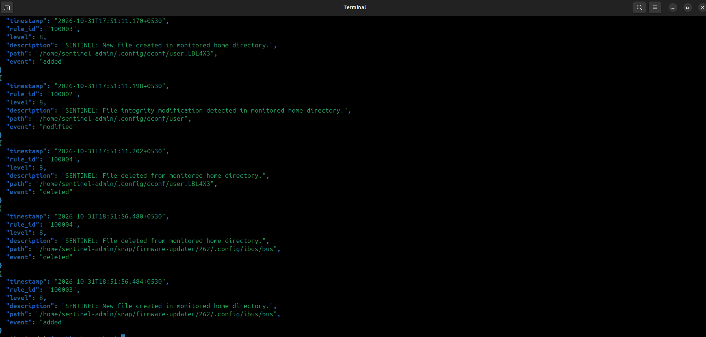

# SENTINEL v0.3: SOC Investigation Evidence

## FIM detection evidence for CASE-001: modification, creation, and deletion

This directory is the evidence index for the SENTINEL v0.3 SOC investigation checkpoint. It covers endpoint file metadata, Wazuh File Integrity Monitoring (FIM) events, custom Rules `100002`, `100003` and `100004`, built-in alerts from the October 16 tests, and FIM configuration evidence from the endpoint and the manager.

The evidence supports the specific results described below. It does not establish complete FIM coverage, repeatable detection, or a comprehensive endpoint forensic assessment. The full timeline, technical findings, severity classification, limitations and follow-up actions are in [CASE-001](../../investigations/CASE-001.md); this README does not duplicate them.

## Status

- SENTINEL v0.3 is in progress.
- Evidence reconciliation for the reviewed CASE-001 scope is closed. The broader CASE-001 investigation and detection-engineering work remain open.
- No containment, eradication, or recovery exercise has been completed.

## How to Read This Evidence

- **Direct evidence:** a screenshot or record directly showing an alert, configuration or event.
- **Supporting evidence:** context that does not independently establish a detection result.
- **Screenshots are not raw alert exports.** They show only what is visibly captured. Findings that rest on reviewed source records (the October 16 timestamps and the absence of Rule `100002`) are marked as such.
- The absence of Rule `100002` from the October 16 records is an **observation**, not a confirmed detection failure. Its cause is unresolved.

### Severity terms

These classifications measure different things and must not be compared or substituted:

| Term | Value | What it measures |
|---|---|---|
| CASE-001 administrative investigation classification | **Low** | An administrative classification of the CASE-001 investigation for its reviewed scope. It is not the severity or impact assessment of any individual alert. |
| Custom Wazuh alert level (Rules `100002`, `100003`, `100004`) | **Level 8** | The level assigned to each alert by its rule definition. It is not an assessment of case severity or impact. |
| October 16 built-in alert levels | **5** (Rule `554`), **7** (Rule `553`) | Default levels of the built-in Wazuh rules for file creation and deletion. |

## Custom Rule Observations

| Rule | Event | Alert level | Observed | Basis |
|---|---|---|---|---|
| `100002` | Modification | 8 | October 11 and October 26 | Screenshots; terminal output |
| `100003` | Creation | 8 | October 31 | Terminal screenshot |
| `100004` | Deletion | 8 | October 31 | Terminal screenshot |

These are separate testing milestones, not one end-to-end lifecycle test or a regression suite:

- **October 11 and 26:** Rule `100002` detected modification events. October 26 shows two alerts from consecutive modifications of one file; they are not two independent tests.
- **October 16:** creation produced built-in Rule `554` (Level 5) and deletion produced built-in Rule `553` (Level 7). Custom Rule `100002` was absent from both reviewed records; the reason is unresolved. These are not custom-rule validations.
- **October 31:** Rule `100003` (creation) and Rule `100004` (deletion) were observed at Level 8, at approximately 18:51:56 IST, with paths under the `snap/firmware-updater` application configuration directory. These are observed detections. Whether the events were deliberately triggered or ordinary application activity has not been established.

---

## Evidence Index

| ID | Evidence filename | Type | Description | Supported finding |
|---|---|---|---|---|
| E01 | [`v0.3-case001-endpoint-file-metadata.png`](screenshots/v0.3-case001-endpoint-file-metadata.png) | Supporting (investigation) | Metadata for the controlled test file | Test artifact context |
| E02 | [`v0.3-case001-fim-filtered-events.png`](screenshots/v0.3-case001-fim-filtered-events.png) | Supporting (investigation) | Filtered FIM events reviewed in CASE-001 | Event-review stage |
| E03 | [`v0.3-case001-rule-550-event-details.png`](screenshots/v0.3-case001-rule-550-event-details.png) | Direct (detection) | Built-in Rule `550` integrity-checksum-change alert | Built-in detection path |
| E04 | [`v0.3-custom-rule-100002.png`](screenshots/v0.3-custom-rule-100002.png) | Direct (detection) | Custom Level 8 alert, Oct 11 modification test | `100002` modification |
| E05 | [`v0.3-custom-rule-100002-dashboard-json.png`](screenshots/v0.3-custom-rule-100002-dashboard-json.png) | Direct (alert JSON / event fields) | Event fields for the Oct 11 alert | `100002` modification |
| E06 | [`v0.3-oct16-creation-rule-554.png`](screenshots/v0.3-oct16-creation-rule-554.png) | Direct (detection) | Built-in "File added to the system" alert | Oct 16 creation, Rule `554` |
| E07 | [`v0.3-oct16-creation-file-path.png`](screenshots/v0.3-oct16-creation-file-path.png) | Supporting (event field) | Test-file path on the creation event | Oct 16 creation |
| E08 | [`v0.3-oct16-detection-rule-553.png`](screenshots/v0.3-oct16-detection-rule-553.png) | Direct (detection) | Built-in "File deleted" alert | Oct 16 deletion, Rule `553` |
| E09 | [`v0.3-oct16-detection-file-path.png`](screenshots/v0.3-oct16-detection-file-path.png) | Supporting (event field) | Test-file path on the deletion event | Oct 16 deletion |
| E10 | [`v0.2-oct26-controlled-modification-source-alerts-new.png`](../v0.2/screenschots/v0.2-oct26-controlled-modification-source-alerts-new.png) | Direct (detection) | Terminal output of two Level 8 `100002` alerts (stored in `evidence/v0.2/`; existing directory spelling preserved) | `100002` modification, Oct 26 |
| E11 | [`v0.3-rule-100002-definition.png`](screenshots/v0.3-rule-100002-definition.png) | Supporting (rule configuration) | Reported configuration of custom Rule `100002` | Rule logic context |
| E12 | [`v0.3-fim-rule-100002-investigation-github.png`](screenshots/v0.3-fim-rule-100002-investigation-github.png) | Supporting (investigation) | How the report appears on GitHub; not proof of detection | Documentation |
| E13 | [`v0.3-fim-lifecycle-custom-detections.png`](screenshots/v0.3-fim-lifecycle-custom-detections.png) | Direct (detection) | Terminal screenshot of Rules `100003` and `100004` alerts, Oct 31 | `100003` creation; `100004` deletion |
| E14 | `[PENDING EVIDENCE: filename not supplied; repository presence not verified]` | Direct (endpoint configuration), pending | Local `/var/ossec/etc/ossec.conf` on SENTINEL-LINUX01, reviewed by the maintainer | Endpoint Syscheck configuration, including `/home` |
| E15 | `[PENDING EVIDENCE: filename not supplied; photograph not committed]` | Direct (manager configuration), pending | `/var/ossec/etc/ossec.conf` on SENTINEL-WAZUH | Manager-side configuration only; not endpoint evidence |

> **Filename note:** The deletion screenshots (E08, E09) keep their existing `detection` filenames. Descriptive text uses "deletion". No operational-recovery screenshots are indexed in this directory.

---

## 1. Test-File Metadata and Event Review (E01–E03)


- E01 records metadata for the controlled test file, E02 shows the filtered FIM events reviewed, and E03 captures a built-in Rule `550` alert.
- Rule `550` and custom Rule `100002` are distinct rules. Evidence of one does not independently validate the other.

---

## 2. Custom Rule 100002: October 11 Modification Test (E04, E05)


| Field | Value |
|---|---|
| Rule ID | `100002` |
| Alert level | `8` |
| Description | SENTINEL: File integrity modification detected in monitored home directory. |
| Event timestamp | `2026-10-11T20:25:14.746+0530` |

- **Source record:** the original source alert record was not recovered; this test is supported by the screenshots.
- **Scope:** the tested modification scenario only.

---

## 3. October 16 Creation and Deletion: Built-in Rules (E06–E09)


**From the reviewed source alert records**

| Test | Rule | Level | Timestamp | Test file | `100002` |
|---|---|---|---|---|---|
| Creation | Built-in `554`, "File added to the system." | `5` | `2026-10-16T11:40:06.007+0530` | `/home/sentinel-admin/sentinel-audit-test.txt` | Absent |
| Deletion | Built-in `553`, "File deleted." | `7` | `2026-10-16T12:31:32.819+0530` | Same path | Absent |

The screenshots are visual references for the alerts and paths. The absence of Rule `100002` rests on review of the source records, not on the screenshots alone.

> **Observation, not a conclusion:** the reason for `100002` being absent is unresolved. No root cause, detection failure or malicious activity is established. These results apply to the reviewed records only. They are historical and are not custom-rule validations.

---

## 4. Custom Rule 100002: October 26 Modification Test (E10)


- **Test file:** `/home/sentinel-admin/sentinel-v02-mod-test.txt`
- **Observed:** two Level 8 Rule `100002` alerts from two consecutive modifications of one file:
  - `2026-10-26T21:38:27.910+0530`: 0 to 23 bytes.
  - `2026-10-26T21:38:48.473+0530`: 23 to 61 bytes.
- **Scope:** two alert events from one file, not two independent test cases or a regression suite.
- **Location:** stored in `evidence/v0.2/` and referenced here, not copied.

---

## 5. Custom Rules 100003 and 100004: October 31 Observation (E13)



| Rule | Event | Alert level | Approx. time | Path |
|---|---|---|---|---|
| `100003` | Creation | `8` | ~18:51:56 IST | Under `/home/sentinel-admin/snap/firmware-updater/262/.config/bus/` |
| `100004` | Deletion | `8` | ~18:51:56 IST | Same directory |

- Both alerts identify the affected file path.
- The paths are in an application configuration directory. The screenshot does not show whether the events were deliberately triggered or ordinary application activity.
- The alerts are **not repeatable controlled tests**. No trigger, process attribution or root cause is established.
- Each rule is evidenced by a single event in a terminal screenshot. Raw alert records are not committed.
- This does not convert the October 16 observations into custom-rule validations, and `100002` is not claimed to handle creation or deletion. Why `100003`/`100004` were observed on October 31 when `554`/`553` appeared on October 16 is unresolved.

---

## 6. FIM Configuration Evidence (E14, E15)

The two configuration screenshots come from different hosts and serve different purposes. Neither substitutes for the other. **Endpoint `/home` monitoring is attributed only to E14.** Manager-side settings (E15) are not evidence of endpoint coverage.

### Endpoint configuration: SENTINEL-LINUX01 (E14)

**Status:** reviewed by the maintainer; **pending evidence**. The final repository filename has not been supplied and presence in the repository is unverified, so no link is given.

The reviewed screenshot shows the local `/var/ossec/etc/ossec.conf` with these visible Syscheck settings:

```xml
<syscheck>
  <disabled>no</disabled>
  <frequency>43200</frequency>
  <scan_on_start>yes</scan_on_start>
  <directories realtime="yes">/home</directories>
</syscheck>
```

Verified from the visible settings:

- Syscheck is enabled.
- `/home` is included in the endpoint's local FIM configuration, with real-time monitoring.
- Startup scanning is enabled.
- Scheduled scan frequency is 43,200 seconds (12 hours).

Limits: this is the endpoint's *local* configuration as visible in the screenshot. It does not establish which configuration was loaded during the October 16 tests, whether centrally pushed settings apply, or why `100002` was absent on October 16.

### Manager configuration: SENTINEL-WAZUH (E15)

**Status:** **pending evidence**. The photograph has not been committed and no filename has been supplied, so no link is given.

The October 31 manager-side screenshot of `/var/ossec/etc/ossec.conf` shows `<disabled>no</disabled>`, `<scan_on_start>yes</scan_on_start>`, `<alert_new_files>yes</alert_new_files>` and `<directories>/etc,/usr/bin,/bin,/usr/sbin</directories>`.

- This is **manager-side** evidence only. It lists no `/home` directory and must **not** be read as evidence for or against `/home` monitoring on the endpoint.

---

## 7. Custom Rule 100002: Rule Definition (E11)


- **Reported dependency:** described as using `<if_sid>550</if_sid>`, tying it to events matched by built-in Rule `550`.
- **Reported path condition:** a match on `/home/`; exact matching behavior is unverified.
- **Limits:** it does not establish which definition was loaded during the October 16 tests, and the active configuration has not been re-verified here. The reported dependency is not established as the cause of `100002` being absent on October 16.
- The definitions of Rules `100003` and `100004` are not covered by any screenshot in this directory.

---

## 8. Investigation Report (E12)


- Detailed findings: [FIM Rule 100002 investigation report](../../investigations/fim-rule-100002-investigation.md).
- This screenshot shows how the report appears on GitHub. It is not independent proof of detection.

---

## Evidence Limitations

- **October 31:** the custom creation and deletion findings rely on a terminal screenshot. Raw alert records are not committed.
- **October 16:** findings rest on reviewed historical source records; screenshots are visual references.
- **October 11:** the original source log was unavailable during the later review.
- **Configuration screenshots:** endpoint (E14) and manager (E15) evidence have different purposes and are kept separate. E14 shows local configuration only.
- **Pending evidence:** E14 and E15 are indexed as pending. Their findings rest on maintainer review and cannot be checked by a reader until the screenshots are committed and linked.
- **Attribution:** the `snap/firmware-updater` paths and other background events have not been independently attributed to a process.
- **Coverage:** creation and deletion have each been observed for limited paths only; other directories, multiple files and repeated events remain untested. Modification was tested for its respective test files only.
- No false-positive or false-negative testing is documented here.

## Remaining Work

- Review the active definitions of Rules `100002`, `100003` and `100004` and built-in Rules `550`, `553`, `554`; confirm which rule version was loaded on October 16.
- Explain the differences between the October 16 and October 31 observations.
- Export raw alert records for October 16, 26 and 31 where available.
- Develop repeatable creation, modification and deletion tests using dedicated test files.
- Develop false-positive and false-negative test cases; review noisy FIM events.
- No containment, eradication, or recovery exercise has been completed.

---

## Scope Statement

These screenshots document specific detection observations and investigation checkpoints. CASE-001 evidence reconciliation is closed for the reviewed scope; the broader investigation and detection-engineering work remain open. They are not evidence that every detection scenario has been tested, that FIM coverage is complete, or that the SENTINEL SOC workflow is finished. A FIM alert alone does not indicate malicious activity, and no malicious indicators were identified in the reviewed events. SENTINEL v0.3 remains in progress, and the broader CASE-001 investigation remains open.

---

## Related Documentation

| Document | Path |
|---|---|
| CASE-001: full timeline, technical findings, severity classification, limitations and follow-up actions | [`CASE-001`](../../investigations/CASE-001.md) |
| FIM Rule 100002 investigation report | [`fim-rule-100002-investigation`](../../investigations/fim-rule-100002-investigation.md) |
| Detection methodology and remaining validation work | [`Detection Engineering`](../../docs/05-detection-engineering.md) |

---

SENTINEL v0.3: SOC Investigation Evidence
