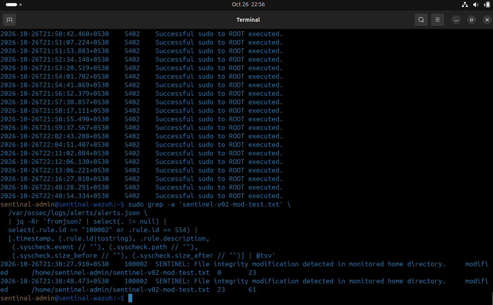
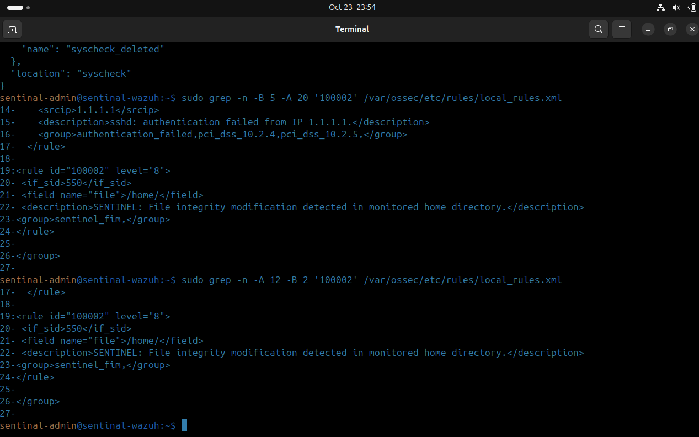
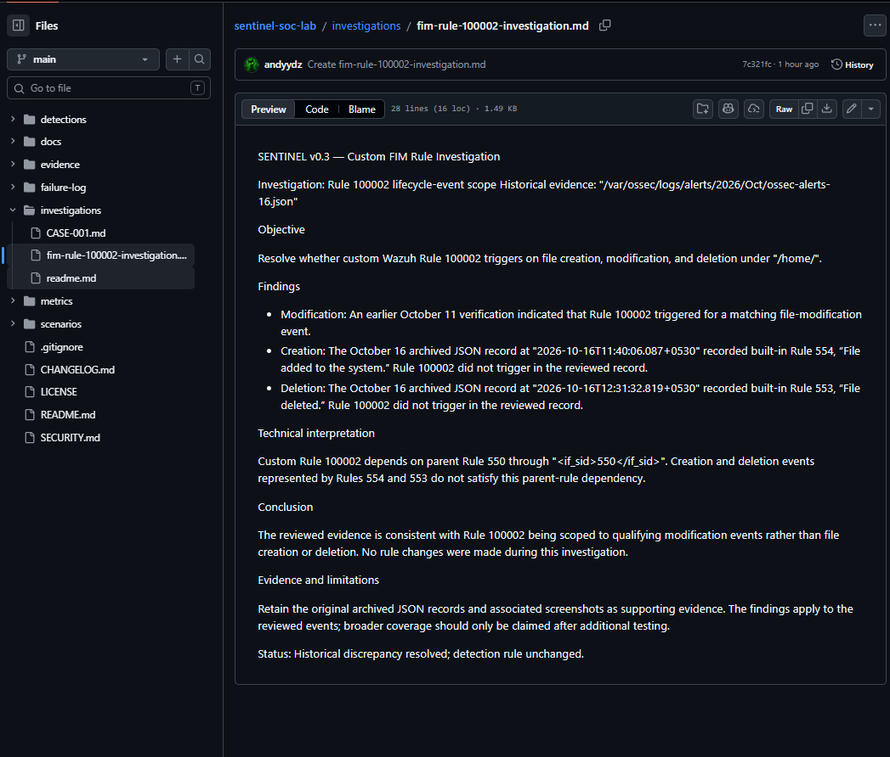

# SENTINEL v0.3 — SOC Investigation Evidence

## Controlled FIM detection validation for CASE-001: modification, creation, and deletion

This directory contains screenshots supporting the SENTINEL v0.3 SOC investigation checkpoint: endpoint file metadata, Wazuh File Integrity Monitoring (FIM) events, validation of custom detection Rule `100002`, and follow-up file-creation and deletion tests that generated built-in Wazuh alerts. One further modification test (26 October) is referenced from `evidence/v0.2/`.

The evidence supports the specific results described below. It does not establish complete FIM coverage or a comprehensive endpoint forensic assessment.

---

## Evidence Overview

| # | Evidence | File | What it supports |
|---|----------|------|------------------|
| 1 | CASE-001 endpoint file metadata | [`v0.3-case001-endpoint-file-metadata.png`](v0.3-case001-endpoint-file-metadata.png) | Metadata for the controlled test file |
| 2 | CASE-001 filtered FIM events | [`v0.3-case001-fim-filtered-events.png`](v0.3-case001-fim-filtered-events.png) | FIM events reviewed during the investigation |
| 3 | CASE-001 Rule 550 event details | [`v0.3-case001-rule-550-event-details.png`](v0.3-case001-rule-550-event-details.png) | Built-in integrity-checksum-change alert |
| 4 | Custom Rule 100002 alert | [`v0.3-custom-rule-100002.png`](v0.3-custom-rule-100002.png) | Custom Level 8 alert from the Oct 11 modification test |
| 5 | Custom Rule 100002 dashboard JSON | [`v0.3-custom-rule-100002-dashboard-json.png`](v0.3-custom-rule-100002-dashboard-json.png) | Event fields used to verify the alert |
| 6 | Oct 16 creation, Rule 554 | [`v0.3-oct16-creation-rule-553.png`](v0.3-oct16-creation-rule-553.png) | Built-in "File added to the system" alert (the filename contains `553`, but the content shows Rule `554`) |
| 7 | Oct 16 creation, file path | [`v0.3-oct16-creation-file-path.png`](v0.3-oct16-creation-file-path.png) | Test-file path on the creation event |
| 8 | Oct 16 deletion, Rule 553 | [`v0.3-oct16-detection-rule-553.png`](v0.3-oct16-detection-rule-553.png) | Built-in "File deleted" alert |
| 9 | Oct 16 deletion, file path | [`v0.3-oct16-detection-file-path.png`](v0.3-oct16-detection-file-path.png) | Test-file path on the deletion event |
| 10 | Oct 26 modification, source alerts | [`v0.2-oct26-controlled-modification-source-alerts.png`](../v0.2/v0.2-oct26-controlled-modification-source-alerts.png) | Terminal output of two Level 8 Rule 100002 modification alerts (stored in `evidence/v0.2/`) |
| 11 | Rule 100002 definition | [`v0.3-rule-100002-definition.png`](v0.3-rule-100002-definition.png) | Reported configuration of the custom rule |
| 12 | Investigation report on GitHub | [`v0.3-fim-rule-100002-investigation-github.png`](v0.3-fim-rule-100002-investigation-github.png) | How the report appears on GitHub; not independent proof of detection |

---

## 1. CASE-001: Endpoint File Metadata

- **Purpose:** Records metadata for the controlled test file in the investigation scenario.
- **Evidence value:** Documents the test artifact and provides context for the file-integrity investigation.

---

## 2. CASE-001: Filtered FIM Events

- **Purpose:** Shows the filtered Wazuh FIM events reviewed during CASE-001.
- **Evidence value:** Demonstrates the event-review stage and helps identify the relevant integrity-change activity.

---

## 3. CASE-001: Built-in Rule 550 Event Details

- **Purpose:** Captures a built-in Wazuh Rule `550` (integrity checksum changed) alert.
- **Evidence value:** Provides context for the underlying FIM event and shows the built-in detection path observed during testing.

> **Note:** Rule 550 and custom Rule 100002 are distinct rules. Evidence of one does not independently validate the other.

---

## 4. Custom Rule 100002: October 11 Modification Test

| Field | Value |
|-------|-------|
| Rule ID | `100002` |
| Alert level | `8` |
| Description | SENTINEL: File integrity modification detected in monitored home directory. |
| Test objective | Confirm that the controlled file modification triggers the custom detection. |

- **Evidence value:** Supports successful validation of the custom modification-detection path for this controlled test.

### Dashboard event JSON

- **Purpose:** Captures the event details used to inspect and verify the alert.
- **Evidence value:** Supports verification of the rule ID, alert level, file path, event details, and integrity information visible in the captured event.
- **Timestamp:** The controlled validation event was recorded at `2026-10-11T20:25:14.746+0530`.

> Interpret the screenshots together with the investigation report, not as proof of broader detection coverage.

---

## 5. October 16 File-Creation Test: Built-in Rule 554

- **Rule:** Built-in Wazuh Rule `554`, "File added to the system."
- **Test file:** `/home/sentinel-admin/sentinel-audit-test.txt`
- **Reviewed event timestamp:** `2026-10-16T11:40:06.007+0530`
- **Observed result:** The reviewed creation record shows built-in Rule 554. Rule `100002` was absent from this record.

---

## 6. October 16 File-Deletion Test: Built-in Rule 553

- **Rule:** Built-in Wazuh Rule `553`, "File deleted."
- **Test file:** `/home/sentinel-admin/sentinel-audit-test.txt` (same path as the creation test)
- **Reviewed event timestamp:** `2026-10-16T12:31:32.819+0530`
- **Observed result:** The reviewed deletion record shows built-in Rule 553. Rule `100002` was absent from this record.

> These are observed results for the reviewed records only. They do not show how Rule `100002` behaves for other creation or deletion events.

---

## 7. Custom Rule 100002: October 26 Modification Test

- **Test file:** `/home/sentinel-admin/sentinel-v02-mod-test.txt`
- **Observed result:** Terminal output shows two Rule `100002` Level 8 modification alerts:
  - `2026-10-26T21:38:27.910+0530`: size 0 → 23 bytes.
  - `2026-10-26T21:38:48.473+0530`: size 23 → 61 bytes.
- **Evidence value:** Repeats the modification validation for this controlled test file only. The screenshot is stored in `evidence/v0.2/` and is referenced from here, not copied.

---

## 8. Custom Rule 100002: Rule Definition

- **Purpose:** Shows the reported configuration of the custom rule.
- **Reported dependency:** The rule has been described as using `<if_sid>550</if_sid>`, which would tie it to events already matched by built-in Rule 550. The active rule configuration and its matching behavior have not been re-verified during this documentation pass.
- **Reported path condition:** A match on `/home/` has been described; its exact matching behavior is unverified.
- **Relation to Oct 16 results:** Why Rule `100002` was absent from the reviewed creation and deletion records is unresolved. The reported Rule 550 dependency is not established here as the cause.

---

## 9. Investigation Report

- The detailed findings are in the [FIM Rule 100002 investigation report](../../investigations/fim-rule-100002-investigation.md).
- This screenshot documents how the report appears on GitHub. It is not independent proof of the underlying detection; the supporting evidence is in sections 1–8.

---

## Investigation Outcome

- The controlled October 11 modification test generated the expected custom Rule `100002` Level 8 alert.
- On October 26, terminal output showed two further Rule `100002` Level 8 modification alerts for `sentinel-v02-mod-test.txt`. Together with October 11, these validate the tested modification scenario only.
- The reviewed October 16 creation and deletion records showed built-in Rules `554` and `553`, respectively, with Rule `100002` absent from those records. The reason is unresolved.
- The CASE-001 reviewed event set also contained background configuration and cache changes. No malicious indicators were identified in that dataset, but the evidence does not establish process-level attribution for every event or prove that the endpoint was free of threats.
- Findings are documented in [CASE-001](../../investigations/CASE-001.md) and the [FIM Rule 100002 investigation report](../../investigations/fim-rule-100002-investigation.md).

---

## Limitations and Remaining Work

- Creation and deletion were each reviewed for a single test file path; other directories, multiple files, and repeated events remain untested. The October 11 and 26 modification tests likewise cover only their respective test files.
- Review the active Rule 100002 definition and determine why it was absent from the reviewed October 16 records.
- Decide whether file creation and deletion in `/home/` warrant custom detections.
- Review and tune noisy FIM events where appropriate.
- Develop systematic false-positive and false-negative test cases.
- Expand telemetry and investigation coverage as the project progresses.

---

## Scope Statement

These screenshots document specific, controlled detection-validation and investigation checkpoints. They are not evidence that every detection scenario has been tested, that FIM coverage is complete, or that the SENTINEL SOC workflow is finished.

---

## Related Documentation

| Document | Path |
|----------|------|
| Investigation findings and disposition (CASE-001) | [`CASE-001`](../../investigations/CASE-001.md) |
| FIM Rule 100002 investigation report | [`fim-rule-100002-investigation`](../../investigations/fim-rule-100002-investigation.md) |
| Detection methodology and remaining validation work | [`Detection Engineering`](../../docs/05-detection-engineering.md) |

---

SENTINEL v0.3 — SOC Investigation Evidence
