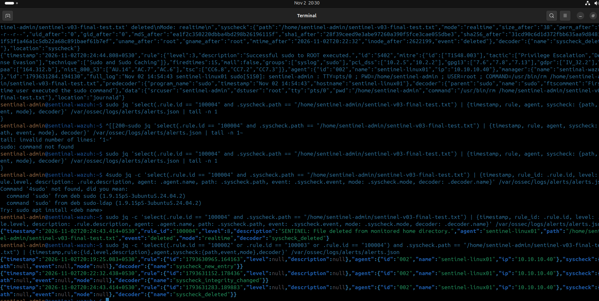
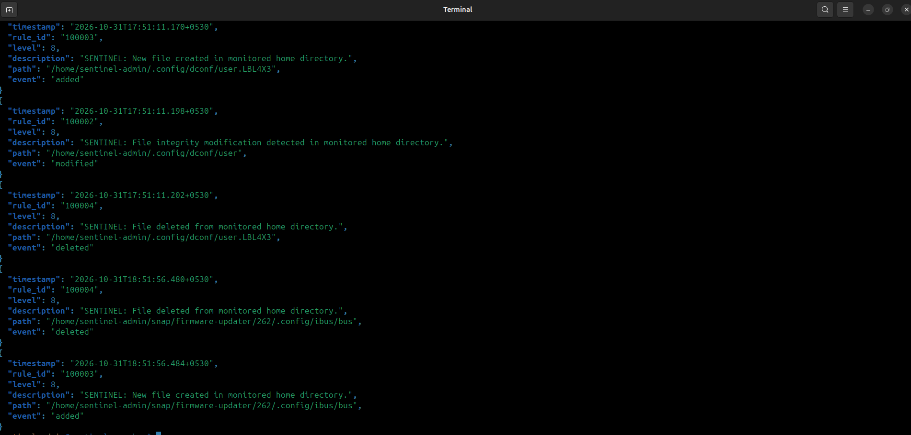

# CASE-001 — FIM Detection Validation and Evidence Reconciliation

| Field | Value |
|---|---|
| Case ID | CASE-001 |
| Project | SENTINEL — SOC Lab |
| Version | v0.3 — SOC Investigation |
| Status | Evidence reconciliation for the reviewed CASE-001 scope: Closed. Broader investigation, detection-engineering work and SENTINEL v0.3 work: Open / in progress |
| Severity | Low |
| Detection Source | Wazuh File Integrity Monitoring (FIM) |
| Custom Rules | 100002 (modification), 100003 (creation), 100004 (deletion) |
| Endpoint | SENTINEL-LINUX01 (10.10.10.40), Agent ID 002 |

> Severity note: Case severity Low is an administrative investigation classification for this case's reviewed scope. It is not the severity level assigned to an individual Wazuh alert. The custom detections discussed here generated Level 8 alerts, while the October 16 built-in alerts were Levels 5 and 7.

---

## Executive Summary

This case reviewed Wazuh FIM detections on SENTINEL-LINUX01 across five dates: four in October 2026 and one in November 2026.

- Modification (100002, Level 8): fired for the controlled test on 11 October, and 26 October terminal output showed two further alerts from consecutive modifications of one test file.
- Creation/deletion, 16 October (historical): the reviewed records showed built-in Rule 554 (Level 5) for creation and 553 (Level 7) for deletion. 100002 was absent from both reviewed records, which is consistent with its parent-rule design (it chains from Rule 550, modification, not 554/553) and is not necessarily a detection failure. Whether the 100002 definition was deployed and loaded on 16 October, and whether custom Rules 100003 and 100004 were, is unknown. These were not custom-rule validations.
- Creation/deletion, 31 October (separate observation): a terminal screenshot showed custom Rule 100003 (creation) and 100004 (deletion), both Level 8, under /home/sentinel-admin/snap/firmware-updater/262/.config/bus/. Whether these were deliberately triggered or ordinary application activity is not established. Separately committed 31 October Wazuh alert JSON records show Rule 100003 (creation) and 100004 (deletion), both Level 8, for /home/sentinel-admin/sentinel-v03-controlled-test.txt; their relationship to the screenshot observation is not established.
- Full lifecycle, 2 November (controlled validation): a dedicated test file, /home/sentinel-admin/sentinel-v03-final-test.txt, was created, modified and deleted. Terminal evidence shows custom Rule 100003 (creation, "added"), 100002 (modification, "modified") and 100004 (deletion, "deleted"), each at Level 8, all for the same file path. sudo /var/ossec/bin/wazuh-analysisd -t was also run and returned exit code 0.

> These observations do not establish repeatable detection, detection or false-positive/false-negative rates, complete FIM coverage, creation or deletion handling by 100002, or that the endpoint is free from threats. The 2 November result is a single controlled session on one file and is not a completed regression suite. It does not explain the 16 October results.

### Detection-Validation Summary

| Custom Rule | Event | Observed Result | Evidence Basis |
|---|---|---|---|
| 100002 | Modification | Level 8 alerts on October 11 and 26 | Existing screenshots and terminal evidence |
| 100003 | Creation | Level 8 alert on October 31 (observation; trigger origin not established) | Terminal screenshot |
| 100004 | Deletion | Level 8 alert on October 31 (observation; trigger origin not established) | Terminal screenshot |
| 100003 | Creation ("added") | Level 8 alert on November 2 (controlled test, sentinel-v03-final-test.txt) | Terminal screenshot |
| 100002 | Modification ("modified") | Level 8 alert on November 2 (same file) | Terminal screenshot |
| 100004 | Deletion ("deleted") | Level 8 alert on November 2 (same file) | Terminal screenshot |

The October observations span separate sessions and do not represent one end-to-end lifecycle test or a repeatable regression suite. The October 31 creation and deletion events occurred under an application configuration path; deliberate test attribution has not been established. The November 2 results are a separate, controlled lifecycle session on a dedicated test file; they do not convert the October 16 or October 31 observations into validations. Raw alert JSON for November 2 is not committed.

---

## Objective

- Review custom FIM rules 100002, 100003 and 100004 against the modification, creation and deletion events observed.
- Reconcile earlier reported results against reviewed source records.
- Record the 2 November controlled lifecycle validation alongside, and distinct from, the October historical findings.
- Document noise, limitations, and follow-up detection-engineering work.

---

## Environment and Scope

| Component | Details |
|---|---|
| Wazuh Manager | SENTINEL-WAZUH — 10.10.10.10 |
| Wazuh Agent | SENTINEL-LINUX01 — 10.10.10.40, Agent ID 002 |
| Wazuh Version | 4.14.8 |
| Custom rules | 100002 (modification), 100003 (creation), 100004 (deletion); all Level 8, group sentinel_fim |
| Modification test file (11 Oct) | /home/sentinel-admin/sentinel-fim-validation.txt |
| Creation/deletion test file (16 Oct) | /home/sentinel-admin/sentinel-audit-test.txt |
| Modification test file (26 Oct) | /home/sentinel-admin/sentinel-v02-mod-test.txt |
| Observed paths (31 Oct, screenshot) | Under /home/sentinel-admin/snap/firmware-updater/262/.config/bus/ (origin not established) |
| File in 31 Oct alert JSON records | /home/sentinel-admin/sentinel-v03-controlled-test.txt (creation and deletion alert records; relationship to the screenshot observation not established) |
| Lifecycle test file (2 Nov) | /home/sentinel-admin/sentinel-v03-final-test.txt (dedicated test file; creation, modification and deletion) |
| Test session (2 Nov) | Controlled FIM lifecycle validation on SENTINEL-LINUX01; separate session from all October dates |
| Configuration check (2 Nov) | sudo /var/ossec/bin/wazuh-analysisd -t returned exit code 0 |

Scope: the controlled tests of 11, 16 and 26 October, the 31 October observed alerts, the 2 November controlled lifecycle validation, the reviewed alert records, and related FIM events. Operational events are recorded separately and are not detection evidence.

---

## Evidence

| Evidence | Purpose |
|---|---|
| [v0.3-fim-full-lifecycle-custom-rules.png](../evidence/v0.3/screenshots/v0.3-fim-full-lifecycle-custom-rules.png) | Rules 100003, 100002 and 100004 alerts for the dedicated test file (2 Nov) |
| [v0.3-fim-lifecycle-custom-detections.png](../evidence/v0.3/screenshots/v0.3-fim-lifecycle-custom-detections.png) | Rules 100003 and 100004 alerts (31 Oct) |
| [sentinel-v03-creation-alert.json](../evidence/v0.3/raw-alerts/sentinel-v03-creation-alert.json) | 31 Oct Wazuh alert JSON record: Rule 100003, Level 8, timestamp 2026-10-31T22:56:46.988+0530, file /home/sentinel-admin/sentinel-v03-controlled-test.txt. This is a Wazuh alert record, not an original Syscheck input log. It is a 31 Oct record, not a 2 Nov record |
| [sentinel-v03-deletion-alert.json](../evidence/v0.3/raw-alerts/sentinel-v03-deletion-alert.json) | 31 Oct Wazuh alert JSON record: Rule 100004, Level 8, timestamp 2026-10-31T23:27:05.164+0530, file /home/sentinel-admin/sentinel-v03-controlled-test.txt. This is a Wazuh alert record, not an original Syscheck input log. It is a 31 Oct record, not a 2 Nov record |
| [SHA256SUMS](../evidence/v0.3/raw-alerts/SHA256SUMS) | Checksum manifest for the 31 Oct alert JSON records. Hashes were not independently recomputed for this document |
| [v0.3-custom-rule-100002.png](../evidence/v0.3/screenshots/v0.3-custom-rule-100002.png) | Rule 100002 validation (11 Oct) |
| [v0.3-custom-rule-100002-dashboard-json.png](../evidence/v0.3/screenshots/v0.3-custom-rule-100002-dashboard-json.png) | Alert JSON and event fields (11 Oct) |
| [v0.3-case001-fim-filtered-events.png](../evidence/v0.3/screenshots/v0.3-case001-fim-filtered-events.png) | Filtered FIM event view |
| [v0.3-case001-rule-550-event-details.png](../evidence/v0.3/screenshots/v0.3-case001-rule-550-event-details.png) | Built-in Rule 550 event details |
| [v0.3-case001-endpoint-file-metadata.png](../evidence/v0.3/screenshots/v0.3-case001-endpoint-file-metadata.png) | Endpoint file metadata |
| [v0.3-e14-manager-syscheck-configuration.png](../evidence/v0.3/screenshots/v0.3-e14-manager-syscheck-configuration.png) | Manager-side syscheck configuration on SENTINEL-WAZUH (not endpoint configuration). Committed. The "e14" in the filename appears inconsistent with the endpoint screenshot's "e14" label; flagged for later evidence-index reconciliation; not renamed |
| [v0.3-e14-endpoint-syscheck-configuration.png](../evidence/v0.3/screenshots/v0.3-e14-endpoint-syscheck-configuration.png) | Endpoint syscheck configuration screenshot, committed. Its contents were not reviewed for this document update and are not relied on here |
| [v0.2-oct26-controlled-modification-source-alerts-new.png](../evidence/v0.2/screenschots/v0.2-oct26-controlled-modification-source-alerts-new.png) | Two Rule 100002 alerts (26 Oct); existing v0.2 directory spelling preserved |

### 2 November — full lifecycle, custom rules 100003, 100002, 100004

### 31 October — observed creation/deletion (not a controlled test)

### Evidence basis

- 11 Oct: the original alert log could not be recovered during the 26 Oct review; the existing evidence images support the result.
- 16 Oct: results rest on reviewed source records; no repository evidence path is listed.
- 26 Oct: two Rule 100002 alerts from consecutive modifications of one file; not independent test cases.
- 31 Oct: a terminal screenshot, plus two committed Wazuh alert JSON records (creation, Rule 100003; deletion, Rule 100004) and a SHA256SUMS manifest, listed in the Evidence table. The JSON records are Wazuh alert records, not original Syscheck input logs, and they are separate from the 2 Nov evidence. They concern /home/sentinel-admin/sentinel-v03-controlled-test.txt at 22:56:46.988 and 23:27:05.164 (+0530), whereas the screenshot shows paths under /home/sentinel-admin/snap/firmware-updater/262/.config/bus/ at ~18:51:56; the relationship between the two sets is not established. The evidence does not establish how the screenshot events were triggered or repeatability. Checksums were not independently recomputed for this document.
- 2 Nov: a terminal screenshot showing Rules 100003 (added), 100002 (modified) and 100004 (deleted), each Level 8, for the same dedicated test-file path, plus the reported exit code 0 from wazuh-analysisd -t. No raw JSON alert records for 2 Nov have been committed. The screenshot does not show repeatability, and the exit-code result is a command outcome reported for this session, not a committed artifact.
- 31 Oct manager configuration: a screenshot of ossec.conf syscheck configuration on SENTINEL-WAZUH is committed ([v0.3-e14-manager-syscheck-configuration.png](../evidence/v0.3/screenshots/v0.3-e14-manager-syscheck-configuration.png)). It shows manager-side configuration, not endpoint configuration (see Finding 5).

### Corrections and Evidence-Quality Notes

These are documentation and evidence-quality notes, not security incidents.

1. An earlier version stated 100002 fired for the 16 Oct creation (11:40:06.105). This was unsupported and corrected to the reviewed Rule 554 record (11:40:06.007).
2. The 31 Oct creation and deletion events in the screenshot are observations, not confirmed deliberate tests.
3. The manager configuration screenshot is not endpoint configuration evidence.
4. The v0.2 directory spelling (screenschots) is preserved; a rename requires a coordinated update and has not been approved.
5. The manager configuration screenshot is committed ([evidence/v0.3/screenshots/v0.3-e14-manager-syscheck-configuration.png](../evidence/v0.3/screenshots/v0.3-e14-manager-syscheck-configuration.png)). Its filename contains "e14", which appears inconsistent with the endpoint screenshot's "e14" label; flagged for later evidence-index reconciliation. It has not been renamed.
6. The 2 Nov controlled lifecycle validation is recorded separately and is not merged with the 31 Oct observations, which used a different path and have no established trigger.
7. The committed 31 Oct alert JSON records (file sentinel-v03-controlled-test.txt; 22:56:46.988 and 23:27:05.164 +0530) differ in path and time from the 31 Oct screenshot observation (application configuration path; ~18:51:56). They are recorded separately and not reconciled here. They are not 2 Nov records.

---

## Investigation Timeline

All times IST (+0530) where recorded.

| Date / time | Event |
|---|---|
| 11 Oct 2026, ~20:24–20:30 | Reviewed FIM events and Rule 550 details; modified sentinel-fim-validation.txt. Rule 100002 alert at 2026-10-11T20:25:14.746+0530. Additional home-directory events observed. |
| 16 Oct 2026, 11:40:06.007 | Controlled creation of sentinel-audit-test.txt. Built-in Rule 554 (Level 5); 100002 absent from the reviewed record. |
| 16 Oct 2026, 12:31:32.819 | Controlled deletion of the same file. Built-in Rule 553 (Level 7); 100002 absent from the reviewed record. |
| 26 Oct 2026, 21:38:27.910 | sentinel-v02-mod-test.txt modified; Rule 100002 (Level 8); 0 → 23 bytes. |
| 26 Oct 2026, 21:38:48.473 | Same file modified again; Rule 100002 (Level 8); 23 → 61 bytes. |
| 31 Oct 2026, ~18:51:56 | Terminal screenshot showed Rule 100004 (deletion, Level 8) and 100003 (creation, Level 8), each with a path under /home/sentinel-admin/snap/firmware-updater/262/.config/bus/. Trigger, individual timestamps and order not established. |
| 31 Oct 2026 | Manager-side ossec.conf syscheck configuration on SENTINEL-WAZUH; screenshot committed ([v0.3-e14-manager-syscheck-configuration.png](../evidence/v0.3/screenshots/v0.3-e14-manager-syscheck-configuration.png)). |
| 31 Oct 2026, 22:56:46.988 | Wazuh alert JSON record: Rule 100003 (creation, Level 8) for /home/sentinel-admin/sentinel-v03-controlled-test.txt. Relationship to the ~18:51:56 screenshot observation not established. |
| 31 Oct 2026, 23:27:05.164 | Wazuh alert JSON record: Rule 100004 (deletion, Level 8) for the same file. Relationship to the ~18:51:56 screenshot observation not established. |
| 2 Nov 2026 (separate session; exact times not recorded) | Controlled lifecycle test on dedicated file sentinel-v03-final-test.txt: creation ("added", Rule 100003, Level 8), modification ("modified", Rule 100002, Level 8), deletion ("deleted", Rule 100004, Level 8), all for the same path. |
| 2 Nov 2026 (exact time not recorded) | Command: sudo /var/ossec/bin/wazuh-analysisd -t; reported exit code 0. |

The 11 Oct window is approximate. No modification-test timestamp is recorded for 31 Oct. All five dates were separate sessions. No exact timestamps are recorded for the 2 Nov events, and none are inferred here; the order shown for 2 Nov follows the lifecycle sequence stated for the test and the table of events, and individual alert times and the time of the -t run are not established.

---

## Technical Findings

### Finding 1 — Rule 100002 detected the tested modification scenario

Result: Confirmed for the 11 and 26 October tests (and see Finding 7 for 2 November).

| Field (11 Oct) | Value |
|---|---|
| Rule ID / Level | 100002 / 8 |
| Event type | modified |
| File | /home/sentinel-admin/sentinel-fim-validation.txt |
| Decoder / location | syscheck_integrity_changed / syscheck |

The event included file-integrity metadata, including size and hash information. The 26 Oct alerts came from consecutive modifications of one file; they do not extend the result to other paths, file types or event types.

### Finding 2 — 16 October creation and deletion: Rule 100002 absent from reviewed records (historical)

Result: Limited to the reviewed records; absence of 100002 is consistent with its parent-rule design; 16 Oct deployment/loading status of the custom rules unknown.

| Test (16 Oct) | Rule shown | 100002 |
|---|---|---|
| Creation (11:40:06.007) | 554 (Level 5) | Absent |
| Deletion (12:31:32.819) | 553 (Level 7) | Absent |

The reviewed 16 Oct creation and deletion records show built-in Rules 554 (Level 5) and 553 (Level 7); Rule 100002 was absent from both reviewed records. Rule 100002 is defined with parent Rule 550 (modification; see Finding 6), whereas these creation and deletion events matched Rules 554 and 553. Its absence from those records is therefore consistent with its parent-rule design and is not necessarily a detection failure. Whether the 100002 definition was actually deployed and loaded on 16 Oct remains unknown. The 16 Oct deployment/loading status of Rules 100003 and 100004 also remains unknown; the reviewed records do not show it, and this document does not claim they were absent or not loaded. No root cause is asserted for any discrepancy. The rules have not been changed. These were historical observations, not custom-rule validations, and 100002 is not claimed to handle creation or deletion. The later observations (31 Oct) and the 2 Nov results (Finding 7) do not resolve this discrepancy.

### Finding 3 — Rules 100003 and 100004 observed on 31 October

Result: Single terminal screenshot plus separately committed alert JSON records; trigger origin and scope limited.

| Field (screenshot) | 100003 | 100004 |
|---|---|---|
| Event | Creation | Deletion |
| Alert level | 8 | 8 |
| Approx. time | ~18:51:56 IST | ~18:51:56 IST |
| Path | Under /home/sentinel-admin/snap/firmware-updater/262/.config/bus/ | Same |

- The paths are in an application configuration directory, not a dedicated test file. The screenshot does not show whether the events were deliberate or ordinary application activity, so they are observations, not controlled tests.
- As of 31 Oct, each rule was evidenced by a single event in the screenshot; no other paths, file types or repetitions were shown there.
- Separately, two committed Wazuh alert JSON records dated 31 Oct show Rule 100003 (creation, Level 8, 2026-10-31T22:56:46.988+0530) and Rule 100004 (deletion, Level 8, 2026-10-31T23:27:05.164+0530) for /home/sentinel-admin/sentinel-v03-controlled-test.txt. These are Wazuh alert records, not original Syscheck input logs. They differ in path and time from the screenshot observation, and the relationship between the two is not established here. They are 31 Oct records, not 2 Nov records. Their checksums have not been independently recomputed for this document.
- This does not convert the 16 Oct observations into validations. Why 100003/100004 appeared on 31 Oct is unresolved, and whether they were deployed and loaded on 16 Oct is unknown.

### Finding 4 — Additional home-directory FIM events

On 11 Oct the dashboard showed 19 matching events, including the controlled event; others involved GNOME Tracker cache, desktop configuration and application state, consistent with ordinary desktop activity. Responsible processes were not established. The 31 Oct screenshot paths are likewise under an application configuration path; their origin is unconfirmed.

### Finding 5 — Manager-side FIM configuration; endpoint configuration unverified

The committed screenshot [evidence/v0.3/screenshots/v0.3-e14-manager-syscheck-configuration.png](../evidence/v0.3/screenshots/v0.3-e14-manager-syscheck-configuration.png) shows /var/ossec/etc/ossec.conf on SENTINEL-WAZUH with `<disabled>no</disabled>`, `<scan_on_start>yes</scan_on_start>`, `<alert_new_files>yes</alert_new_files>` and `<directories>/etc,/usr/bin,/bin,/usr/sbin</directories>`.

- This is manager-side evidence. It does not establish the effective FIM configuration on SENTINEL-LINUX01.
- The listed directories do not include /home. That does not prove the endpoint is not monitoring /home; its configuration may be local or centrally managed and has not been inspected in this document.
- The /home alerts in Findings 1–3 and 7 show such events from Agent 002 reached the manager, which is consistent with /home being monitored on the endpoint; the mechanism is unidentified.
- An endpoint screenshot, [v0.3-e14-endpoint-syscheck-configuration.png](../evidence/v0.3/screenshots/v0.3-e14-endpoint-syscheck-configuration.png), is also committed. Its contents were not reviewed for this document update and are not relied on here, so the endpoint's effective configuration remains unverified in this document.
- The manager screenshot filename contains "e14", which appears inconsistent with the endpoint screenshot's "e14" label. This is flagged for later evidence-index reconciliation; the file has not been renamed.

### Finding 6 — Reviewed custom rule definitions; detection scope is broad and requires tuning

The current custom rule definitions have been reviewed:

| Rule | Event | Parent rule | file condition | Level | Group |
|---|---|---|---|---|---|
| 100002 | Modification | 550 | ^/home/ | 8 | sentinel_fim |
| 100003 | Creation | 554 | ^/home/ | 8 | sentinel_fim |
| 100004 | Deletion | 553 | ^/home/ | 8 | sentinel_fim |

- Each rule chains from the built-in rule for its event type and adds a file condition anchored to paths beginning /home/.
- On 2 Nov, sudo /var/ossec/bin/wazuh-analysisd -t returned exit code 0. This is configuration/analysis validation only: it indicates the configuration was accepted. It does not test matching behavior or show that any detection scenario works.
- The ^/home/ condition covers any path beginning /home/, so ordinary desktop and application activity (Finding 4) may also generate Level 8 alerts. Noise has not been quantified.
- The definitions show which built-in rules each custom rule depends on. They do not establish whether 100002, 100003 and 100004 were present and loaded on 16 Oct. The absence of 100002 from the reviewed 16 Oct creation/deletion records is consistent with its parent-rule design (Rule 550); whether its definition was deployed and loaded on 16 Oct is unknown. Why 100003/100004 appeared on 31 Oct remains unresolved; no root cause is asserted.
- The active deployed copy of the rules on the manager has not been compared against the reviewed definitions in this document.

### Finding 7 — Controlled creation, modification and deletion lifecycle on 2 November

Result: Confirmed for one dedicated test file in one controlled session; limited scope.

| Field (2 Nov) | Creation | Modification | Deletion |
|---|---|---|---|
| Event type | added | modified | deleted |
| Custom rule | 100003 | 100002 | 100004 |
| Parent rule (Finding 6) | 554 | 550 | 553 |
| Alert level | 8 | 8 | 8 |
| File | /home/sentinel-admin/sentinel-v03-final-test.txt | Same | Same |

- Terminal evidence shows the three lifecycle events, each matched by its corresponding custom rule, for the same dedicated test-file path, which falls under /home/ and so within the ^/home/ condition of all three rules.
- This is the first controlled single-file lifecycle in which 100003, 100002 and 100004 are all shown firing for creation, modification and deletion respectively. It is distinct from the 16 Oct historical records (built-in 554/553, 100002 absent) and from the 31 Oct observations (application configuration path, trigger origin not established).
- wazuh-analysisd -t returned exit code 0; see Finding 6 for what that does and does not show.
- The wazuh-logtest FIM replay limitation is a limitation of that replay method for exercising FIM events. It is not recorded as a detection failure, and it does not affect the live-event results above.
- The result does not show repeatability, other paths, file types or sizes, detection or false-positive/false-negative rates, or the 16 Oct deployment/loading status of the custom rules (100002's absence from the reviewed 16 Oct creation/deletion records is consistent with its parent-rule design). No raw JSON alert records for 2 Nov are committed.

---

## Operational Events — Manager Incident and Restart Test (reported)

> Operational recovery only; not detection evidence. Reported observations; raw logs not supplied or independently reviewed. No timestamps recorded.

### Manager startup timeout

- Manager startup timed out (about 45 seconds per earlier session notes; to be confirmed).
- /var/ossec/var/start-script-lock was a directory containing a PID file for PID 1440, then associated with the Wazuh Indexer Java process (per earlier notes; to be confirmed).
- No active Manager processes were found; the lock directory was removed, systemctl daemon-reload was run, and the Manager started. Later checks showed Manager and Dashboard active, API and agent ports listening, and Agent 002 Active.

Root cause: not established. "Stale" only reflects that no Manager process was found; successful startup after removal does not prove the lock caused the failure. The lock directory should not be deleted without fresh diagnostics.

### Restart-persistence test

One graceful shutdown and restart of both VMs (SENTINEL-WAZUH first, then SENTINEL-LINUX01) was reported successful: wazuh-manager and wazuh-dashboard active; listeners on 0.0.0.0:55000 (API), 1514 (agent communication) and 1515 (enrollment); Agent 002 Disconnected, then Active. A single cycle; it does not demonstrate resilience under other failures or boot orders.

---

## Assessment and Disposition

Evidence reconciliation for the reviewed CASE-001 scope is closed: the 11 and 26 Oct modification results are recorded, the 16 Oct results are corrected to the reviewed records, the 31 Oct alerts are recorded as observations of unestablished origin, and the 2 Nov controlled lifecycle validation is recorded as a separate result.

Still open: broader investigation, detection-engineering work and SENTINEL v0.3 work (in progress); endpoint FIM configuration verification; comparison of the active deployed rules with the reviewed definitions; whether Rules 100002, 100003 and 100004 were deployed and loaded on 16 Oct; why 100003/100004 appeared on 31 Oct; reconciliation of the 31 Oct alert JSON records with the 31 Oct screenshot observation; repeatable lifecycle testing; noise and false-positive/false-negative assessment. Follow-up actions are future work, not prerequisites for the limited closure.

Rule 100002 detected the tested modification scenario at Level 8 on 11 and 26 Oct. On 2 Nov, in a dedicated controlled session on sentinel-v03-final-test.txt, 100003 (creation), 100002 (modification) and 100004 (deletion) each fired at Level 8 for the same file, and wazuh-analysisd -t returned exit code 0 (configuration syntax/analysis validation only). 100003 and 100004 were also observed once each at Level 8 on 31 Oct under an application configuration path, with trigger origin not established, and separate 31 Oct alert JSON records show the same two rules for sentinel-v03-controlled-test.txt. The 16 Oct records showed built-in 554 (Level 5) and 553 (Level 7); Rule 100002 was absent from those records, which is consistent with its parent-rule design (Rule 550, modification) and not necessarily a detection failure; the 16 Oct deployment/loading status of 100002, 100003 and 100004 is unknown. Case severity Low is the administrative classification for this scope and is distinct from these alert levels. No malicious indicators were identified in the reviewed events; this is limited to the events examined, a FIM alert alone does not indicate malicious activity, and this is not a comprehensive forensic assessment. No containment, eradication or recovery is claimed or was required.

---

## Limitations

- No detection rates, false-positive/false-negative results, repeatability, or complete FIM coverage are claimed.
- Observations span separate sessions. The 2 Nov lifecycle is one controlled session on one file; it is not a completed regression suite.
- The 31 Oct 100003/100004 screenshot observations have unestablished trigger origin. The committed 31 Oct alert JSON records are a separate evidence set from the 2 Nov evidence, differ in path and time from the screenshot observation, and their relationship to it is not established.
- The 31 Oct JSON files are Wazuh alert records, not original Syscheck input logs. The SHA256SUMS manifest exists, but checksums have not been independently recomputed for this document.
- The 2 Nov results rest on a terminal screenshot; no raw JSON alert records for 2 Nov are committed.
- wazuh-analysisd -t exit code 0 validates configuration/analysis only; it is not evidence that all detection scenarios work.
- The wazuh-logtest FIM replay limitation constrains offline replay of FIM events; it is a tooling limitation, not a detection failure.
- Rule 100002's absence from the reviewed 16 Oct creation/deletion records is consistent with its parent-rule design (Rule 550) and is not necessarily a detection failure. Unresolved or unknown: whether the 100002 definition was deployed and loaded on 16 Oct; whether Rules 100003 and 100004 were deployed and loaded on 16 Oct; and why 100003/100004 appeared on 31 Oct. The 2 Nov test does not establish the 16 Oct loading status.
- The committed manager-side configuration screenshot shows manager configuration only and does not establish endpoint configuration. The endpoint configuration screenshot's contents were not reviewed for this document. The "e14" label in the manager screenshot filename appears inconsistent with the endpoint screenshot's "e14" label and is flagged for evidence-index reconciliation; the file has not been renamed.
- The original 11 Oct alert log is unavailable.
- Background home-directory events were not attributed to processes.
- All three rules use the broad ^/home/ condition; noise has not been quantified.
- The active deployed rules have not been compared with the reviewed definitions in this document.
- Operational events are reported only; the startup-timeout root cause is unconfirmed.

---

## Follow-Up Actions

Future work; none of the items below has been completed unless stated under "Tested to date".

Tested to date (limited): a single controlled creation, modification and deletion lifecycle on /home/sentinel-admin/sentinel-v03-final-test.txt (2 Nov), and one wazuh-analysisd -t run with exit code 0.

Remaining:

- Verify the effective FIM configuration on SENTINEL-LINUX01, including review of the committed endpoint screenshot ([v0.3-e14-endpoint-syscheck-configuration.png](../evidence/v0.3/screenshots/v0.3-e14-endpoint-syscheck-configuration.png)).
- Compare the active deployed copy of the custom rules with the reviewed definitions, and establish which rules were loaded on each test date.
- Review built-in Rules 550, 553 and 554.
- Export raw JSON alert records for 16 Oct, 26 Oct and 2 Nov where available, and keep them distinct from the committed 31 Oct alert JSON set.
- Independently verify the 31 Oct SHA256SUMS manifest against the committed JSON files.
- Repeat the lifecycle test to assess repeatability, and extend it to other paths, file types and sizes using dedicated test files; develop it into a repeatable regression suite.
- Establish whether the Rule 100002 definition was deployed and loaded on 16 Oct. Its absence from the reviewed creation/deletion records is consistent with its parent-rule design (Rule 550) and is not itself treated as a detection failure.
- Establish whether Rules 100003 and 100004 were deployed and loaded on 16 Oct.
- Establish why Rules 100003 and 100004 appeared on 31 Oct.
- Reconcile the 31 Oct alert JSON records (sentinel-v03-controlled-test.txt; 22:56:46.988 and 23:27:05.164 +0530) with the 31 Oct screenshot observation (application configuration path; ~18:51:56), and establish the origin of the 31 Oct events, if possible.
- Reconcile the "e14" label in the evidence index for the manager and endpoint syscheck configuration screenshots; do not rename files without a coordinated update.
- Evaluate path matching and noise reduction (including the broad ^/home/ condition) without breaking existing detections.
- Document false-positive and false-negative results once measured.
- Capture diagnostics before any change if the Manager startup failure recurs.
- Update detection-engineering documentation and changelog after validation.

---

## Conclusion

CASE-001 documents validation of custom rule 100002 for the tested modification scenario (11 and 26 October 2026), the separate observation of 100003 (creation) and 100004 (deletion) at Level 8 on 31 October 2026 under an application configuration path with trigger origin not established (with separately committed 31 October alert JSON records for sentinel-v03-controlled-test.txt whose relationship to that observation is not established), and a dedicated controlled lifecycle validation on 2 November 2026 in which 100003 (creation), 100002 (modification) and 100004 (deletion) each fired at Level 8 for /home/sentinel-admin/sentinel-v03-final-test.txt. The reviewed definitions show the three rules chained from built-in Rules 554, 550 and 553 with a ^/home/ file condition at Level 8 in group sentinel_fim. A wazuh-analysisd -t run on 2 November returned exit code 0, which validates configuration/analysis only. The 16 October records showed built-in Rules 554 and 553 with 100002 absent from the reviewed records, preserved as a historical observation; that absence is consistent with 100002's parent-rule design (Rule 550, modification) and not necessarily a detection failure, and the 16 October deployment/loading status of 100002, 100003 and 100004 is unknown. The committed manager-side configuration screenshot does not establish the endpoint's effective FIM configuration. No raw JSON alert records for 2 November are committed, and no repeatability, coverage, or false-positive/false-negative claims are made. Next steps are endpoint configuration verification, comparison of deployed and reviewed rules, repeatable multi-path lifecycle tests and false-positive/false-negative assessment, without disturbing working detections. The broader investigation and SENTINEL v0.3 work remain open.

---

CASE-001 — evidence first, uncertainty preserved.
