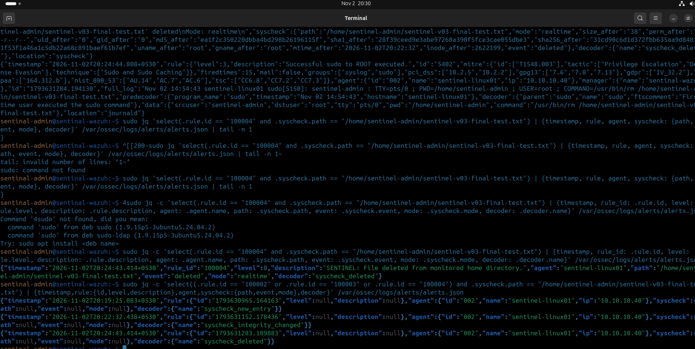
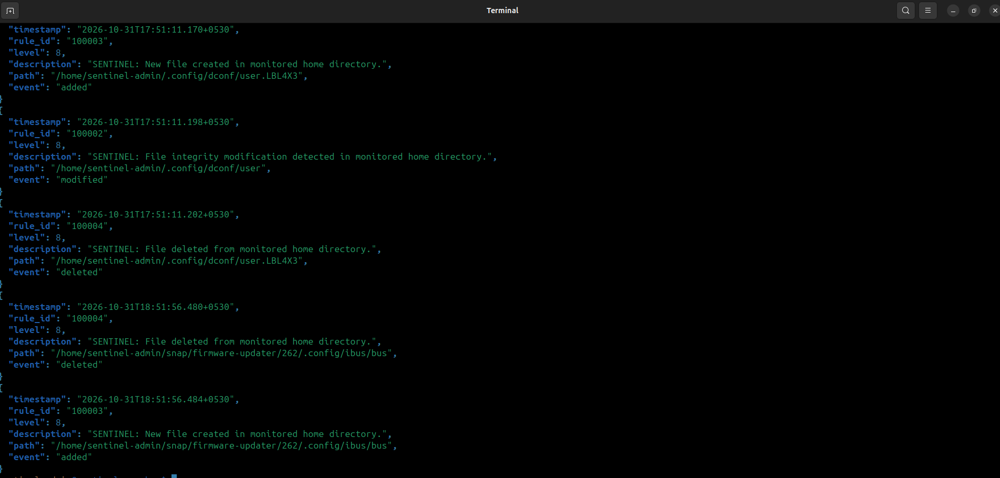

# CASE-001: FIM Detection Validation and Evidence Reconciliation

## 1. Case Overview

| Field | Value |
|---|---|
| Case ID | CASE-001 |
| Project | SENTINEL: SOC Lab |
| Version | v0.3: SOC Investigation |
| Detection source | Wazuh File Integrity Monitoring (FIM) |
| Custom rules | 100002 (modification), 100003 (creation), 100004 (deletion) |
| Endpoint | SENTINEL-LINUX01 (10.10.10.40), Agent ID 002 |
| Case classification | **Low** (administrative) |

### Status

| Item | Status |
|---|---|
| CASE-001 investigation | **Closed**, per the 18 November 2026 closeout (Section 7). |
| Evidence reconciliation, reviewed scope | **Closed.** |
| SENTINEL v0.3 milestone | **Complete**, per the 18 November 2026 closeout. |
| Post-closeout follow-up work (engineering, validation and historical evidence recovery) | **Partly implemented after closeout; remainder open.** Not a prerequisite for closure (Sections 10 and 11). |
| Post-closeout developments (v0.6, v0.8, v0.9, v0.9.1, v0.10, v0.11) | Documented separately. **Not part of CASE-001 evidence** (Section 10). |

> The 18 November closeout is authoritative and supersedes the earlier "open / in progress" wording. Closure applies to the reviewed CASE-001 scope. It does not mean that subsequent detection engineering or tuning is complete.
>
> The Low classification is administrative for this case's reviewed scope. It is not the level of any Wazuh alert. The custom rules generate Level 8 alerts; the 16 October built-in alerts were Levels 5 and 7.

---

## 2. Executive Summary

Wazuh FIM detections on SENTINEL-LINUX01 were reviewed across separate sessions on 11, 16, 26 and 31 October and 2 and 18 November 2026.

- **Modification (100002):** Level 8 alerts on 11 and 26 October.
- **16 October (historical):** the reviewed records show built-in Rules 554 (creation, Level 5) and 553 (deletion, Level 7), with 100002 absent. Not custom-rule validations (Finding 2).
- **31 October:** two separate evidence sets for Rules 100003 and 100004 (screenshot and JSON); their relationship is not established.
- **2 November:** one controlled lifecycle session (screenshot): 100003, 100002, 100004 at Level 8 on one dedicated file.
- **18 November:** one separate controlled lifecycle session (raw JSON): the same three rules at Level 8 on a different dedicated file, plus endpoint configuration verification, rule standardization with MITRE ATT&CK tags, and observed benign FIM noise.

- **After closeout:** later FIM sessions and tuning (v0.6, v0.8), Sysmon and triage work (v0.9, v0.9.1), a live FIM probe with Python-assisted triage whose evidence archive is external to the repository (v0.10), and committed v0.11 artifacts that remain pending reconciliation are summarized in Section 10. They are separate developments and are not CASE-001 evidence.

No malicious indicators were identified in the reviewed events. A FIM alert alone does not indicate malicious activity. The results do not establish detection rates, false-positive/false-negative rates, complete FIM coverage, or repeatability across paths, file types and sizes. See Limitations (Section 9).

---

## 3. Environment and Scope

| Component | Details |
|---|---|
| Wazuh Manager | SENTINEL-WAZUH, 10.10.10.10 |
| Wazuh Agent | SENTINEL-LINUX01, 10.10.10.40, Agent ID 002 |
| Wazuh version | 4.14.8 |
| Custom rules | 100002, 100003, 100004; Level 8; group `sentinel_fim` |

Scope: the controlled tests of 11, 16 and 26 October; the 31 October observations; the controlled lifecycle sessions of 2 and 18 November; the reviewed alert records; and related FIM events. Operational events (Section 8) are not detection evidence.

---

## 4. Evidence Inventory

### 4.1 Evidence sets (kept separate; not merged)

| Date | Rules | File | Evidence | Notes |
|---|---|---|---|---|
| 11 Oct | 100002 | `/home/sentinel-admin/sentinel-fim-validation.txt` | Screenshots | Original alert log not recovered |
| 16 Oct | 554, 553 (built-in) | `/home/sentinel-admin/sentinel-audit-test.txt` | Reviewed source records | No repository evidence path listed |
| 26 Oct | 100002 ×2 | `/home/sentinel-admin/sentinel-v02-mod-test.txt` | Terminal screenshot | Consecutive modifications of one file; not two independent tests |
| 31 Oct (A) | 100003, 100004 | Under `/home/sentinel-admin/snap/firmware-updater/262/.config/bus/` | Terminal screenshot | Trigger origin not established |
| 31 Oct (B) | 100003, 100004 | `/home/sentinel-admin/sentinel-v03-controlled-test.txt` | Raw alert JSON | Creation and deletion only; relationship to (A) not established |
| 2 Nov | 100003, 100002, 100004 | `/home/sentinel-admin/sentinel-v03-final-test.txt` | Terminal screenshot | One controlled session; no raw JSON committed |
| 18 Nov | 100003, 100002, 100004 | `/home/sentinel-admin/fim-sprint-test.txt` | Raw alert JSON | One controlled session |

### 4.2 Files

| Evidence | Purpose |
|---|---|
| [v0.3-custom-rule-100002.png](../evidence/v0.3/screenshots/v0.3-custom-rule-100002.png) | Rule 100002 alert (11 Oct) |
| [v0.3-custom-rule-100002-dashboard-json.png](../evidence/v0.3/screenshots/v0.3-custom-rule-100002-dashboard-json.png) | Alert event fields (11 Oct) |
| [v0.3-case001-fim-filtered-events.png](../evidence/v0.3/screenshots/v0.3-case001-fim-filtered-events.png) | Filtered FIM event view |
| [v0.3-case001-rule-550-event-details.png](../evidence/v0.3/screenshots/v0.3-case001-rule-550-event-details.png) | Built-in Rule 550 event details |
| [v0.3-case001-endpoint-file-metadata.png](../evidence/v0.3/screenshots/v0.3-case001-endpoint-file-metadata.png) | Endpoint file metadata |
| [v0.2-oct26-controlled-modification-source-alerts-new.png](../evidence/v0.2/screenschots/v0.2-oct26-controlled-modification-source-alerts-new.png) | Two Rule 100002 alerts (26 Oct); existing v0.2 directory spelling preserved |
| [v0.3-fim-lifecycle-custom-detections.png](../evidence/v0.3/screenshots/v0.3-fim-lifecycle-custom-detections.png) | Rules 100003 and 100004 (31 Oct, set A) |
| [sentinel-v03-creation-alert.json](../evidence/v0.3/raw-alerts/sentinel-v03-creation-alert.json) | 31 Oct (B): Rule 100003, Level 8, `2026-10-31T22:56:46.988+0530` |
| [sentinel-v03-deletion-alert.json](../evidence/v0.3/raw-alerts/sentinel-v03-deletion-alert.json) | 31 Oct (B): Rule 100004, Level 8, `2026-10-31T23:27:05.164+0530` |
| [v0.3-fim-full-lifecycle-custom-rules.png](../evidence/v0.3/screenshots/v0.3-fim-full-lifecycle-custom-rules.png) | Rules 100003, 100002, 100004 (2 Nov) |
| [fim-lifecycle-evidence.json](../evidence/v0.3/raw-alerts/fim-lifecycle-evidence.json) | Three Wazuh alert records (18 Nov); Section 7 |
| [SHA256SUMS](../evidence/v0.3/raw-alerts/SHA256SUMS) | Manifest covering the three raw alert JSON files. Not recomputed for this document |
| [v0.3-e15-manager-syscheck-configuration.png](../evidence/v0.3/screenshots/v0.3-e15-manager-syscheck-configuration.png) | **E15:** manager-side syscheck configuration (SENTINEL-WAZUH). Not proof of endpoint monitoring |
| [v0.3-e14-endpoint-syscheck-configuration.png](../evidence/v0.3/screenshots/v0.3-e14-endpoint-syscheck-configuration.png) | **E14:** endpoint syscheck configuration (SENTINEL-LINUX01) |

The raw JSON files are Wazuh alert records, not original Syscheck input logs. E14 is endpoint configuration evidence and E15 is manager configuration evidence; both filenames were confirmed against the repository tree. No files were renamed.

### 4.3 Corrections to earlier documentation

1. An earlier version stated 100002 fired for the 16 Oct creation (11:40:06.105). This was unsupported and was corrected to the reviewed Rule 554 record (11:40:06.007).
2. The 31 Oct screenshot events are observations, not confirmed deliberate tests.
3. The v0.2 directory spelling (`screenschots`) is preserved; renaming requires a coordinated update and has not been approved.

---

## 5. Investigation Timeline

All times IST (+0530) where recorded.

| Date / time | Event |
|---|---|
| 11 Oct, ~20:24–20:30 | Reviewed FIM events and Rule 550 details; modified `sentinel-fim-validation.txt`. Rule 100002 alert at `2026-10-11T20:25:14.746+0530`. |
| 16 Oct, 11:40:06.007 | Controlled creation of `sentinel-audit-test.txt`. Built-in Rule 554 (Level 5); 100002 absent from the reviewed record. |
| 16 Oct, 12:31:32.819 | Controlled deletion of the same file. Built-in Rule 553 (Level 7); 100002 absent. |
| 26 Oct, 21:38:27.910 | `sentinel-v02-mod-test.txt` modified; Rule 100002 (Level 8); 0 → 23 bytes. |
| 26 Oct, 21:38:48.473 | Same file modified again; Rule 100002 (Level 8); 23 → 61 bytes. |
| 31 Oct, ~18:51:56 | Screenshot (set A): Rules 100004 and 100003 (Level 8) under the Snap application configuration path. Individual timestamps and order not established. |
| 31 Oct | Manager-side syscheck configuration screenshot committed. |
| 31 Oct, 22:56:46.988 | JSON (set B): Rule 100003 (creation, Level 8), `sentinel-v03-controlled-test.txt`. |
| 31 Oct, 23:27:05.164 | JSON (set B): Rule 100004 (deletion, Level 8), same file. |
| 2 Nov (exact times not recorded) | Controlled lifecycle on `sentinel-v03-final-test.txt`: creation ("added", 100003), modification ("modified", 100002), deletion ("deleted", 100004), each Level 8. `wazuh-analysisd -t` reported exit code 0. |
| 18 Nov, 12:57:06.508 | Controlled lifecycle on `fim-sprint-test.txt`: creation, Rule 100003 (Level 8). |
| 18 Nov, 12:59:29.407 | Modification, Rule 100002 (Level 8). |
| 18 Nov, 13:04:23.506 | Deletion, Rule 100004 (Level 8). |

The 11 Oct window is approximate. No exact timestamps are recorded for 2 Nov, and none are inferred. The order shown follows the stated lifecycle sequence.

---

## 6. Technical Findings

### Finding 1: Rule 100002 detected the tested modification scenario

Confirmed for 11 and 26 Oct (and in the lifecycle sessions, Findings 6 and 7).

| Field (11 Oct) | Value |
|---|---|
| Rule ID / level | 100002 / 8 |
| Event type | modified |
| File | `/home/sentinel-admin/sentinel-fim-validation.txt` |
| Decoder / location | `syscheck_integrity_changed` / `syscheck` |

The event included file-integrity metadata (size, hash). The 26 Oct alerts came from consecutive modifications of one file and do not extend the result to other paths, file types or event types.

### Finding 2: 16 October creation and deletion (historical)

| Test | Rule shown | 100002 |
|---|---|---|
| Creation (11:40:06.007) | 554 (Level 5) | Absent |
| Deletion (12:31:32.819) | 553 (Level 7) | Absent |

100002 is defined with parent Rule 550 (modification), whereas these events matched 554 and 553. Its absence from those records is therefore consistent with its parent-rule design and is not necessarily a detection failure. **Unknown:** whether Rules 100002, 100003 and 100004 were deployed and loaded on 16 Oct. No root cause is asserted. These are historical observations, not custom-rule validations, and 100002 is not claimed to handle creation or deletion. Later sessions do not resolve the 16 Oct loading status.

### Finding 3: Rules 100003 and 100004 on 31 October (two separate sets)

**Set A: screenshot.** Creation (100003) and deletion (100004), Level 8, ~18:51:56, under `/home/sentinel-admin/snap/firmware-updater/262/.config/bus/`. This is an application configuration directory, not a dedicated test file. Whether the events were deliberate or ordinary application activity is not established, so they are observations, not controlled tests. Each rule is evidenced by a single event.

**Set B: raw JSON.** Rule 100003 (creation, `2026-10-31T22:56:46.988+0530`) and Rule 100004 (deletion, `2026-10-31T23:27:05.164+0530`), Level 8, for `sentinel-v03-controlled-test.txt`. Both records contain inode `2622181` and matching file hashes, which supports the interpretation that they concern the same file. Creation and deletion only; no modification record, so not a lifecycle test.

The two sets differ in path and time, and their relationship is not established. Why 100003/100004 appeared on 31 Oct is unresolved.

### Finding 4: Additional home-directory FIM events

On 11 Oct the dashboard showed 19 matching events, including the controlled event; others involved GNOME Tracker cache, desktop configuration and application state, consistent with ordinary desktop activity. Responsible processes were not established. The 18 Nov noise observation is in Section 7.

### Finding 5: Manager-side configuration is not endpoint configuration

The manager screenshot (E15) shows `/var/ossec/etc/ossec.conf` on SENTINEL-WAZUH with `<disabled>no</disabled>`, `<scan_on_start>yes</scan_on_start>`, `<alert_new_files>yes</alert_new_files>` and `<directories>/etc,/usr/bin,/bin,/usr/sbin</directories>`. It lists no `/home` and says nothing about the endpoint's effective configuration. Endpoint configuration is addressed in Section 7.

### Finding 6: Custom rule definitions

Reviewed CASE-001 rule definitions (historical). This table is not a representation of the current post-v0.8 `detections/local_rules.xml`.

| Rule | Event | Parent rule | file condition | Level | Group (as reviewed) |
|---|---|---|---|---|---|
| 100002 | Modification | 550 | `^/home/` | 8 | `sentinel_fim` |
| 100003 | Creation | 554 | `^/home/` | 8 | `sentinel_fim` |
| 100004 | Deletion | 553 | `^/home/` | 8 | `sentinel_fim` |

- Each rule chains from the built-in rule for its event type and adds a path condition anchored at `/home/`.
- `wazuh-analysisd -t` returning exit code 0 (2 Nov and 18 Nov) validates configuration/analysis syntax only. It does not test matching behavior or show that any detection works.
- The `^/home/` condition covers any path under `/home/`, so ordinary desktop and application activity may also generate Level 8 alerts. Noise has not been quantified.
- The 18 Nov raw alert records list `sshd` alongside `sentinel_fim` in their rule group metadata (Section 7.3). That is the historical state and does not reflect the group isolation made later in v0.8 (Section 10).
- The current [`detections/local_rules.xml`](../detections/local_rules.xml) is a later implementation. It has the top-level group `local,syscheck,sentinel_fim`; Rules 100002, 100003 and 100004 at Level 8 with anchored `/home/` matching and rule-specific groups (`fim_modify,sentinel_fim`, `fim_create,sentinel_fim`, `fim_delete,sentinel_fim`); and negative PCRE2 conditions excluding selected Tracker3 and Nautilus database activity. Those exclusions are v0.8 tuning. They are not part of the CASE-001 rule definitions or the 18 Nov closeout.
- These definitions show rule dependencies. They do not establish what was loaded on 16 Oct, and neither they nor the current file establish what was loaded during any historical test. The active deployed definitions have not been compared against them in this document.

### Finding 7: 2 November controlled lifecycle

Confirmed for one dedicated file in one controlled session.

| Field | Creation | Modification | Deletion |
|---|---|---|---|
| Event type | added | modified | deleted |
| Custom rule | 100003 | 100002 | 100004 |
| Parent rule | 554 | 550 | 553 |
| Level | 8 | 8 | 8 |
| File | `/home/sentinel-admin/sentinel-v03-final-test.txt` | Same | Same |

The evidence is a terminal screenshot; no raw JSON for 2 Nov is committed. The `wazuh-logtest` FIM replay limitation is a limitation of that replay method, not a detection failure, and does not affect the live-event results. The result is distinct from the 16 Oct and 31 Oct sets and from the 18 Nov session.

---

## 7. 18 November 2026: Resolution and Validation (Closeout)

Recorded in the closeout section as "CLOSED / RESOLVED". Items below are listed in the closeout's order; times other than the alert timestamps are not recorded.

### 7.1 Endpoint configuration verification

The closeout records inspection of the active `/var/ossec/etc/ossec.conf` on SENTINEL-LINUX01 (10.10.10.40, Agent ID 002) and confirms `<directories realtime="yes">/home</directories>` (real-time monitoring via the Linux inotify subsystem). The committed endpoint screenshot (E14) shows the local configuration. This addresses the earlier gap in Finding 5, but does not establish which configuration was loaded on 16 Oct.

### 7.2 Rule standardization and MITRE ATT&CK mapping

Anchored matching did not first appear on 18 Nov: [`docs/05-detection-engineering.md`](../docs/05-detection-engineering.md) records that Rule 100002 already used an anchored `^/home/` pattern in v0.2. The closeout records that a regex discrepancy in `/var/ossec/etc/rules/local_rules.xml` was reconciled and that all three custom FIM rules were standardized to the anchored prefix `^/home/`. The exact earlier regex, and which rule or rules it affected, are not documented in the material used for this document. MITRE ATT&CK tags were embedded in the rule definitions:

| Rule | Event | Technique | Tactic as recorded |
|---|---|---|---|
| 100003 | Creation | `T1105` | Command and Control (Ingress Tool Transfer) |
| 100002 | Modification | `T1565.001` | Impact (Stored Data Manipulation) |
| 100004 | Deletion | `T1070.004` | Defense Evasion (File Deletion) |

The tags classify each rule's intended detection purpose. A FIM alert is not evidence that the technique occurred. XML syntax was validated with `wazuh-analysisd -t` (exit code 0) and `wazuh-manager` was reloaded. That check validates syntax only, and the loaded definitions have not been independently compared with the on-disk files here.

### 7.3 Controlled lifecycle session

One controlled session on `/home/sentinel-admin/fim-sprint-test.txt`, evidenced by [fim-lifecycle-evidence.json](../evidence/v0.3/raw-alerts/fim-lifecycle-evidence.json) (three Wazuh alert records).

| Event | Rule | Level | Timestamp |
|---|---|---|---|
| Creation | 100003 | 8 | `2026-11-18T12:57:06.508+0530` |
| Modification | 100002 | 8 | `2026-11-18T12:59:29.407+0530` |
| Deletion | 100004 | 8 | `2026-11-18T13:04:23.506+0530` |

- All records identify Agent `002`, `sentinel-linux01`, `10.10.10.40`, with real-time Syscheck events. Their rule group metadata lists `sshd` alongside `sentinel_fim`.
- Inode `2622203` appears in all three records. The modification record contains before-and-after hashes, and its final SHA-256 matches the SHA-256 in the deletion record.
- The matching inode and hash transitions support the interpretation that the three records concern the same file across the creation, modification and deletion sequence.
- **Evidence artifact checksum:** `d3765e7240462b21d82b7ae8e7f772beeb8c57420f80d3e306024fb9ed32b2b6` is the SHA-256 of `fim-lifecycle-evidence.json`, as recorded in `SHA256SUMS`. The manifest covers all three raw JSON files.
- **Monitored-file hash:** `05372b0d1a06363b07732b34d36860f96d9f191517465764e7c6f450c67180ac` is the final SHA-256 of the monitored test file, as represented in the FIM modification and deletion records. It is a property of `fim-sprint-test.txt`, not of the evidence file, and is a different value from the artifact checksum.
- Neither value was independently recomputed for this document.
- Together with 2 Nov, this makes two single-file controlled sessions. It is not a regression suite and does not establish repeatability across other paths, file types, sizes or repeated runs. The closeout's wording "full lifecycle repeatability confirmed" is therefore not carried forward.

### 7.4 Observed benign noise

During testing, activity under `/home/sentinel-admin/.cache/tracker3/files/.../tracker#FileSystem.db-wal` triggered Rule 100002 at Level 8 (`firedtimes: 12`). The closeout attributes this to the GNOME `tracker3` indexing service; the attribution rests on the path, and process attribution is not independently shown here. This is consistent with Finding 4 and indicates that unscoped `/home` monitoring captures application cache activity. Noise was not quantified. Later tuning is summarized in Section 10.

---

## 8. Operational Events: Manager Incident and Restart Test (reported)

> Operational recovery only; not detection evidence. Reported observations; raw logs not supplied or reviewed. No timestamps recorded.

**Manager startup timeout.** Startup timed out (about 45 seconds per earlier session notes; to be confirmed). `/var/ossec/var/start-script-lock` was a directory containing a PID file for PID 1440, then associated with the Wazuh Indexer Java process (per earlier notes; to be confirmed). No active Manager processes were found; the lock directory was removed, `systemctl daemon-reload` was run, and the Manager started. Later checks showed Manager and Dashboard active, API and agent ports listening, and Agent 002 Active. Root cause not established: successful startup after removal does not prove the lock caused the failure. The lock directory should not be deleted without fresh diagnostics.

**Restart-persistence test.** One graceful shutdown and restart of both VMs (SENTINEL-WAZUH first, then SENTINEL-LINUX01) was reported successful: `wazuh-manager` and `wazuh-dashboard` active; listeners on 0.0.0.0:55000 (API), 1514 (agent communication) and 1515 (enrollment); Agent 002 Disconnected, then Active. A single cycle; it does not demonstrate resilience under other failures or boot orders.

---

## 9. Assessment, Disposition and Limitations

### Assessment

- Rule 100002 detected the tested modification scenario at Level 8 on 11 and 26 Oct.
- In two separate controlled sessions (2 Nov, screenshot; 18 Nov, raw JSON), Rules 100003, 100002 and 100004 each fired at Level 8 for creation, modification and deletion of one dedicated file.
- 100003 and 100004 were also observed on 31 Oct in two evidence sets of unestablished relationship.
- Endpoint real-time `/home` monitoring was verified at closeout. Rules were standardized to `^/home/` and tagged with MITRE ATT&CK techniques.
- Benign background activity under `/home` also produces Level 8 alerts.
- The Low classification is administrative and distinct from these alert levels.
- No malicious indicators were identified in the reviewed events. This is limited to the events examined and is not a comprehensive forensic assessment. No containment, eradication or recovery was claimed or required.

### Disposition

CASE-001 is closed per the 18 Nov closeout. The items in Section 11 are post-closeout follow-up work, not conditions of closure.

### Limitations

These apply to the CASE-001 evidence. The later sessions in Section 10 are not part of it.

- No detection rates, false-positive/false-negative rates, repeatability across paths, file types or sizes, or complete FIM coverage are claimed. The 2 Nov and 18 Nov sessions are each one controlled session on one file.
- Evidence types differ: 11 Oct and 31 Oct (A) are screenshot-based, 16 Oct rests on reviewed records, and 2 Nov is a screenshot with no raw JSON committed. Only 31 Oct (B) and 18 Nov have raw alert JSON. The original 11 Oct log is unavailable.
- 31 Oct (A) and (B) have no established relationship, and the trigger origin of (A) is unknown.
- Checksums were not recomputed for this document.
- 16 Oct: whether Rules 100002, 100003 and 100004 were deployed and loaded is unknown, and why 100003/100004 appeared on 31 Oct is unresolved. Later results do not retroactively establish earlier configuration.
- `wazuh-analysisd -t` exit code 0 validates configuration/analysis only.
- The active loaded rule definitions have not been compared with the reviewed definitions. The regex in place before the 18 Nov standardization is not documented here.
- Manager-side configuration evidence does not establish endpoint configuration.
- Background `/home` events were not attributed to processes beyond path-based inference.
- Operational events are reported only; the startup-timeout root cause is unconfirmed.

---

## 10. Post-Closeout Developments (outside CASE-001 evidence)

Developments documented after the 18 November closeout, per the repository's current detection documentation, CHANGELOG and evidence records, as reported to this draft. They are post-closeout milestones, not CASE-001 evidence. They do not alter its findings, do not reopen the case, and were not independently reviewed here.

| Date / version | Development | Relationship to CASE-001 |
|---|---|---|
| 20 Nov (v0.6) | Separate controlled FIM lifecycle session: Rules 100003 (creation), 100002 (modification), 100004 (deletion), each Level 8. The repository reports 3 of 3 selected lifecycle events detected and 0 of 3 `/tmp` negative-control operations alerted. | Separate from the 18 Nov session. A small-sample result: 3/3 and 0/3 are not statistically meaningful detection or false-positive rates, and not a regression suite or coverage assessment. |
| 21 Nov (v0.8) | FIM tuning (details below). A live Agent 002 probe verified creation, modification and deletion detection. | Implements part of the noise tuning recommended at closeout. Does not eliminate false positives. |
| v0.9 (date not supplied) | Sysmon JSON replay ingestion and evidence ([v0.9 evidence README](../evidence/v0.9/readme.md)). | Separate development; not part of CASE-001. |
| v0.9.1 (date not supplied) | Follow-up work addressing field/timestamp separation in the Python triage integration, as described in the [v0.9 evidence README](../evidence/v0.9/readme.md). | Separate from v0.9; not part of CASE-001. |
| 22 Nov (v0.10) | Separate live Linux FIM probe using custom Rules `100003`, `100002` and `100004` on `/home/sentinel-admin/.fim_probe_test.txt`, with Python-assisted triage using `python-soc-automation` v1.0. The archived evidence is at `~/soc-evidence/v0.10-fim-probe/`, outside this GitHub repository; it is not committed here. | Separate from CASE-001 and from the v0.6 and v0.8 sessions. Because the archive is external, its contents cannot be reviewed from this repository. Not CASE-001 evidence. |
| v0.11 (date not supplied) | Committed artifacts: [`evidence/v0.11/v011_fim_alerts.json`](../evidence/v0.11/v011_fim_alerts.json), [`evidence/v0.11/triage_report.md`](../evidence/v0.11/triage_report.md) and [`evidence/v0.11/regression_summary.json`](../evidence/v0.11/regression_summary.json). The alert file contains 10 records, including three Level 8 custom FIM events (creation `100003`, modification `100002`, deletion `100004`) for `/home/sentinel-admin/v011_fim_probe.txt`. The remaining seven records concern desktop/configuration paths and are not confirmed benign noise. In the triage report, the process, target-process and event-time enrichment fields are `None`. | Separate from CASE-001. The v0.11 milestone remains pending reconciliation. These artifacts do not establish a completed regression suite or comprehensive FIM coverage. Not CASE-001 evidence. |

**v0.8 tuning, as reported:**

- FIM rules were separated from SSH-related group inheritance, and a dedicated FIM group was established. The current [`detections/local_rules.xml`](../detections/local_rules.xml) uses `local,syscheck,sentinel_fim`. The `sentinel_fim` label already appeared in earlier alert metadata and was not first introduced in v0.8.
- Anchored `^/home/` matching retained.
- Selected Tracker3 and Nautilus database activity excluded (implemented as negative PCRE2 conditions in the current file).
- Hidden dot-directory monitoring preserved.
- Residual desktop noise under `/home/sentinel-admin/.config/dconf/user` remains. Broader noise-suppression retesting is pending.

The linked `detections/local_rules.xml` is the post-v0.8 implementation, not a historical v0.3 snapshot, and does not show what was loaded during the CASE-001 tests. Related repository documentation:

- **v0.6:** [metrics/v0.6-purple-team-measurement.md](../metrics/v0.6-purple-team-measurement.md)
- **v0.8:** no dedicated document is linked; see the detection documentation, [docs/05-detection-engineering.md](../docs/05-detection-engineering.md) and [detections/readme.md](../detections/readme.md)
- **v0.9 and v0.9.1:** [evidence/v0.9/readme.md](../evidence/v0.9/readme.md)
- **v0.10 and v0.11:** the v0.10 evidence archive is external and not linked; the committed v0.11 artifacts are linked in the table above.

---

## 11. Post-Closeout Follow-Up Work

**Implemented after closeout (v0.8):** FIM group isolation; selected Tracker3 and Nautilus exclusions; a live Agent 002 probe; hidden-directory monitoring verification. Noise reduction is therefore partly done, not unstarted.

**Outstanding:**

- Broader noise-suppression retest, and investigation of the residual `dconf` noise.
- Compare the active deployed rules with the reviewed definitions, and establish historical rule and configuration state where recoverable (including 16 Oct, 31 Oct, and the regex before standardization).
- Wider path, file-type and size testing, and development of a regression suite.
- Measurement and documentation of false-positive and false-negative rates.
- Independently recompute the `SHA256SUMS` checksums.
- Review built-in Rules 550, 553 and 554.
- Export raw JSON alert records for 16 Oct, 26 Oct and 2 Nov where available.
- Where recoverable, establish why Rules 100003 and 100004 appeared on 31 Oct, and whether the two 31 Oct sets are related.
- Capture diagnostics before any change if the Manager startup failure recurs.
- **Repository-wide documentation synchronization:** The `CHANGELOG.md` and [`docs/05-detection-engineering.md`](../docs/05-detection-engineering.md) have been reconciled with the authoritative 18 November closure. Remaining documentation updates are tracked separately. Verify that the other investigation, evidence and project-level documents consistently reflect CASE-001's closed status and the correct E14/E15 evidence filenames.

---

CASE-001: evidence first, uncertainty preserved.
