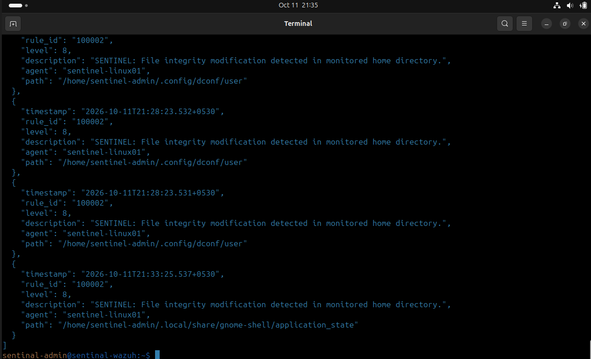
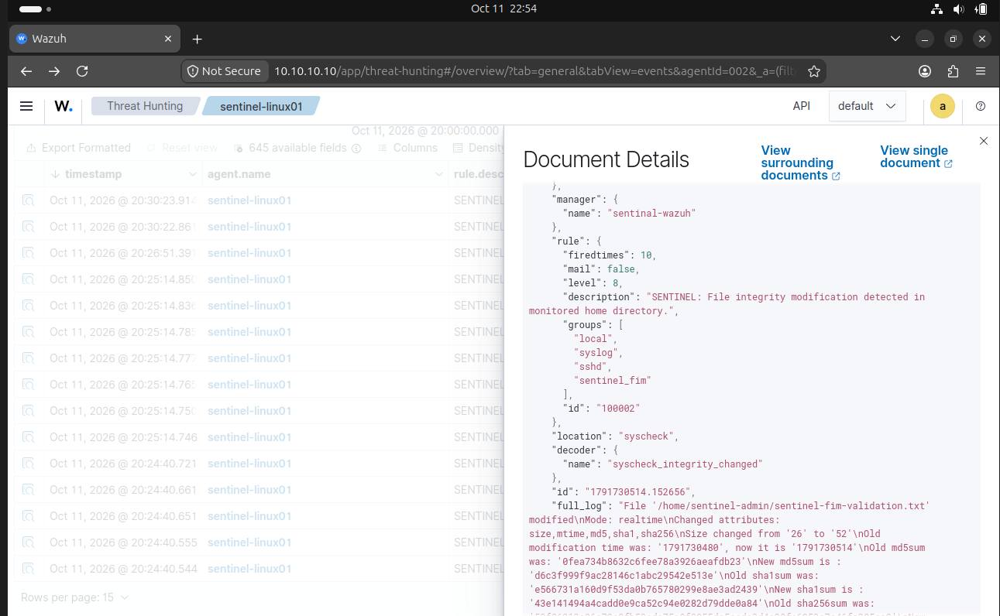
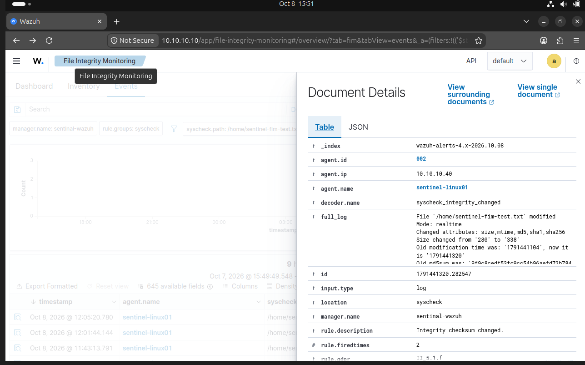
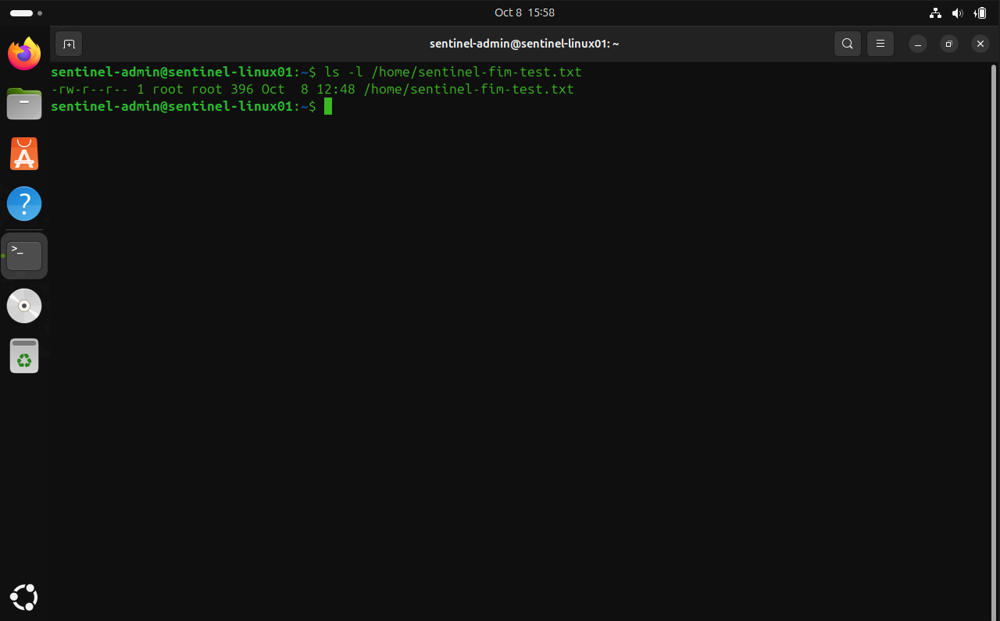

## CASE-001 — Controlled FIM Validation and Evidence Reconciliation

| Field | Value |
|---|---|
| Case ID | CASE-001 |
| Project | SENTINEL — SOC Lab |
| Version | v0.3 — SOC Investigation |
| Status | Evidence reconciliation for the reviewed CASE-001 scope: Closed. Broader investigation and detection-engineering work: Open (see Assessment and Disposition) |
| Severity | Low |
| Detection Source | Wazuh File Integrity Monitoring (FIM) |
| Custom Rule | `100002` |
| Endpoint | SENTINEL-LINUX01 (`10.10.10.40`) |
| Wazuh Agent ID | `002` |

---

## Executive Summary

This case validated custom Wazuh rule `100002` (Level 8) against controlled file modifications on SENTINEL-LINUX01. The rule fired for the modification test on 11 October 2026, and 26 October 2026 terminal output showed two further Rule `100002` modification alerts.

For the controlled creation and deletion tests on 16 October 2026, the reviewed creation record showed built-in Rule `554` and the reviewed deletion record showed built-in Rule `553`. Rule `100002` was absent from the reviewed records. The reason is unresolved.

> The tests demonstrate that `100002` detected the tested modification scenario. They do not establish creation or deletion coverage by the custom rule, complete FIM coverage, or that the endpoint is free from threats.

---

## Objective

- Validate custom Wazuh FIM rule `100002` against controlled file events.
- Reconcile earlier reported results against reviewed source records.
- Document noise, limitations, and follow-up detection-engineering work.

---

## Environment and Scope

| Component | Details |
|---|---|
| Wazuh Manager | SENTINEL-WAZUH — `10.10.10.10` |
| Wazuh Agent | SENTINEL-LINUX01 — `10.10.10.40` |
| Agent ID | `002` |
| Wazuh Version | `4.14.8` |
| Detection Rule | `100002` |
| Modification test file (11 Oct) | `/home/sentinel-admin/sentinel-fim-validation.txt` |
| Creation/deletion test file (16 Oct) | `/home/sentinel-admin/sentinel-audit-test.txt` |
| Modification test file (26 Oct) | `/home/sentinel-admin/sentinel-v02-mod-test.txt` |

Scope: the controlled modification, creation, and deletion tests listed above, the reviewed alert records, and related FIM events available during the investigation. Operational events are recorded separately and are not detection evidence.

---

## Evidence

| Evidence | Purpose |
|---|---|
| [`v0.3-custom-rule-100002.png`](../evidence/v0.3/v0.3-custom-rule-100002.png) | Custom rule validation evidence (11 Oct) |
| [`v0.3-custom-rule-100002-dashboard-json.png`](../evidence/v0.3/v0.3-custom-rule-100002-dashboard-json.png) | Alert JSON and event-field evidence (11 Oct) |
| [`v0.3-case001-fim-filtered-events.png`](../evidence/v0.3/v0.3-case001-fim-filtered-events.png) | Filtered FIM event view |
| [`v0.3-case001-rule-550-event-details.png`](../evidence/v0.3/v0.3-case001-rule-550-event-details.png) | Built-in Rule 550 event details |
| [`v0.3-case001-endpoint-file-metadata.png`](../evidence/v0.3/v0.3-case001-endpoint-file-metadata.png) | Endpoint file metadata evidence |

**Evidence basis and limitations**

- **11 October:** the original alert log could not be recovered from the currently available log files during the 26 October review. The existing 11 October evidence above still supports the documented result; no new source-log evidence is claimed.
- **16 October:** the results rest on the reviewed source records. No repository evidence path for them is listed in this document.
- **26 October:** the results rest on terminal output showing two Rule `100002` modification alerts. A screenshot of that output counts as repository evidence only once its upload and exact path have been verified; until then no link is provided.

---

## Investigation Timeline

All times IST (`+0530`).

| Date / time | Event |
|---|---|
| 11 Oct 2026, ~20:24–20:30 | Reviewed FIM events and Rule 550 details; modified `sentinel-fim-validation.txt`. Rule `100002` alert at `2026-10-11T20:25:14.746+0530`. Additional home-directory events observed. |
| 16 Oct 2026, `11:40:06.007` | Controlled creation of `sentinel-audit-test.txt`. Reviewed record showed Rule `554`. |
| 16 Oct 2026, `12:31:32.819` | Controlled deletion of the same file. Reviewed record showed Rule `553` (Level 7). |
| 26 Oct 2026, `21:38:27.910` | `sentinel-v02-mod-test.txt` modified; Rule `100002` (Level 8); size 0 → 23 bytes. |
| 26 Oct 2026, `21:38:48.473` | Same file modified again; Rule `100002` (Level 8); size 23 → 61 bytes. |

The 11 October review window is approximate and is not the timestamp of every event.

---

## Technical Findings

### Finding 1 — Rule 100002 detected the tested modification scenario

Result: Confirmed for the 11 and 26 October tests.

11 October alert details:

| Field | Value |
|---|---|
| Rule ID | `100002` |
| Severity level | `8` |
| Event type | `modified` |
| File | `/home/sentinel-admin/sentinel-fim-validation.txt` |
| Decoder | `syscheck_integrity_changed` |
| Event location | `syscheck` |

The event included file-integrity metadata, including size and hash information.

On 26 October, terminal output showed two consecutive modifications of `sentinel-v02-mod-test.txt`, each with a Rule `100002` Level 8 alert (size changes in the timeline). This repeats the modification validation; it does not extend it to other paths, file types, or event types.

### Finding 2 — 16 October creation and deletion records: Rule 100002 absent

Result: Observation limited to the reviewed records; cause unresolved.

| Test (16 Oct) | Rule shown in reviewed record | `100002` in reviewed record |
|---|---|---|
| Creation (`11:40:06.007`) | `554` | Absent |
| Deletion (`12:31:32.819`) | `553`, Level 7 | Absent |

This finding is limited to these two reviewed records and does not establish how `100002` behaves for creation or deletion events in general. `100002` has been described as anchored to built-in Rule `550`; why it was absent from these records is **unresolved**. No root cause is asserted, and the rule has not been changed.

An earlier version of this report recorded `100002` as firing on creation, with a creation timestamp of `11:40:06.105`. Neither is supported by the reviewed records and both have been corrected above.

### Finding 3 — Additional home-directory FIM events

Result: Additional activity observed; attribution remains limited.

On 11 October the dashboard showed 19 matching events in the reviewed period, including the controlled event. Others involved paths associated with GNOME Tracker cache, desktop configuration, and application state. These are consistent with ordinary desktop activity, but the process responsible for each event was not independently established.

### Finding 4 — Detection scope requires further tuning

Result: Follow-up required.

As reported, `100002` uses a `file` field condition of `/home/` (parent `<if_sid>550</if_sid>`, Level 8, group `sentinel_fim`). This has not been re-checked against the active `local_rules.xml`, and the exact matching behavior (substring vs. regular expression, case handling) is unverified. If the condition is broad, routine user-session activity may generate noise; this has not been quantified.

---

## Operational Events — Manager Incident and Restart Test (reported)

> Operational recovery only; not evidence for detection-rule validation. Items are reported observations; raw logs have not been supplied or independently reviewed. No timestamps are recorded.

**Manager startup timeout**

- Wazuh Manager startup timed out (approximately 45 seconds per earlier session notes; to be confirmed).
- `/var/ossec/var/start-script-lock` was found to be a directory containing a PID file for PID `1440`, which was then associated with the Wazuh Indexer Java process (per earlier session notes; to be confirmed).
- No active Wazuh Manager processes were found; the lock directory was then removed.
- `systemctl daemon-reload` was run and the Manager started successfully. Later checks showed Manager and Dashboard active, API and agent-communication ports listening, and Agent `002` back to Active.

Root cause: **not established.** Calling the lock "stale" reflects only that no Manager process was found, and successful startup after removal does not prove the lock caused the failure. The lock directory should not be deleted without fresh diagnostic evidence.

**Restart-persistence test**

One graceful shutdown-and-restart of the Manager and Linux endpoint VMs was reported successful with `SENTINEL-WAZUH` started before `SENTINEL-LINUX01`. Reported checks: `wazuh-manager` and `wazuh-dashboard` active; listeners on `0.0.0.0:55000` (API), `0.0.0.0:1514` (agent communication) and `0.0.0.0:1515` (enrollment); Agent `002` initially Disconnected, then Active. This is a single cycle and does not demonstrate resilience under other failures or boot orders.

---

## Assessment and Disposition

Evidence reconciliation for the reviewed CASE-001 scope is **closed**: the 11 and 26 October modification results are recorded, and the 16 October results are corrected to match the reviewed records. The follow-up actions below are future engineering work and are not prerequisites for this limited closure. The overall investigation and detection-engineering work remain **open**.

Rule `100002` detected the tested modification scenario at Level 8. For the 16 October creation and deletion, the reviewed records showed built-in Rules `554` and `553`, with `100002` absent. No malicious indicators were identified in the reviewed events; this is limited to the events examined and is not a comprehensive forensic assessment.

---

## Limitations

- Results cover single controlled tests; no detection rates, false-positive/false-negative results, or complete FIM coverage are claimed.
- Custom-rule behavior for creation and deletion is unconfirmed beyond the two reviewed records, and the reason `100002` was absent from them is unresolved.
- The original 11 October alert log is unavailable; that result rests on the existing evidence images.
- Background home-directory events were not attributed to processes.
- The `/home/` condition's matching behavior and noise level are unverified.
- Operational events are reported only; the Manager startup-timeout root cause is unconfirmed.

---

## Follow-Up Actions

Future engineering work; none is a prerequisite for the limited closure above.

- Review the active `100002` definition and the built-in `550`, `553`, and `554` definitions (read-only) to explain the absence of `100002` from the 16 October records and confirm how the `file` condition matches.
- Optionally export the raw 16 and 26 October alert records as additional evidence, and verify the upload and path of any 26 October screenshot before linking it.
- After review and approval, design and test a safe change for creation/deletion coverage; do not alter the rule before that review.
- Define repeatable creation, modification, and deletion regression tests with explicit pass/fail criteria, and document false-positive/false-negative results.
- Evaluate narrower path matching and test any exclusions against benign and controlled events, confirming modification detection is preserved.
- Capture diagnostics (service status, logs, process list) before any change if the Manager startup failure recurs.
- Update detection-engineering, incident-response, and testing documentation and the changelog after validation.

---

## Conclusion

CASE-001 documents successful controlled validation of custom rule `100002` for the tested file-modification scenario (11 and 26 October 2026). The reviewed 16 October creation and deletion records showed built-in Rules `554` and `553` with `100002` absent, and the reason is unresolved. Next steps are to review the rule definitions and validate creation and deletion behavior without disturbing the working modification detection.

---

CASE-001 — evidence first, uncertainty preserved.
