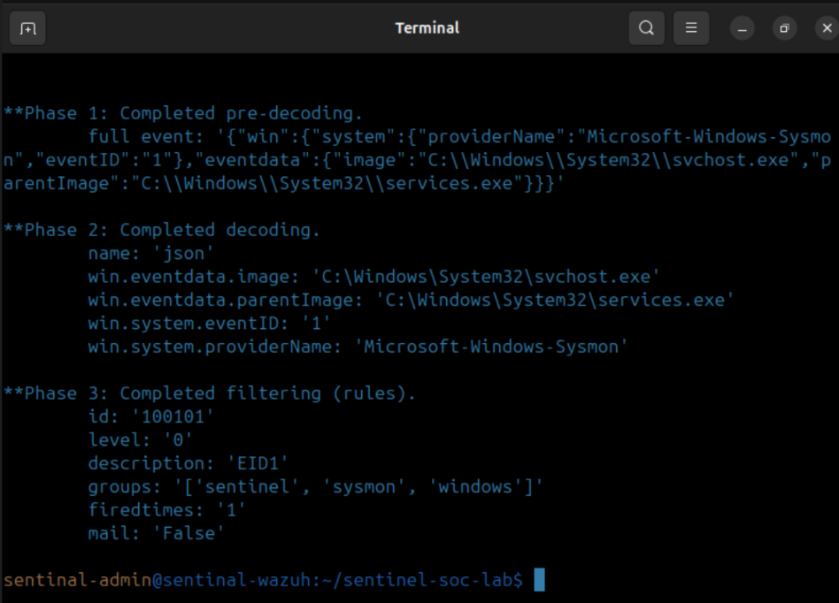
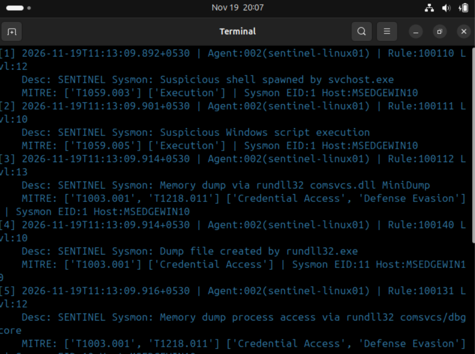
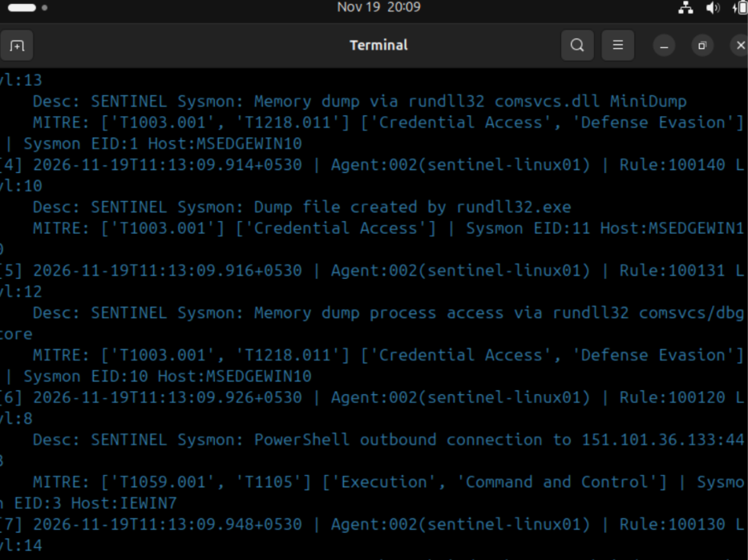
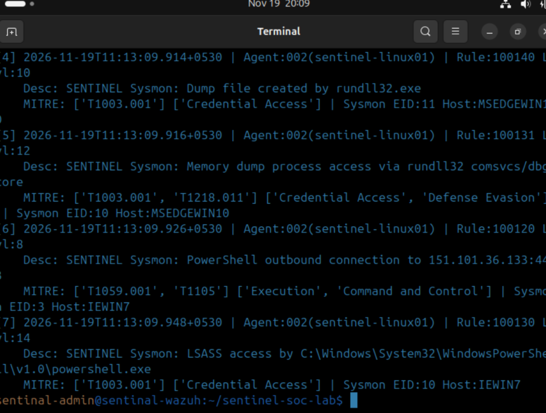
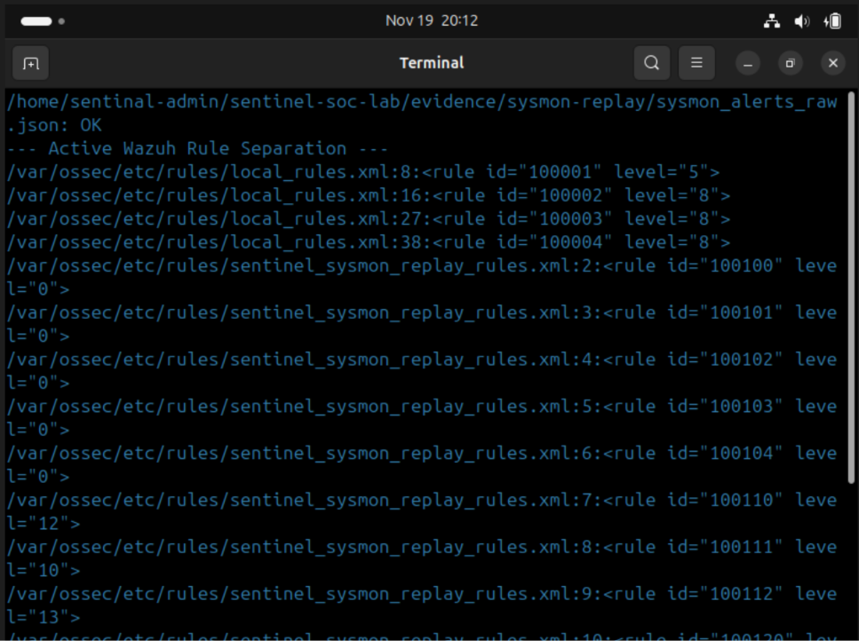
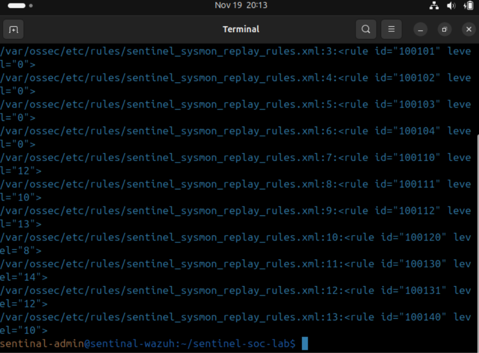
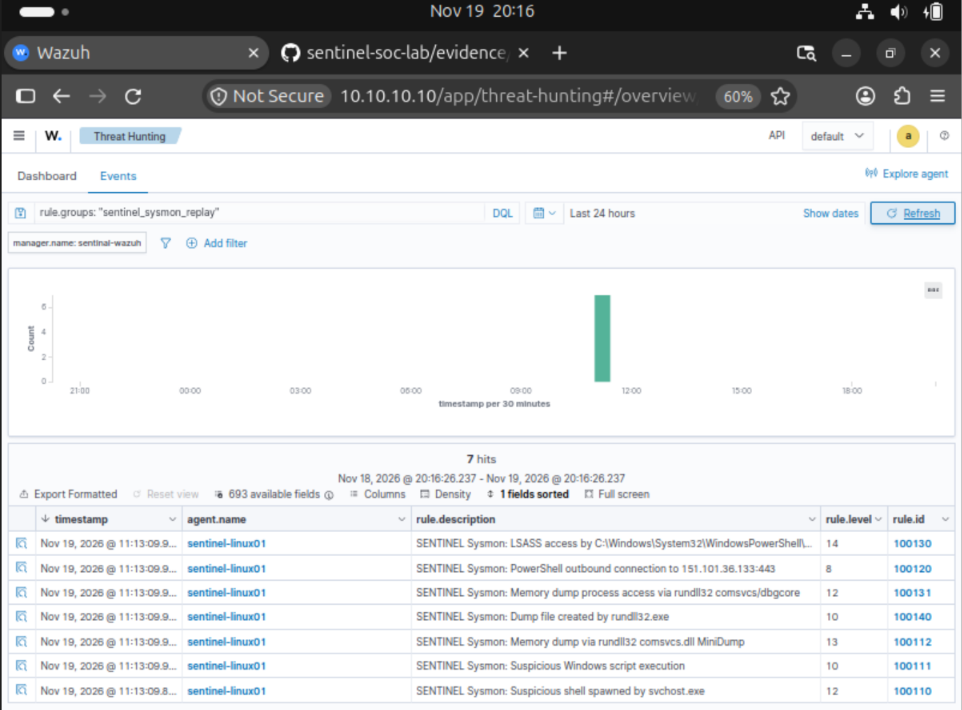

# CASE-002 — Windows Sysmon Telemetry Replay and Attack Detection Validation

| Field | Value |
|---|---|
| Case ID | CASE-002 |
| Project | SENTINEL — SOC Lab |
| Milestone | v0.4 — Windows Sysmon Replay & Cross-Platform Detection |
| Status | **Complete / Verified** (replayed telemetry, defined scope below) |
| Case severity | Medium (administrative classification; see note) |
| Detection source | Replayed Windows Sysmon events (Event IDs 1, 3, 10, 11) |
| Ingestion path | `.evtx` → `evtx_to_wazuh.py` (`python-evtx`) → NDJSON → Wazuh logcollector (`<localfile>`, `json`) |
| Replay endpoint | `SENTINEL-LINUX01` (`10.10.10.40`, Agent ID `002`) |
| Analysis manager | `SENTINEL-WAZUH` (`10.10.10.10`, Wazuh `v4.14.8`) |
| Ruleset under test | `/var/ossec/etc/rules/sentinel_sysmon_replay_rules.xml` (`100100–100140`) |
| Telemetry origin | `Microsoft-Windows-Sysmon/Operational` (hosts `MSEDGEWIN10` / `IEWIN7`, pre-recorded captures) |
| Evidence file | `evidence/sysmon-replay/sysmon_alerts_raw.json` |
| Evidence SHA-256 | `b53473fd6340ec17365fec9cbbc1403e445523322c4c84ae28e40882995d7a59` |

> **Severity note.** Case severity *Medium* is an administrative classification for this validation milestone. It is distinct from Wazuh alert levels, which for the fired detections range from Level 8 to Level 14.

---

## 1. Executive Summary

On 19 November 2026, pre-recorded Windows Sysmon `.evtx` captures were replayed through `SENTINEL-LINUX01` to validate a custom Wazuh detection ruleset for Windows endpoint attack techniques. A persistent Windows VM was not used, because of VM storage constraints on the lab host.

| Outcome | Result |
|---|---|
| Benign noise suppressed | 3 benign `services.exe → svchost.exe` process-creation events matched Level 0 rule `100101`; **0 alerts** reached `alerts.json` |
| Attack detections | **7 of 7** rules fired (`100110`, `100111`, `100112`, `100120`, `100130`, `100131`, `100140`), Levels 8–14 |
| Evidence integrity | 7 raw alert records extracted to `sysmon_alerts_raw.json`, SHA-256 recorded in §7 |
| Baseline integrity | `local_rules.xml` (`100001–100004`, including FIM Rule `100002` and the CASE-001 ruleset) not modified |

---

## 2. Scope Boundary

**This milestone validated replayed `.evtx` telemetry processed on Linux. It did not validate a live Windows host or the Sysmon kernel driver (`SysmonDrv.sys`).**

- The `.evtx` files were converted to NDJSON and ingested on `SENTINEL-LINUX01`. This exercises logcollector JSON parsing, field extraction, `analysisd` rule evaluation, and alert generation on the manager.
- It does **not** exercise `SysmonDrv.sys`, live event generation, the Wazuh Windows agent, or Windows-side log collection.
- The lab still has **no live Windows, Sysmon, or Active Directory endpoint.**
- Results show that these rules match these replayed events. They do not establish detection rates, false-negative rates, or coverage of the wider technique space. False-positive behavior was checked only against the 3 benign events listed in §5.

---

## 3. Architecture and Data Flow

```text
 .evtx samples (pre-recorded Sysmon captures)
        |
        v
 SENTINEL-LINUX01 (10.10.10.40, Agent 002)
   evtx_to_wazuh.py  ->  NDJSON (12 records; 24 lines replayed)
   <localfile> log_format=json  ->  wazuh-logcollector
        |
        v   (agent -> manager)
 SENTINEL-WAZUH (10.10.10.10, Wazuh v4.14.8)
   analysisd  ->  /var/ossec/etc/rules/sentinel_sysmon_replay_rules.xml (100100–100140)
        |
        v
   alerts.json  ->  sysmon_alerts_raw.json (7 records, SHA-256 recorded)
```

**Replayed samples**

| # | Sample file |
|---|---|
| 1 | `revshell_cmd_svchost_sysmon_1.evtx` |
| 2 | `sysmon_10_1_memdump_comsvcs_minidump.evtx` |
| 3 | `sysmon_3_10_Invoke-Mimikatz_hosted_Github.evtx` |

Three `.evtx` samples were converted by `evtx_to_wazuh.py` into **12 NDJSON records (24 lines replayed)** and ingested through a `<localfile>` block with `json` format.

**Rule file separation**

| File | Rules | State |
|---|---|---|
| `/var/ossec/etc/rules/local_rules.xml` | `100001–100004` (FIM, including Rule `100002`; CASE-001) | Untouched |
| `/var/ossec/etc/rules/sentinel_sysmon_replay_rules.xml` | `100100–100140` (this case) | New; repo copy at `detections/sentinel_sysmon_replay_rules.xml` |

---

## 4. Ruleset Validation

Before replay, the ruleset was loaded and checked with `wazuh-logtest`.



*Figure 1 — `wazuh-logtest` validation of the custom Sysmon ruleset.*

---

## 5. Noise Suppression — Level 0 Base Rules (`100100–100104`)

Base rules establish the Sysmon event structure and suppress known-benign activity so it never reaches `alerts.json`.

| Rule ID | Level | Role |
|---|---|---|
| 100100 | 0 | Structural base rule |
| 100101 | 0 | Benign `services.exe → svchost.exe` process creation (Sysmon EID 1) |
| 100102 | 0 | Structural base rule |
| 100103 | 0 | Structural base rule |
| 100104 | 0 | Structural base rule |

**Result:** the 3 benign `services.exe → svchost.exe` events were classified under Rule `100101` (Level 0). No false-positive alerts were emitted.

---

## 6. Attack Detection Rules (7 of 7 fired)

| Rule ID | Level | Sysmon EID | Detection logic | MITRE ATT&CK |
|---|---|---|---|---|
| 100110 | 12 | 1 (Process Create) | `svchost.exe` spawning `cmd.exe` / `powershell.exe` / `pwsh.exe` | T1059.003 |
| 100111 | 10 | 1 (Process Create) | Suspicious `cscript.exe` / `wscript.exe` script execution | T1059.005 |
| 100112 | 13 | 1 (Process Create) | `rundll32.exe` invoking `comsvcs.dll` MiniDump | T1003.001, T1218.011 |
| 100120 | 8 | 3 (Network Connect) | Outbound network connection from PowerShell | T1059.001, T1105 |
| 100130 | 14 | 10 (Process Access) | `lsass.exe` process access by PowerShell / LOLBins | T1003.001 |
| 100131 | 12 | 10 (Process Access) | `rundll32.exe` process access with `comsvcs.dll` / `dbgcore.dll` in `callTrace` | T1003.001, T1218.011 |
| 100140 | 10 | 11 (File Create) | Suspicious `.bin` / `.dmp` dump file created in `System32` by `rundll32.exe` | T1003.001 |

**Observed triggers in the replayed data**

| Rule ID | Observed event |
|---|---|
| 100110 | `svchost.exe` spawning `cmd.exe` |
| 100111 | `cscript.exe` executing `memdump.vbs` from `ProgramData` |
| 100112 | `rundll32.exe` invoking `comsvcs.dll, MiniDump` |
| 100120 | `powershell.exe` outbound connection to `151.101.36.133:443` |
| 100130 | `powershell.exe` opening a handle to `lsass.exe` |
| 100131 | `rundll32.exe` access with `comsvcs` / `dbgcore` in the call trace |
| 100140 | `rundll32.exe` creating a `.bin` dump file in `System32` |

### Fired alerts and MITRE ATT&CK mapping



*Figure 2a — Fired Sysmon alerts with MITRE ATT&CK mapping (1 of 3).*



*Figure 2b — Fired Sysmon alerts with MITRE ATT&CK mapping (2 of 3).*



*Figure 2c — Fired Sysmon alerts with MITRE ATT&CK mapping (3 of 3).*

---

## 7. Evidence and Integrity

| Item | Value |
|---|---|
| File | `evidence/sysmon-replay/sysmon_alerts_raw.json` |
| Contents | 7 raw Wazuh alert records (JSON) |
| SHA-256 | `b53473fd6340ec17365fec9cbbc1403e445523322c4c84ae28e40882995d7a59` |

Verify from the repository root:

```bash
sha256sum evidence/sysmon-replay/sysmon_alerts_raw.json
# expected: b53473fd6340ec17365fec9cbbc1403e445523322c4c84ae28e40882995d7a59
```



*Figure 3a — SHA-256 integrity check of the raw alert file (1 of 2).*



*Figure 3b — SHA-256 integrity check of the raw alert file (2 of 2).*



*Figure 4 — Wazuh Dashboard view of the replayed Sysmon events.*

---

## 8. Limitations

- **Replay, not live telemetry.** See §2. `SysmonDrv.sys` and live Windows collection were not tested.
- **Sample-bound.** Detections were validated against 3 specific `.evtx` captures. Rule logic was not tested against variants, obfuscation, or evasion.
- **Limited false-positive testing.** Only 3 benign events were used; no benign-baseline corpus was replayed.
- **No measured rates.** No detection-rate, false-negative, or tuning-effectiveness figures are claimed.
- **Replay is repeatable.** `evtx_to_wazuh.py` produces deterministic injection suitable for future regression testing, which is planned but not yet built.

---

## 9. Conclusion

The `sentinel_sysmon_replay_rules.xml` ruleset (`100100–100140`) suppressed 3 benign events and fired all 7 attack detections on replayed Sysmon telemetry. The raw alerts are preserved under a recorded SHA-256 hash. The validation covers the replay pipeline and rule logic only, and the existing FIM ruleset (`100001–100004`) was not changed.
